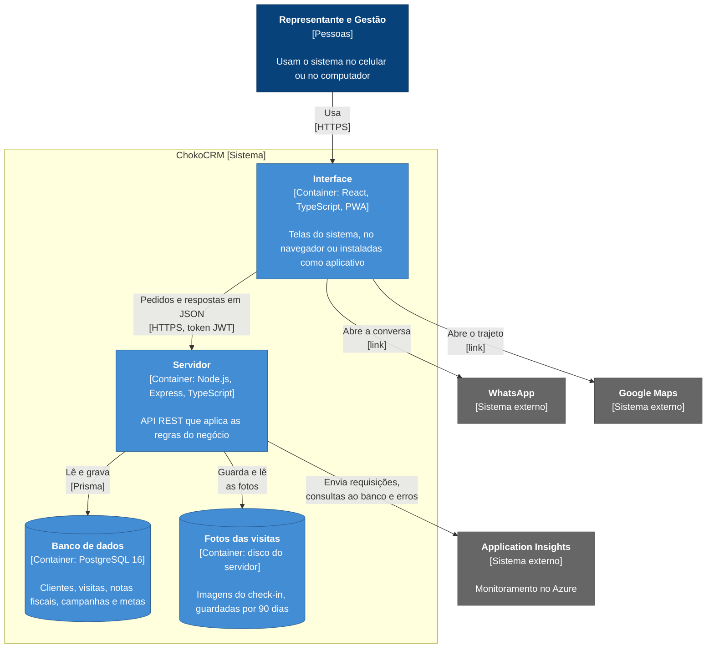

# ChokoCRM

[](https://github.com/dudapetzinger/CHOKOCRM/actions/workflows/ci.yml)
[](https://sonarcloud.io/summary/new_code?id=dudapetzinger_CHOKOCRM)

O ChokoCRM é um sistema de acompanhamento de clientes e visitas feito para os representantes comerciais da Chokolaten, fábrica de chocolates artesanais de Pomerode (SC). Foi projetado com foco no uso mobile e pode ser instalado como PWA.

O diferencial do sistema é o uso do histórico de compras de cada cliente. A cada data comemorativa que se aproxima, como a Páscoa e o Natal, ele compara o que o cliente comprou no mesmo período do ano anterior com a média de compras dele e sugere ao representante o que oferecer. Para a gestão, mostra a sazonalidade das vendas, o que ajuda a fábrica a se antecipar na produção.

Projeto extensionista (PAC) do curso de Engenharia de Software do Centro Universitário Católica de Santa Catarina, desenvolvido em parceria com a empresa.

## Sumário

- [O problema](#o-problema)
- [O que o sistema faz](#o-que-o-sistema-faz)
- [Como testar](#como-testar)
- [Como o sistema é construído](#como-o-sistema-é-construído)
- [Testes e qualidade](#testes-e-qualidade)
- [Organização do repositório](#organização-do-repositório)
- [Documentação](#documentação)
  - [Requisitos e histórias de usuário](#requisitos-e-histórias-de-usuário)
  - [Funcionalidades e regras de negócio](#funcionalidades-e-regras-de-negócio)
  - [Arquitetura e diagramas C4](#arquitetura-e-diagramas-c4)
  - [Decisões técnicas](#decisões-técnicas)
  - [Modelo de dados](#modelo-de-dados)
  - [Instalação e publicação](#instalação-e-publicação)
  - [Testes, integração contínua e análise de código](#testes-integração-contínua-e-análise-de-código)
  - [Monitoramento](#monitoramento)
  - [Privacidade, segurança e acessibilidade](#privacidade-segurança-e-acessibilidade)
- [Autoria e licença](#autoria-e-licença)

## O problema

Os representantes da Chokolaten visitam confeitarias, cafés, empórios e mercados de várias cidades de Santa Catarina. O controle dessas visitas era feito em agenda de papel e em conversas de WhatsApp. Com isso, a informação se perdia, não havia um histórico de cada cliente para consultar e não era possível saber com segurança quais clientes estavam há tempo demais sem receber uma visita.

A gestão também não conseguia acompanhar esse trabalho. Como nada era medido, não havia números de visitas, de vendas ou de resultado por representante, nem clareza sobre quais dados deveriam ser acompanhados.

O ChokoCRM reúne esse controle em um só lugar. O representante registra cada visita no celular, na hora, e o sistema passa a mostrar quem precisa ser visitado e o que cada cliente costuma comprar. A gestão passa a contar com indicadores definidos, como o número de visitas, os clientes visitados, a conversão em vendas e os clientes esfriando, e acompanha a equipe em relação às metas.

## O que o sistema faz

Há dois perfis de uso: Representante e Gestor. O representante trabalha com a própria carteira de clientes. A gestão, que usa o perfil Gestor, enxerga todas as carteiras e cuida das configurações.

O representante:

- vê a carteira de clientes organizada por cores, do verde (visita em dia) ao vermelho (há muito tempo sem visita), e sabe quem atender primeiro;
- abre a agenda do dia, separada nas abas Hoje, Atrasadas, Próximos 7 dias e Lembretes, e traça o roteiro no Google Maps;
- registra a visita em quatro passos, com foto, resultado e a data da próxima visita;
- consulta a ficha do cliente, com o histórico de visitas, as compras e sugestões do que oferecer conforme a época do ano (Páscoa, Dia das Mães, Natal e outras datas);
- abre a conversa com o contato do cliente no WhatsApp, já com uma mensagem sugerida, que ele pode ajustar, perguntando sobre o estoque;
- acompanha as próprias metas e os resultados no painel.

A gestão:

- acompanha no painel as visitas, as vendas e a conversão de cada representante, com gráficos e ranking, e abre com um clique os clientes e as visitas por trás de cada número;
- vê na página de clientes o mapa da carteira por cidade, com a situação mais urgente de cada uma;
- vê quais clientes estão esfriando e, para cada data comemorativa que se aproxima, as vendas do mesmo período do ano anterior, as campanhas e os produtos com estoque baixo nos clientes;
- cria campanhas e metas e acompanha o resultado de cada uma;
- importa as notas fiscais em PDF emitidas pelo sistema de gestão (ERP) da empresa. É a partir delas que os clientes são criados e que as vendas entram no sistema;
- cria as contas dos usuários, inativa clientes e transfere clientes de um representante para outro.

A descrição completa, com as regras de cada funcionalidade, está em [docs/funcionalidades.md](docs/funcionalidades.md).

## Como testar

O sistema está publicado e pode ser usado direto pelo navegador, no celular ou no computador:

<https://app-chokocrm-api-cscvc7aserd4c4g9.canadacentral-01.azurewebsites.net>

O ambiente permanece no ar durante todo o período de avaliação do projeto. Para avaliar o sistema não é preciso instalar nada.

### Contas de acesso

O acesso é feito com usuário e senha. A senha de todas as contas é `chokocrm123`.

| Perfil | Nome | Usuário |
|--------|------|---------|
| Representante | Eduarda Fischer | `eduarda` |
| Representante | Rafael Schmitt | `rafael` |
| Gestor | Gestão Chokolaten | `gestao` |

Gestor é o nome do perfil, como aparece na tela. Gestão Chokolaten é o nome da conta compartilhada desse perfil, e `gestao` é o usuário para entrar.

Os dados que aparecem são de demonstração: clientes, visitas e vendas fictícios, gerados para simular diferentes períodos de uso. Todos os clientes e contatos já cadastrados usam o telefone da autora do projeto, de modo que as ligações e as mensagens de teste pelo WhatsApp chegam a um número conhecido.

A carteira de demonstração segue um modelo: cada representante tem a maior parte dos clientes em dia, alguns em Atenção e alguns em Prioridade, com visitas distribuídas pelos dias úteis. As quantidades variam conforme os testes feitos no ambiente, pois cada nota fiscal importada pode criar um cliente novo.

### Cuidados ao testar

O ambiente publicado é único e é usado ao mesmo tempo por todas as pessoas que avaliam o projeto. O que uma pessoa altera aparece para as demais. Por isso:

- Não altere a senha das três contas da tabela, não inative essas contas e não transfira a carteira delas. Elas são a porta de entrada de todos.
- Visitas, campanhas, metas e lembretes podem ser criados livremente, pois são dados de demonstração.
- Use o Modo demonstração apenas para ver o sistema em outra época do ano: as sugestões de Páscoa ou de Natal, a aba Produção e sazonalidade e os gráficos de outro período. Recriar a demonstração apaga as visitas, as campanhas e as metas registradas por todos os usuários e altera a data para todos. Ao terminar, use Voltar ao real.
- No dia da apresentação do projeto, 08/12/2026, não recrie a demonstração: ela estará preparada em uma data escolhida para a mostra.

Se a carteira aparecer diferente do que o roteiro abaixo descreve, ela pode ter sido alterada por outro usuário durante um teste. Recriar a demonstração devolve os clientes de demonstração, as visitas, as campanhas e as metas ao modelo. As contas e os clientes criados a partir de notas fiscais são mantidos, e as duas contas de representante da tabela voltam à senha padrão.

### Roteiro sugerido

Como representante (conta da Eduarda ou do Rafael):

1. Entre no sistema. A primeira tela é a Agenda, aberta na aba Hoje. A aba Atrasadas mostra, ao lado do nome, quantas visitas estão em atraso.
2. Abra Clientes e observe as cores e as abas Prioridade, Atenção e Em dia. Em Prioridade ficam os clientes com visita atrasada, os que estão com a visita vencendo, os que nunca foram visitados e os rebaixados pela última compra.
3. Toque em um cliente para abrir a ficha. Veja as compras, as sugestões da época e o histórico de visitas.
4. Toque em WhatsApp, no alto da ficha, e, se o cliente tiver dois contatos, escolha com quem falar. A conversa abre com a mensagem pronta.
5. Toque em Check-in, escolha um cliente e registre uma visita. A foto é obrigatória e pode ser qualquer imagem.
6. Volte à ficha e confira a visita no histórico e a nova cor do cliente.
7. Abra o Painel para ver as metas e os resultados da carteira.

Como gestor (conta Gestão Chokolaten):

1. Entre no sistema. A primeira tela é o Painel, com os indicadores de toda a equipe.
2. Use o seletor de representante para comparar as carteiras e troque o período de análise.
3. Clique em um indicador ou em uma barra de gráfico para abrir, ao lado, os clientes e as visitas por trás do número.
4. Abra a aba Produção e sazonalidade para ver as próximas datas comemorativas, o estoque baixo por produto e as vendas por mês.
5. Abra Clientes para ver o mapa da carteira por cidade e clique em uma cidade para ver os clientes dela.
6. Em Campanhas, crie uma campanha e uma meta para um representante.

A importação de notas fiscais não faz parte do roteiro, porque usa documentos fiscais reais da empresa. No ambiente de demonstração, as visitas com venda já trazem os produtos e o valor, como se a nota tivesse sido importada. As regras da importação estão em [Importação de notas fiscais](docs/funcionalidades.md#11-importação-de-notas-fiscais).

### Simulando outra data

A tela de login tem o botão Modo demonstração. Ele pede uma data e a senha da conta Gestão e faz o sistema se comportar como se aquele fosse o dia de hoje, recriando os dados de demonstração em volta da data. É a forma de ver, por exemplo, as sugestões de Páscoa fora da época. A opção Voltar ao real desfaz a simulação. Ela também pede a senha da conta Gestão e recria os dados de demonstração, na data real.

A data simulada vale para todas as pessoas que estão usando o sistema, e a recriação apaga o que foi registrado antes. Leia os [cuidados ao testar](#cuidados-ao-testar) antes de usar.

### Usando como aplicativo

No Android (Google Chrome):
1. Acesse o ChokoCRM pelo navegador e faça login.
2. Toque no menu de três pontos (⋮), no canto superior direito.
3. Selecione "Instalar aplicativo" ou "Adicionar à tela inicial".
4. Confirme a instalação.
   
No iPhone (Safari):
1. Acesse o ChokoCRM pelo Safari e faça login.
2. Toque no ícone de compartilhamento (quadrado com uma seta para cima).
3. Selecione "Adicionar à Tela de Início".
4. Toque em "Adicionar" para confirmar.
   
Depois de instalado, o ChokoCRM aparecerá na tela inicial do celular. Basta tocar no ícone para abrir o sistema, sem precisar acessar o navegador.

Importante: é necessário estar conectado à internet para registrar as visitas.

## Como o sistema é construído

O ChokoCRM tem três partes: a interface que é executada no navegador, o servidor que aplica as regras do negócio e o banco de dados que guarda as informações.

O desenho abaixo é o diagrama de containers do modelo C4, que mostra as partes do sistema e como elas se comunicam. Os outros dois níveis, o de contexto e o de componentes, estão em [docs/arquitetura.md](docs/arquitetura.md).



A interface não toma decisões de negócio. Ela exibe o que o servidor calcula: a cor de cada cliente, a agenda, as sugestões e os indicadores. O servidor é organizado em camadas, cada uma com uma responsabilidade, e é o único que acessa o banco de dados.

| Parte | Tecnologias |
|-------|-------------|
| Interface | React 19, TypeScript, Vite, Tailwind CSS, instalável como aplicativo (PWA) |
| Servidor | Node.js 22, Express 5, TypeScript, autenticação por token (JWT) |
| Banco de dados | PostgreSQL 16, acessado com Prisma |
| Ambiente local | Docker Compose |
| Publicação | GitHub Actions e Microsoft Azure |
| Qualidade | Jest, Vitest, SonarCloud |

O desenho das camadas, a organização das pastas e as decisões técnicas, com o motivo de cada uma, estão em [docs/arquitetura.md](docs/arquitetura.md).

## Testes e qualidade

O projeto tem mais de 2.400 testes automatizados, cerca de 1.250 no servidor e 1.200 na interface. Eles conferem as regras do negócio, cada endereço da API e o comportamento das telas.

A verificação é automática e não depende de quem avalia o projeto. A cada envio de código para o GitHub, o GitHub Actions executa todos os testes, o SonarCloud analisa o código e, se não houver falhas, a nova versão é publicada no Azure. Os dois selos no topo desta página mostram o resultado mais recente: o primeiro é o da verificação automática (CI) e o segundo, o da análise do SonarCloud (Quality Gate).

O que é testado, como os testes estão organizados, como executá-los e como a publicação funciona estão em [docs/testes.md](docs/testes.md).

## Organização do repositório

```
CHOKOCRM/
├── backend/              servidor (API)
│   ├── prisma/           estrutura do banco de dados e suas alterações
│   ├── src/              código do servidor, dividido em camadas
│   └── tests/            testes do servidor
├── frontend/             interface
│   ├── public/           logo e ícones do aplicativo
│   └── src/              telas, componentes e seus testes
├── docs/                 documentação
├── scripts/              roteiro de criação do ambiente no Azure
├── .github/workflows/    verificação e publicação automáticas
└── docker-compose.yml    ambiente local
```

## Documentação

A documentação fica na pasta [docs](docs), versionada junto com o código. Cada tópico abaixo traz um resumo e o link do documento completo.

### Requisitos e histórias de usuário

Lista os requisitos funcionais e não funcionais, as histórias de usuário de cada perfil, com os critérios de aceite, e os quatro fluxos de negócio completos do sistema. Está em [docs/requisitos.md](docs/requisitos.md).

### Funcionalidades e regras de negócio

Descreve o que cada perfil faz, tela por tela, e as regras que valem em cada funcionalidade, como a cor dos clientes, o check-in e a importação das notas fiscais. Está em [docs/funcionalidades.md](docs/funcionalidades.md).

### Arquitetura e diagramas C4

Mostra a arquitetura nos três níveis do modelo C4 (contexto, containers e componentes), as camadas do servidor, a organização da interface, a estrutura de pastas e os endereços da API. Está em [docs/arquitetura.md](docs/arquitetura.md).

### Decisões técnicas

Registra o que foi escolhido em cada assunto e o motivo, das tecnologias às regras de negócio, além da melhoria planejada para depois do projeto. Está na seção [Decisões técnicas](docs/arquitetura.md#5-decisões-técnicas) do documento de arquitetura.

### Modelo de dados

Traz o diagrama das tabelas do banco de dados, o que cada campo guarda e o que é calculado na hora da consulta em vez de gravado. Está em [docs/modelo-de-dados.md](docs/modelo-de-dados.md).

### Instalação e publicação

Ensina a executar o sistema no computador, explica as contas e as variáveis de configuração e descreve o ambiente no Azure e como a publicação automática (deploy) acontece. Está em [docs/instalacao-e-configuracao.md](docs/instalacao-e-configuracao.md), e a parte do deploy fica na seção [Ambiente publicado no Azure](docs/instalacao-e-configuracao.md#9-ambiente-publicado-no-azure).

### Testes, integração contínua e análise de código

Explica o que é testado, como executar os testes, como o GitHub Actions confere e publica cada envio de código e o que o SonarCloud exige do projeto. Está em [docs/testes.md](docs/testes.md).

### Monitoramento

Descreve como o sistema é acompanhado depois de publicado: o registro de cada pedido, o endereço que informa se o servidor e o banco de dados estão respondendo (`/health`) e o Application Insights. Está nas seções [Publicação e monitoramento](docs/arquitetura.md#7-publicação-e-monitoramento) e [Acompanhamento](docs/instalacao-e-configuracao.md#96-acompanhamento).

### Privacidade, segurança e acessibilidade

Explica quais dados pessoais o sistema guarda e como a LGPD foi considerada, as medidas de segurança do código e o que foi feito de acessibilidade, seguindo as diretrizes WCAG 2.1. Está em [docs/privacidade-seguranca-e-acessibilidade.md](docs/privacidade-seguranca-e-acessibilidade.md).

## Autoria e licença

Eduarda Petzinger Rodrigues, Engenharia de Software, Centro Universitário Católica de Santa Catarina.

Distribuído sob a licença MIT. O texto está em [LICENSE](LICENSE).
