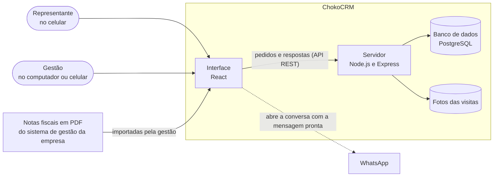

# ChokoCRM

[](https://github.com/dudapetzinger/CHOKOCRM/actions/workflows/ci.yml)
[](https://sonarcloud.io/summary/new_code?id=dudapetzinger_CHOKOCRM)

O ChokoCRM é um sistema de acompanhamento de clientes e visitas feito para os representantes comerciais da Chokolaten, fábrica de chocolates artesanais de Pomerode (SC). Ele abre no navegador, foi desenhado primeiro para o celular e pode ser instalado como aplicativo.

É o projeto extensionista (PAC) do curso de Engenharia de Software do Centro Universitário Católica de Santa Catarina, desenvolvido em parceria com a empresa.

## Sumário

- [O problema](#o-problema)
- [O que o sistema faz](#o-que-o-sistema-faz)
- [Como testar](#como-testar)
- [Como instalar no seu computador](#como-instalar-no-seu-computador)
- [Como o sistema é construído](#como-o-sistema-é-construído)
- [Testes e qualidade](#testes-e-qualidade)
- [Organização do repositório](#organização-do-repositório)
- [Documentação](#documentação)
- [Autoria e licença](#autoria-e-licença)

## O problema

Os representantes da Chokolaten visitam confeitarias, cafés, empórios e mercados de várias cidades de Santa Catarina. O controle dessas visitas era feito em agenda de papel e em conversas de WhatsApp. Com isso, a informação se perdia, não havia um histórico de cada cliente para consultar e ninguém sabia dizer com segurança quais clientes estavam há tempo demais sem receber uma visita.

O ChokoCRM reúne esse controle em um só lugar. O representante registra cada visita no celular, na hora, e o sistema passa a mostrar quem precisa ser visitado, o que cada cliente costuma comprar e como a equipe está em relação às metas.

## O que o sistema faz

Há dois perfis de uso. O representante trabalha com a própria carteira de clientes. A gestão enxerga todas as carteiras e cuida das configurações.

O representante:

- vê a carteira de clientes organizada por cores, do verde (visita em dia) ao vermelho (há muito tempo sem visita), e sabe quem atender primeiro;
- abre a agenda do dia, com as visitas atrasadas, as de hoje e os lembretes, e traça o roteiro no Google Maps;
- registra a visita em quatro passos, com foto, resultado, o pedido feito e a data da próxima visita;
- consulta a ficha do cliente, com o histórico de visitas, as compras e sugestões do que oferecer conforme a época do ano (Páscoa, Dia das Mães, Natal e outras datas);
- envia ao cliente, pelo WhatsApp, uma mensagem pronta perguntando sobre o estoque;
- acompanha as próprias metas e os resultados no painel.

A gestão, além de tudo isso:

- acompanha no painel as visitas, as vendas e a conversão de cada representante, com gráficos, ranking e mapa dos clientes por cidade;
- recebe alertas dos clientes que estão esfriando e dos produtos com estoque baixo antes de uma data comemorativa;
- cria campanhas e metas e acompanha o resultado de cada uma;
- importa as notas fiscais em PDF emitidas pelo sistema de gestão da empresa, que passam a alimentar o histórico de compras de cada cliente;
- cria as contas dos usuários e transfere clientes de um representante para outro.

A descrição completa, com as regras de cada funcionalidade, está em [docs/funcionalidades.md](docs/funcionalidades.md).

## Como testar

O sistema está publicado e pode ser usado direto pelo navegador, no celular ou no computador:

<https://app-chokocrm-api-cscvc7aserd4c4g9.canadacentral-01.azurewebsites.net>

Esse ambiente usa crédito estudantil do Azure e fica ligado nos períodos de teste e de apresentação. Se o endereço não responder, ele está desligado, e o sistema pode ser instalado no computador seguindo a [próxima seção](#como-instalar-no-seu-computador).

### Contas de acesso

A senha de todas as contas é `chokocrm123`.

| Perfil | Nome | E-mail |
|--------|------|--------|
| Representante | Eduarda Fischer | `eduarda@chokolaten.com.br` |
| Representante | Rafael Schmitt | `rafael@chokolaten.com.br` |
| Gestor | Gestão Chokolaten | `gestao@chokolaten.com.br` |

Os dados que aparecem são de demonstração: clientes, visitas e vendas fictícios, gerados para simular três meses de uso.

### Roteiro sugerido

Como representante (conta da Eduarda ou do Rafael):

1. Entre no sistema. A primeira tela é a Agenda, com as visitas atrasadas e as de hoje.
2. Abra Clientes e observe as cores e as abas Prioridade, Atenção e Em dia.
3. Toque em um cliente para abrir a ficha. Veja as compras, as sugestões da época e o histórico de visitas.
4. Toque em Check-in, escolha um cliente e registre uma visita. A foto é obrigatória e pode ser qualquer imagem.
5. Volte à ficha e confira a visita no histórico e a nova cor do cliente.
6. Abra o Painel para ver as metas e os resultados da carteira.

Como gestor (conta Gestão Chokolaten):

1. Entre no sistema. A primeira tela é o Painel, com os indicadores de toda a equipe.
2. Use o seletor de representante para comparar as carteiras e troque o período de análise.
3. Abra a aba Produção e sazonalidade para ver as vendas por mês, os alertas e o mapa.
4. Em Campanhas, crie uma campanha e uma meta para um representante.
5. No menu da conta, abra Usuários para criar uma conta ou definir uma senha provisória.

### Simulando outra data

A tela de login tem o botão Modo demonstração. Ele pede uma data e a senha da conta Gestão e faz o sistema se comportar como se aquele fosse o dia de hoje, recriando os dados de demonstração em volta da data. É a forma de ver, por exemplo, as sugestões de Páscoa fora da época. A opção Voltar ao real desfaz a simulação.

### Usando como aplicativo

No celular, depois do login, o sistema oferece a instalação com o aviso "Use o ChokoCRM como app". Instalado, ele abre em tela cheia, como qualquer aplicativo. É preciso estar com internet para registrar visitas.

## Como instalar no seu computador

É preciso ter o Git, o Docker Desktop e o Node.js 22.13 ou superior.

```bash
git clone https://github.com/dudapetzinger/CHOKOCRM.git
cd CHOKOCRM
cp backend/.env.example backend/.env
cp frontend/.env.example frontend/.env
docker compose up --build
```

Com o ambiente no ar, abra outro terminal para criar as tabelas e carregar os dados de demonstração:

```bash
cd backend
npm install
npm run db:migrate
npm run db:seed
```

Abra <http://localhost:5173> e entre com uma das contas da tabela acima.

O passo a passo detalhado, as variáveis de configuração, a execução sem Docker e a solução dos problemas mais comuns estão em [docs/instalacao-e-configuracao.md](docs/instalacao-e-configuracao.md).

## Como o sistema é construído

O ChokoCRM tem três partes: a interface que roda no navegador, o servidor que aplica as regras do negócio e o banco de dados que guarda as informações.



A interface não decide nada sozinha. Ela mostra o que o servidor calcula: a cor de cada cliente, a agenda, as sugestões e os indicadores. O servidor é organizado em camadas, cada uma com uma responsabilidade, e é o único que acessa o banco de dados.

| Parte | Tecnologias |
|-------|-------------|
| Interface | React 19, TypeScript, Vite, Tailwind CSS, instalável como aplicativo (PWA) |
| Servidor | Node.js 22, Express 5, TypeScript, autenticação por token (JWT) |
| Banco de dados | PostgreSQL 16, acessado com Prisma |
| Ambiente local | Docker Compose |
| Publicação | GitHub Actions e Microsoft Azure |
| Qualidade | Jest, Vitest, SonarCloud |

O desenho das camadas, a organização das pastas e as decisões técnicas, com o motivo de cada uma, estão em [docs/arquitetura.md](docs/arquitetura.md).

## Testes e qualidade

O projeto tem mais de 2.100 testes automatizados, cerca de 1.150 no servidor e 980 na interface. Eles conferem as regras do negócio, cada endereço da API e o comportamento das telas.

```bash
cd backend
npm test
```

```bash
cd frontend
npm test
```

Os testes do servidor usam o banco de dados local e o esvaziam. Depois de rodá-los, recarregue os dados de demonstração com `npm run db:seed:reset` na pasta `backend`.

A cada envio de código para o GitHub, todos os testes rodam de novo, o código passa pela análise do SonarCloud e, se tudo estiver certo, a nova versão é publicada sozinha. Os dois selos no topo desta página mostram o resultado mais recente.

O que é testado, como os testes estão organizados e como a publicação funciona estão em [docs/testes.md](docs/testes.md).

## Organização do repositório

```
CHOKOCRM/
├── backend/              servidor (API)
│   ├── prisma/           estrutura do banco de dados e suas alterações
│   ├── src/              código do servidor, dividido em camadas
│   └── tests/            testes do servidor
├── frontend/             interface
│   ├── public/           logo e ícones do aplicativo
│   └── src/              telas, componentes e seus testes
├── docs/                 documentação
├── scripts/              roteiro de criação do ambiente no Azure
├── .github/workflows/    verificação e publicação automáticas
└── docker-compose.yml    ambiente local
```

## Documentação

| Documento | Conteúdo |
|-----------|----------|
| [Funcionalidades](docs/funcionalidades.md) | O que cada perfil faz no sistema e as regras que valem |
| [Instalação e configuração](docs/instalacao-e-configuracao.md) | Como rodar no computador, contas, variáveis e o ambiente no Azure |
| [Arquitetura](docs/arquitetura.md) | Desenho do sistema, camadas, pastas e decisões técnicas |
| [Modelo de dados](docs/modelo-de-dados.md) | Tabelas do banco de dados e como se relacionam |
| [Testes](docs/testes.md) | O que é testado, como rodar e como funciona a publicação |

## Autoria e licença

Eduarda Petzinger Rodrigues, Engenharia de Software, Centro Universitário Católica de Santa Catarina.

Distribuído sob a licença MIT. O texto está em [LICENSE](LICENSE).
