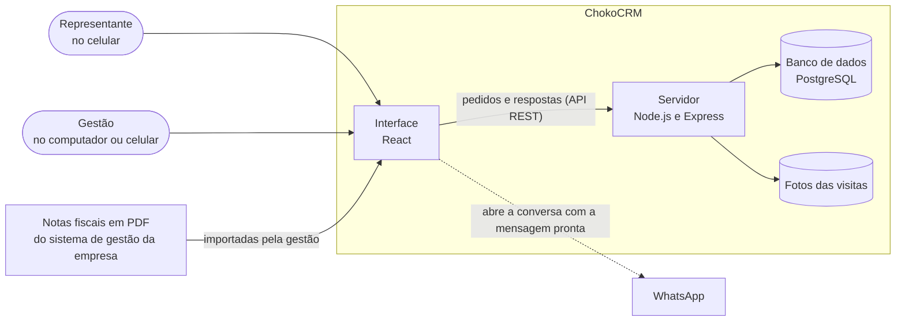
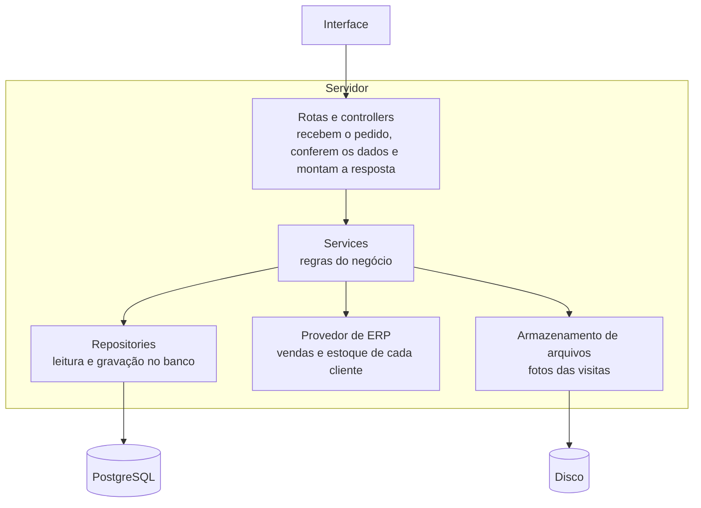

# Arquitetura

Este documento explica como o ChokoCRM é construído: quais são as partes do sistema, como o código está organizado, que decisões técnicas foram tomadas e quais endereços a API oferece.

## Sumário

1. [Visão geral](#1-visão-geral)
2. [Camadas do servidor](#2-camadas-do-servidor)
3. [Organização da interface](#3-organização-da-interface)
4. [Estrutura de pastas](#4-estrutura-de-pastas)
5. [Decisões técnicas](#5-decisões-técnicas)
6. [API](#6-api)
7. [Publicação e monitoramento](#7-publicação-e-monitoramento)

## 1. Visão geral

O sistema tem três partes. A interface roda no navegador do representante ou do gestor. O servidor recebe os pedidos da interface, aplica as regras do negócio e responde. O banco de dados guarda clientes, visitas, pedidos e o restante das informações.



A interface conversa apenas com o servidor, por uma API REST que troca dados em JSON. Cada pedido leva o token de quem está logado. O servidor é o único que acessa o banco de dados e o único que conhece as regras: a interface mostra o que ele calcula.

Dois sistemas de fora aparecem no desenho. O sistema de gestão da empresa (ERP) emite as notas fiscais, que a gestão importa em PDF para alimentar o histórico de compras dos clientes. O WhatsApp é usado pelo próprio representante: o ChokoCRM monta o texto e abre a conversa com o contato escolhido, e quem envia a mensagem é a pessoa.

No computador de desenvolvimento, as três partes sobem juntas com o Docker Compose. No ambiente publicado, o servidor e a interface ficam no mesmo endereço, em um App Service do Azure, e o banco fica em um PostgreSQL gerenciado.

## 2. Camadas do servidor

O servidor é dividido em camadas. Cada camada tem uma responsabilidade e só conversa com a camada logo abaixo dela.



| Camada | Pasta | O que faz | O que não faz |
|--------|-------|-----------|---------------|
| Apresentação | `routes`, `controllers`, `schemas` | Liga cada endereço da API a uma função, valida os dados recebidos e devolve a resposta com o código HTTP certo | Não contém regra de negócio nem acessa o banco |
| Negócio | `services` | Calcula a cor do cliente, a agenda, as sugestões, os indicadores, o resultado das campanhas e das metas, e aplica a regra de carteira | Não conhece o Express nem escreve consultas ao banco |
| Acesso a dados | `repositories`, `prisma` | Lê e grava as tabelas por meio do Prisma | Não decide nada: grava o que a camada de negócio determinou |
| Integrações | `providers/erp`, `storage` | Entrega as vendas e o estoque de um cliente e guarda as fotos, sempre por trás de uma interface | Não é chamada por controllers, só pela camada de negócio |

Ao redor das camadas ficam as peças de apoio: os `middlewares` (login, permissão por perfil, tratamento de erros e registro de cada pedido), os `jobs` (rotinas diárias), a pasta `config` (variáveis de ambiente e os limites usados nas regras) e a pasta `lib` (conexão com o banco, registro de logs e o relógio do sistema).

Dentro da camada de negócio, as regras que só fazem contas ficam em arquivos separados dos que buscam dados. Os arquivos terminados em `.regras.ts` não acessam banco nem ERP: recebem dados e devolvem o resultado. Isso permite testar cada regra sem subir nada.

Duas rotinas rodam todos os dias. A primeira percorre a carteira de cada representante e registra em log as visitas atrasadas e as previstas para o dia. A segunda apaga do disco as fotos de visitas com mais de 90 dias.

## 3. Organização da interface

A interface é uma aplicação React de página única. Ela é dividida assim:

| Pasta | Conteúdo |
|-------|----------|
| `pages` | Uma tela por arquivo: login, clientes, ficha do cliente, check-in, agenda, painel, campanhas, importação de notas, usuários e troca de senha |
| `components` | Peças reaproveitadas pelas telas. Em `ui` ficam os componentes básicos (botão, campo, menu), em `crm` as peças próprias do sistema (moldura, calendário, metas, roteiro) e em `crm/graficos` os gráficos e o mapa do painel |
| `hooks` | Busca e atualização dos dados do servidor, com cache, usando TanStack Query |
| `services` | As chamadas à API, com o envio do token de login |
| `auth` | Controle de quem está logado e proteção das telas |
| `representante` | O representante escolhido pela gestão no seletor que filtra clientes, agenda e painel |
| `pwa` | Convite para instalar, aviso de falta de internet e aviso de versão nova |
| `lib` | Funções de apoio: formatação de datas e valores, cálculo do roteiro, mapa, calendário e geração de planilha |

A interface não repete as regras do negócio. A cor de um cliente, a ordem da agenda e os números do painel chegam prontos do servidor.

O layout se adapta ao tamanho da tela. No celular, a navegação fica em uma barra inferior. A partir de 768 pixels de largura, ela passa para um menu lateral. A partir de 1024 pixels, a lista de clientes e a ficha aparecem lado a lado.

Os gráficos do painel são desenhados em SVG, sem biblioteca de gráficos. Cada um tem uma tabela equivalente para leitores de tela.

## 4. Estrutura de pastas

```
CHOKOCRM/
├── backend/
│   ├── prisma/
│   │   ├── schema.prisma       tabelas do banco de dados
│   │   ├── migrations/         alterações do banco, em ordem
│   │   └── seed.ts             entrada do carregamento dos dados de demonstração
│   ├── src/
│   │   ├── routes/             endereços da API
│   │   ├── controllers/        entrada e saída de cada endereço
│   │   ├── schemas/            validação dos dados recebidos
│   │   ├── services/           regras do negócio
│   │   │   └── importacao-nf/  leitura das notas fiscais em PDF
│   │   ├── repositories/       acesso ao banco de dados
│   │   ├── providers/erp/      fontes de vendas e estoque
│   │   ├── storage/            gravação das fotos
│   │   ├── middlewares/        login, permissões, erros e registro dos pedidos
│   │   ├── jobs/               rotinas diárias
│   │   ├── seed/               gerador dos dados de demonstração
│   │   ├── config/             variáveis de ambiente e limites das regras
│   │   ├── errors/             erros da aplicação e seus códigos
│   │   ├── lib/                banco, logs e relógio do sistema
│   │   ├── types/              tipos compartilhados
│   │   ├── app.ts              montagem do servidor
│   │   ├── server.ts           inicialização
│   │   └── telemetria.ts       monitoramento no Azure
│   └── tests/                  testes do servidor
├── frontend/
│   ├── public/                 logo e ícones do aplicativo
│   ├── scripts/                geração dos ícones e dos dados do mapa
│   └── src/                    telas, componentes e seus testes
├── docs/                       documentação
├── scripts/                    roteiro de criação do ambiente no Azure
├── .github/workflows/          verificação e publicação automáticas
├── docker-compose.yml          ambiente local
└── sonar-project.properties    configuração da análise de código
```

## 5. Decisões técnicas

A tabela resume o que foi escolhido em cada assunto e o motivo.

| Assunto | O que escolhemos | Por quê |
|---------|------------------|---------|
| Tecnologias | React na interface, Node.js com Express no servidor, API REST entre os dois, PostgreSQL e arquitetura em camadas | São exigências da disciplina |
| Repositório | Um só, público, com servidor, interface e documentação | Uma mudança que envolve os dois lados entra de uma vez, e quem avalia encontra tudo em um lugar |
| Acesso ao banco | Prisma, com o arquivo `schema.prisma` como única descrição das tabelas | As alterações do banco ficam versionadas e os tipos do código saem do mesmo arquivo |
| Clientes | Só a gestão cria cliente, a partir de uma nota fiscal importada. Só a gestão inativa | O cadastro oficial é o do sistema de gestão da empresa. Assim não há cliente duplicado nem inventado |
| Carteira | Cada cliente pertence a um representante, que só vê e altera a própria carteira | Reflete como a equipe trabalha. A regra é conferida no servidor, em um único módulo (`services/carteira.ts`) |
| Compras dos clientes | Notas fiscais em PDF importadas pela gestão. Quem não tem nota usa dados simulados | A empresa não liberou acesso direto ao sistema de gestão durante o projeto |
| Valor das vendas | O representante marca só o resultado da visita. O valor chega pela nota fiscal vinculada | A nota é o registro oficial da venda. Evita digitar o pedido duas vezes |
| Cálculos | Cor do cliente, agenda, indicadores, metas e campanhas são calculados na hora da consulta, nunca gravados | Não existe dado desatualizado: uma visita nova muda a cor do cliente no mesmo instante |
| Login | Usuário e senha, com dois perfis (representante e gestor). O acesso vale por oito horas | Simples para quem usa em campo. O e-mail não teria utilidade no sistema |
| Senha esquecida | O gestor define uma senha provisória e a pessoa troca depois, no próprio perfil | Dispensa um serviço de envio de e-mails |
| WhatsApp | O sistema monta o texto e abre a conversa com o contato escolhido. Nada é registrado | Não usa a API paga do WhatsApp. Quem envia é o representante, que pode alterar o texto antes |
| Fotos das visitas | Gravadas no disco do servidor e apagadas depois de 90 dias | Comprovam a visita sem acumular arquivos. Só usuários com acesso ao cliente veem a foto |
| Lembretes | Cada lembrete é uma tarefa com data, aberta até alguém concluir | Um lembrete não pode sumir só porque houve uma visita nova |
| Aplicativo | Instalável no celular (PWA), sem gravação offline | Evita publicar em loja de aplicativos. Gravar offline exigiria resolver conflitos de sincronização |
| Visual | Protótipo aprovado pela empresa, com Tailwind CSS e componentes shadcn | O visual já estava validado com quem vai usar |
| Painel | A mesma tela para os dois perfis, com os dados limitados pelo servidor | O representante acompanha a própria carteira com os mesmos indicadores da gestão |
| Mapa e roteiro | Coordenadas dos 295 municípios de Santa Catarina guardadas no código. O trajeto abre no Google Maps por link | Não depende de chave de API nem tem custo por uso |
| Data do sistema | Um único módulo (`lib/relogio.ts`) responde que dia é hoje, no servidor e na interface | Permite o modo demonstração, que simula outra data. Um teste impede o uso direto do relógio do computador |
| Ambientes | Docker Compose no computador de desenvolvimento e Azure na publicação | Qualquer pessoa roda o sistema com poucos comandos. No Azure, servidor e interface ficam no mesmo endereço |
| Qualidade | SonarCloud a cada envio de código e Application Insights no ambiente publicado | Defeitos e trechos sem teste aparecem antes da publicação, e falhas em uso geram aviso |

### De onde vêm os dados de compra

Hoje o sistema trabalha com dados de demonstração, e as compras de cada cliente vêm de uma de duas fontes:

| Fonte | Quando vale | O que traz |
|-------|-------------|------------|
| Notas fiscais importadas | Para o cliente que tem nota importada no CNPJ dele | As vendas reais, com produtos e valores. Não traz estoque |
| Simulação | Para o cliente sem nota importada | Vendas e estoque gerados por um algoritmo, sempre os mesmos para o mesmo cliente, com variação conforme a época do ano |

O sistema usa uma fonte por cliente e nunca soma as duas. A escolha é automática.

No código, as duas fontes ficam atrás de uma mesma interface, `ErpProvider`. As regras do sistema pedem "as vendas deste cliente" a essa interface, sem saber de onde elas vêm. A variável `ERP_PROVIDER` permite forçar uma fonte só, o que é usado nos testes.

### Melhoria futura: integração com o sistema de gestão

A evolução planejada para depois deste projeto é ligar o ChokoCRM diretamente ao sistema de gestão da empresa. Com a integração:

- os clientes cadastrados pela gestão no sistema de gestão chegam ao ChokoCRM sozinhos, sem importação de notas;
- as vendas e o estoque passam a ser sempre os reais;
- o modo demonstração e os dados fictícios deixam de existir. O sistema começa zerado, e cada representante inicia o próprio controle com clientes reais.

No código, a integração entra como mais uma fonte atrás da interface `ErpProvider`. As telas e as regras não mudam.

## 6. API

Todos os endereços respondem em JSON. Os que exigem login esperam o token no cabeçalho `Authorization: Bearer <token>`. Sem token válido, a resposta é 401. Com token de um perfil sem permissão, é 403. O representante que tenta ler um cliente de outra carteira recebe 404, como se o cliente não existisse.

Na coluna "Quem", R significa representante e G significa gestor.

### Login e conta

| Método | Endereço | Quem | O que faz |
|--------|----------|------|-----------|
| POST | `/auth/login` | público | Confere usuário e senha e devolve o token |
| GET | `/auth/me` | R e G | Devolve os dados de quem está logado |
| PUT | `/auth/password` | R e G | Troca a própria senha, pedindo a atual |

### Clientes e contatos

| Método | Endereço | Quem | O que faz |
|--------|----------|------|-----------|
| GET | `/clients` | R e G | Lista os clientes, com busca e filtros por cor e representante |
| GET | `/clients/:id` | R e G | Ficha do cliente |
| PUT | `/clients/:id` | R e G | Edita os dados e a data da próxima visita. Só o gestor transfere de carteira, inativa e reativa |
| PUT | `/clients/:id/recurrence` | R | Altera o intervalo entre visitas, com justificativa |
| POST | `/clients/:id/contacts` | R e G | Adiciona um contato ao cliente |
| PUT | `/contacts/:id` | R e G | Edita um contato |
| DELETE | `/contacts/:id` | R e G | Remove um contato |

### Visitas, agenda e lembretes

| Método | Endereço | Quem | O que faz |
|--------|----------|------|-----------|
| POST | `/clients/:id/visits` | R | Registra a visita, com resultado, próxima visita e lembrete |
| GET | `/clients/:id/visits` | R e G | Histórico de visitas do cliente |
| PATCH | `/visits/:id` | R | Corrige a descrição ou o resultado de uma visita própria |
| PUT | `/visits/:id/foto` | R | Envia a foto da visita |
| GET | `/visits/:id/foto` | R e G | Devolve a foto da visita |
| GET | `/agenda/today` | R e G | Visitas atrasadas, de hoje e dos próximos sete dias, e lembretes |
| GET | `/agenda/calendario` | R e G | Calendário do mês |
| GET | `/clients/:id/lembretes` | R e G | Lembretes abertos do cliente |
| PATCH | `/lembretes/:id/concluir` | R e G | Marca um lembrete como concluído |

### Vendas, estoque e notas fiscais

| Método | Endereço | Quem | O que faz |
|--------|----------|------|-----------|
| GET | `/clients/:id/erp` | R e G | Última venda, volume comprado, estoque e vendas recentes do cliente |
| GET | `/erp/produtos` | R e G | Catálogo de produtos com preço |
| POST | `/erp/importacoes/leitura` | G | Lê um PDF de notas e devolve o conteúdo para conferência, sem gravar |
| POST | `/erp/importacoes` | G | Importa um PDF de notas |
| GET | `/erp/importacoes` | G | Lista as importações recentes |
| GET | `/erp/pendencias` | G | Notas que aguardam a escolha de uma visita |
| POST | `/erp/vendas/:id/vinculo` | G | Liga a nota a uma visita |
| DELETE | `/erp/vendas/:id/vinculo` | G | Desfaz a ligação |
| GET | `/erp/sem-cliente` | G | Notas de empresas que ainda não são clientes |
| POST | `/erp/sem-cliente/:cnpj/cliente` | G | Cria o cliente a partir dos dados da nota. É a única forma de criar cliente |

### Mensagens e sugestões

| Método | Endereço | Quem | O que faz |
|--------|----------|------|-----------|
| GET | `/clients/:id/stock-message/proposta` | R | Texto sugerido para a mensagem de estoque e contatos do cliente |
| GET | `/clients/:id/insights` | R e G | Sugestões do que oferecer ao cliente na época |
| GET | `/insights/manager-alerts` | R e G | Alertas de estoque baixo antes das datas comemorativas |

### Painel

| Método | Endereço | Quem | O que faz |
|--------|----------|------|-----------|
| GET | `/dashboard/kpis` | R e G | Indicadores do período |
| GET | `/dashboard/kpis/por-representante` | R e G | Resultado, receita e ritmo de visitas por representante |
| GET | `/dashboard/vendas-mensais` | R e G | Vendas mês a mês, com as datas comemorativas |
| GET | `/dashboard/relatorio` | R e G | Dados da planilha, uma linha por cliente |

### Campanhas e metas

| Método | Endereço | Quem | O que faz |
|--------|----------|------|-----------|
| GET | `/campaigns` | R e G | Campanhas com situação e resultados |
| POST | `/campaigns` | G | Cria uma campanha |
| PUT | `/campaigns/:id` | G | Edita uma campanha |
| DELETE | `/campaigns/:id` | G | Exclui uma campanha e as metas dela |
| GET | `/goals` | R e G | Metas com o realizado. O representante vê as próprias |
| POST | `/goals` | G | Cria uma meta |
| PUT | `/goals/:id` | G | Edita uma meta |
| DELETE | `/goals/:id` | G | Exclui uma meta |

### Usuários

| Método | Endereço | Quem | O que faz |
|--------|----------|------|-----------|
| GET | `/users` | G | Lista as contas |
| POST | `/users` | G | Cria uma conta |
| PATCH | `/users/:id` | G | Edita nome, usuário, telefone e perfil, ativa ou inativa a conta |
| POST | `/users/:id/transferir-carteira` | G | Passa todos os clientes de um representante para outro |
| PUT | `/users/:id/senha` | G | Define uma senha provisória |

### Sistema

| Método | Endereço | Quem | O que faz |
|--------|----------|------|-----------|
| GET | `/health` | público | Confere se o servidor e o banco estão respondendo |
| GET | `/sistema/relogio` | público | Informa se o modo demonstração está ativo e em que data |
| POST | `/sistema/demonstracao` | público, com usuário e senha de gestor no pedido | Define a data de demonstração e recria os dados |

## 7. Publicação e monitoramento

A cada envio de código para a branch `main`, o GitHub Actions roda a análise de estilo, os testes e a compilação do servidor e da interface, e envia o resultado ao SonarCloud. Se tudo passar, a nova versão é publicada no Azure e conferida automaticamente. As alterações do banco são aplicadas na inicialização do servidor.

O servidor registra cada pedido em log estruturado, com um identificador por pedido e sem expor o token. O endereço `/health` é usado pela conferência da publicação e pelo teste de disponibilidade do Application Insights, que avisa por e-mail quando o servidor para de responder.

Os detalhes de operação estão em [Instalação e configuração](instalacao-e-configuracao.md#9-ambiente-publicado-no-azure), e a descrição dos testes em [Testes](testes.md).
