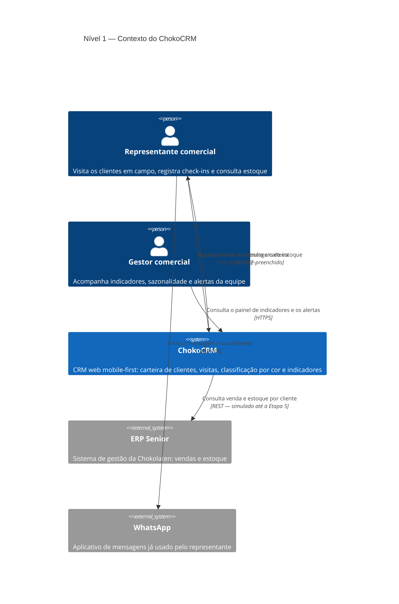
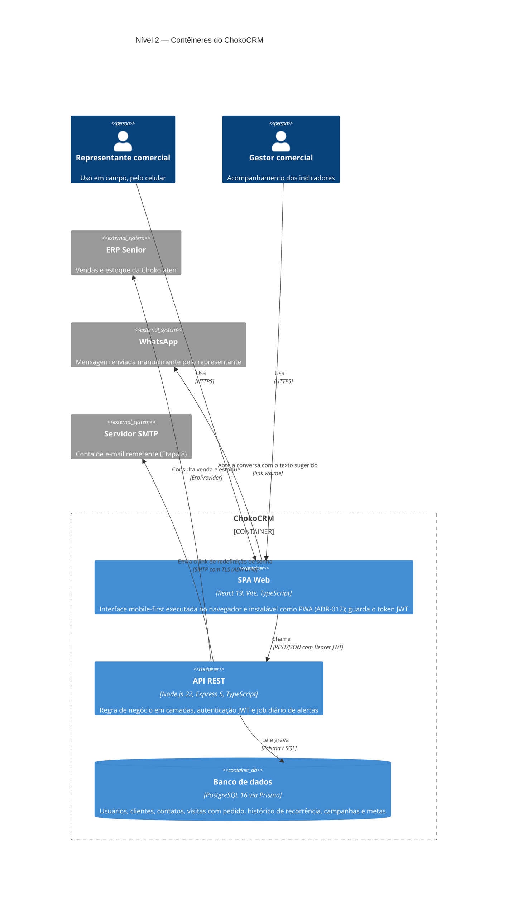
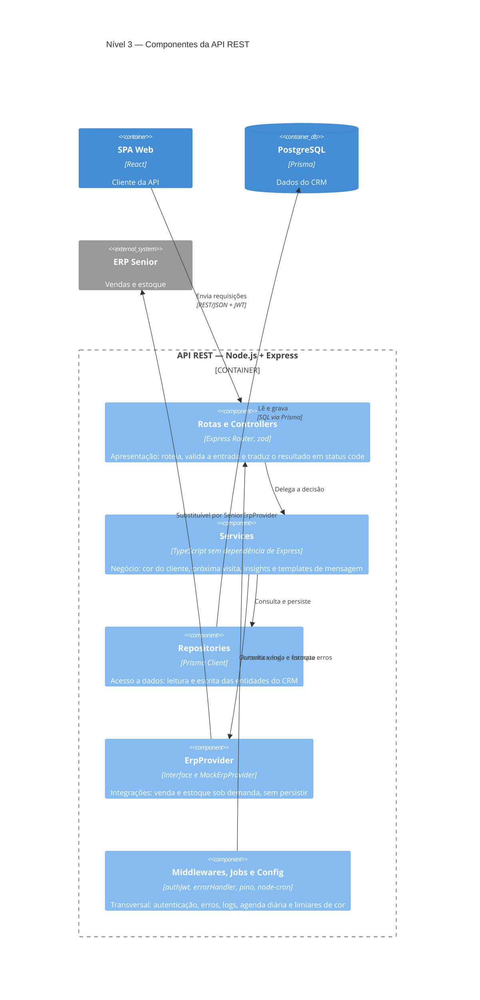

# ChokoCRM — Arquitetura e Decisões Técnicas

Este documento descreve a arquitetura do ChokoCRM e registra as decisões técnicas (ADRs). Complementa a [especificação técnica](especificacao-tecnica.md), que prevalece em caso de divergência.

Este documento registra a arquitetura do ChokoCRM e as decisões técnicas (ADRs) vigentes. Ele serve de referência para as etapas do cronograma (seção 11 da especificação técnica): toda implementação deve manter consistência com as decisões aqui registradas ou, quando necessário, propor um novo ADR justificando o desvio.

## Sumário

1. [Visão geral](#1-visão-geral)
2. [Estrutura de pastas](#2-estrutura-de-pastas)
3. [Decisões arquiteturais (ADRs)](#3-decisões-arquiteturais-adrs)
4. [API REST](#4-api-rest)
5. [Qualidade](#5-qualidade)

---

## 1. Visão geral

O ChokoCRM segue arquitetura em camadas — restrição definida pela disciplina e registrada em [ADR-001](#adr-001--stack-definido-pela-disciplina) — organizada em dois grandes blocos: um frontend em React consumido pelo navegador do representante ou do gestor, e um backend em Node.js/Express dividido internamente em quatro camadas (apresentação, negócio, acesso a dados, integrações) mais um eixo transversal de infraestrutura (autenticação, tratamento de erros, logs, jobs agendados e configuração). A persistência é feita em PostgreSQL via Prisma; dados de venda e estoque do ERP não são persistidos no ChokoCRM e são consultados sob demanda através de um provider substituível.

### 1.1 Nível 1 — Diagrama de contexto



O ChokoCRM atende dois perfis. O **representante comercial** usa o sistema em campo, pelo celular, para consultar a carteira, registrar o check-in de cada visita e pedir o texto da mensagem de consulta de estoque. O **gestor comercial** acompanha os indicadores por sazonalidade, a distribuição de cores da carteira e os alertas de visita atrasada e de produção.

Dois sistemas externos aparecem na fronteira. O **ERP da Senior** é a origem dos dados de venda e estoque, consultados sob demanda e nunca replicados no banco do ChokoCRM ([ADR-004](#adr-004--integração-erp-via-adapter-com-mockerpprovider)). O **WhatsApp** não é integrado por API: o ChokoCRM apenas monta o texto e o link `wa.me`, e o envio é feito manualmente pelo próprio representante, a partir do aplicativo que ele já usa ([ADR-005](#adr-005--mensagem-de-estoque-via-link-wame)) — por isso a seta de envio sai do representante, e não do sistema.

### 1.2 Nível 2 — Diagrama de contêineres



O navegador carrega a SPA React, que consome exclusivamente a API REST do Express via JSON, autenticada por token JWT (seção 8 e [ADR-008](#adr-008--autenticação-jwt-com-papéis-representante-e-gestor)). A API é o único ponto de acesso ao PostgreSQL (via Prisma) e ao ERP: o acesso ao ERP nunca é feito diretamente pelo frontend, e sim através da interface `ErpProvider`, hoje implementada por `MockErpProvider` e futuramente substituível por `SeniorErpProvider` sem alterar as camadas superiores ([ADR-004](#adr-004--integração-erp-via-adapter-com-mockerpprovider)).

Os três contêineres rodam juntos em desenvolvimento via Docker Compose e, em produção, são publicados no Azure — API em App Service, que também serve o build da SPA, e banco em PostgreSQL Flexible Server ([ADR-007](#adr-007--docker-compose-no-desenvolvimento-azure-em-produção)).

### 1.3 Nível 3 — Diagrama de componentes (backend)



O diagrama reproduz as regras de dependência da seção 4.1 da especificação técnica: uma camada superior só conhece a camada imediatamente inferior que ela invoca, nunca o inverso. A camada de **apresentação** (`routes` + `controllers`) recebe a requisição HTTP, valida a entrada (zod) e delega toda decisão à camada de **negócio** (`services`); os services não conhecem `req`/`res` do Express — não têm qualquer dependência da camada de apresentação. A partir do negócio, as duas camadas seguintes são acessadas em paralelo, cada uma isolada da outra: **acesso a dados** (`repositories`, via Prisma), que não contém regra de negócio (não decide, por exemplo, a cor do cliente — apenas lê e grava registros); e **integrações** (`providers`), acessada exclusivamente através da interface `ErpProvider` — nenhuma outra camada chama uma API de ERP diretamente. O eixo **transversal** (middlewares de autenticação JWT e tratamento de erros, jobs agendados via `node-cron`, configuração) dá suporte a todas as camadas sem carregar regra de negócio de domínio própria.

## 2. Estrutura de pastas

```
chokocrm/
├── backend/
│   ├── prisma/                # schema.prisma, migrations versionadas e seed.ts (lê --reset e chama src/seed/)
│   ├── src/
│   │   ├── routes/            # definição das rotas REST por domínio
│   │   ├── controllers/       # req/res, status codes
│   │   ├── schemas/           # validação da entrada com zod
│   │   ├── services/          # regra de negócio pura, testável
│   │   ├── repositories/      # acesso a dados via Prisma
│   │   ├── middlewares/       # authJwt, requireRole, errorHandler, requestLogger
│   │   ├── jobs/              # agenda diária de alertas (node-cron)
│   │   ├── errors/            # AppError e catálogo centralizado de códigos de erro
│   │   ├── storage/           # FileStorage e LocalFileStorage (fotos de check-in)
│   │   ├── providers/erp/     # ErpProvider (interface) e MockErpProvider; mock/ tem o gerador determinístico e o catálogo com preços
│   │   ├── providers/email/   # EmailProvider (interface), ConsoleEmailProvider e SmtpEmailProvider (link de redefinição de senha)
│   │   ├── seed/              # dados de demonstração: semear e reiniciarDemonstracao, chamados por prisma/seed.ts
│   │   ├── lib/               # Prisma Client, logger e detecção de formato de imagem
│   │   ├── config/            # variáveis de ambiente validadas
│   │   ├── types/             # tipagens compartilhadas
│   │   ├── app.ts             # composição do Express
│   │   ├── server.ts          # bootstrap do processo
│   │   └── telemetria.ts      # Application Insights (ligado só com a connection string)
│   ├── tests/                 # Jest + Supertest (tests/unit/: funções puras dos services)
│   └── web/                   # build do frontend copiado no deploy e servido pela API (WEB_DIR; fora do Git)
├── frontend/
│   ├── public/                # logo.svg e ícones do PWA (pwa-192, pwa-512, pwa-maskable-512 e apple-touch-icon)
│   ├── scripts/               # gerar-icones.mjs (PNGs do PWA a partir do logo.svg, npm run icones) e gerar-municipios-sc.mjs (lib/municipiosSC.ts)
│   ├── vite.config.ts         # build e PWA (vite-plugin-pwa: manifest e service worker)
│   ├── vitest.config.ts       # testes (Vitest + jsdom) e cobertura (lcov)
│   └── src/
│       ├── pages/             # Login, Clientes, NovoCliente, ClienteDetalhe, CheckIn, Agenda, Painel, Campanhas, Usuarios, NovoUsuario, AlterarSenha, RedefinirSenha
│       ├── components/        # componentes de UI reutilizáveis
│       │   ├── ui/            # componentes shadcn copiados do protótipo (button, input, textarea, dropdown-menu, popover, sonner)
│       │   └── crm/           # peças do protótipo adaptadas: moldura, menu da conta, calendário, metas, pedido, roteiro, ui.tsx
│       │       └── graficos/  # gráficos do Painel desenhados em SVG e divs, cada um com tabela acessível, e o mapa por cidade
│       ├── hooks/             # estado de servidor com TanStack Query
│       ├── auth/              # contexto de autenticação e rota protegida
│       ├── representante/     # representante escolhido pelo gestor no seletor (contexto React, em memória)
│       ├── pwa/               # convite para instalar, faixa de sem internet e aviso de versão nova
│       ├── services/          # cliente HTTP da API REST
│       ├── config/            # limiares da classificação usados nos textos (espelho de backend/src/config)
│       ├── lib/               # utilitários compartilhados (compressão de imagem, formatação de data e de moeda, iniciais, prazo, listas em português, situação do cliente, ordem por urgência, telefone, larguras de tela, calendário do mês, roteiro, mapa, municípios de SC, CSV e cn)
│       ├── styles.css         # Tailwind CSS 4 com os tokens do protótipo (OKLCH em :root e @theme inline)
│       └── test/              # setup do Vitest e simulações (largura da tela, registro do service worker)
├── docs/                      # casos de uso, modelo de dados, arquitetura, guia e protótipo
├── scripts/                   # wizard-azure.sh (roteiro dos passos manuais do deploy no Azure)
├── docker-compose.yml
├── .github/workflows/         # ci.yml (lint, testes, build, SonarCloud e actionlint) e deploy.yml (Azure)
├── sonar-project.properties   # configuração da análise do SonarCloud
├── .gitattributes             # fim de linha LF nos scripts shell
└── README.md
```

A árvore acima reflete o estado do repositório ao fim da Etapa 9. A Etapa 4 acrescentou `backend/src/jobs/`, `backend/tests/unit/` e, no frontend, a página `AgendaPage` e os componentes e hooks de agenda e recorrência; a Etapa 5 acrescentou `backend/src/providers/erp/` (interface `ErpProvider`, `MockErpProvider` e o gerador determinístico e o catálogo em `providers/erp/mock/`) e, no frontend, o card de dados do ERP na ficha do cliente (`components/DadosErpCard.tsx`, `hooks/useDadosErp.ts`, `services/erp.ts` e `lib/formatarMoeda.ts`). A Etapa 6A acrescentou, no backend, `config/eventosSazonaisSeed.ts` (projeção pura do calendário de `config/sazonalidade.ts` para `SeasonalEvent`), `repositories/seasonal-event.repository.ts`, `services/seasonal-event.service.ts`, `services/stock-message.template.ts`, `services/stock-message.service.ts`, `controllers/stock-message.controller.ts`, `repositories/stock-message.repository.ts`, `schemas/stock-message.schema.ts` e `routes/stock-message.routes.ts`; e, no frontend, o card de mensagem de estoque na ficha do cliente (`components/MensagemEstoqueCard.tsx`, `hooks/useMensagensEstoque.ts`, `services/stockMessages.ts` e `lib/formatarData.ts` (`formatarDataHora`)). A Etapa 6B acrescentou, no backend, `services/insights.regras.ts` (regras puras de insights e alertas, sem acesso a banco nem ao provider), `services/insights.service.ts`, `controllers/insights.controller.ts`, `schemas/insights.schema.ts` e `routes/insights.routes.ts`, além dos parâmetros dos insights em `config/sazonalidade.ts`, da coluna `SeasonalEvent.chave` (migration `20261007141059_seasonal_event_chave`) e, em `services/erp.service.ts`, das consultas `consultarVendas` e `consultarItensBaixosEmLote`; e, no frontend, a página `PainelPage`, os componentes `InsightsCard`, `FiltroHorizonte` e `AvisoSimulado`, `hooks/useInsights.ts`, `services/insights.ts` e os utilitários `lib/descreverPrazo.ts`, `lib/listarComE.ts` e `lib/formatarData.ts` (`formatarDataCalendario`). A Etapa 6C acrescentou, no backend, `config/kpis.ts` (período padrão, períodos aceitos e cores que contam como inativas), `services/kpis.regras.ts` (regras puras dos indicadores, sem acesso a banco nem ao provider), `services/kpis.service.ts`, `controllers/kpis.controller.ts`, `schemas/kpis.schema.ts` e `routes/kpis.routes.ts`, além da consulta `listNoPeriodo` em `repositories/visit.repository.ts` e em `repositories/stock-message.repository.ts`; e, no frontend, os componentes `KpisCard` e `FiltroPilulas` (base de `FiltroHorizonte` e do novo `FiltroPeriodo`), `hooks/useKpis.ts` e `services/kpis.ts`. A Etapa 6D acrescentou o workflow `.github/workflows/deploy.yml` (publicação no Azure — [ADR-007](#adr-007--docker-compose-no-desenvolvimento-azure-em-produção)), os jobs `sonarcloud` e `workflows-lint` no `ci.yml`, `sonar-project.properties` ([ADR-009](#adr-009--análise-estática-e-monitoramento-obrigatórios)), `.gitattributes` e `scripts/wizard-azure.sh` na raiz; no backend, `telemetria.ts` (Application Insights), o script `start:prod` e o frontend servido pela própria API (`WEB_DIR` em `app.ts`, com o build copiado para `backend/web/` no deploy). A Etapa 7 acrescentou, no backend, `services/carteira.ts` (regra de carteira do representante — [ADR-011](#adr-011--carteira-por-representante-e-agenda-calculada-em-tempo-de-consulta)), `services/vendas-mensais.regras.ts`, `services/vendas-mensais.service.ts` e `controllers/vendas-mensais.controller.ts` (gráfico de vendas mensais), `routes/user.routes.ts`, `controllers/user.controller.ts` e `schemas/user.schema.ts` (`GET /users`), `schemas/agenda.schema.ts` e, em `services/erp.service.ts`, a consulta `consultarVendasEmLote`; e, no frontend, as pastas `representante/`, `pwa/` ([ADR-012](#adr-012--pwa-instalável-sem-modo-offline-de-escrita)), `components/graficos/`, `config/` e `test/`, os estilos `tokens.css`, `tipografia.css`, `formularios.css` e `desktop.css`, `public/` com o logo e os ícones do PWA, `scripts/gerar-icones.mjs` e `vitest.config.ts`. A Etapa 8 (revisão pelo protótipo Lovable) acrescentou, no backend, `providers/email/` ([ADR-014](#adr-014--e-mail-por-smtp-com-o-token-no-fragmento-da-url)), `seed/demonstracao.ts`, as regras puras `campaign.regras.ts`, `goal.regras.ts`, `redefinicao-senha.regras.ts` e `agenda.calendario.ts`, os services de campanhas, metas, usuários e relatório e as rotas `/campaigns`, `/goals`, `/erp/produtos` e `/dashboard/relatorio`, além das migrations de usuários, pedido, próxima visita, campanhas e metas; e, no frontend, `styles.css`, `components/ui/` e `components/crm/` ([ADR-013](#adr-013--base-de-interface-do-protótipo-lovable-tailwind--shadcn)), as páginas de campanhas, usuários e senha, `lib/municipiosSC.ts`, `lib/roteiro.ts`, `lib/mapa.ts`, `lib/calendario.ts` e `lib/csv.ts`. Saíram os CSS próprios (`styles/tokens.css`, `tipografia.css`, `formularios.css`, `global.css` e `desktop.css`), `components/Icone.tsx`, `LayoutDuasColunas`, a pasta `components/graficos/` com o Recharts e as fontes Fraunces e Manrope. A Etapa 9 (ajustes pós-validação) acrescentou, no backend, `services/periodo.ts` (período do Painel por dias ou por datas), `services/reminder.service.ts`, `services/lembrete.dto.ts`, `repositories/reminder.repository.ts`, `controllers/reminder.controller.ts` e `routes/reminder.routes.ts` (o lembrete como tarefa própria — [ADR-017](#adr-017--lembrete-como-tarefa-própria-tabela-reminder), com a migration `20261025232841_lembretes_como_tarefa`) e as rotas `/lembretes` e `/clients/:id/lembretes`; e, no frontend, `components/Abas.tsx` e `lib/useAbaNaUrl.ts` (abas acessíveis com a aba na URL, usadas pelo Painel e pela ficha), `components/crm/graficos/BalaoDoGrafico.tsx` e `lib/posicaoDoBalao.ts` (o balão com os clientes de cada fatia dos gráficos), os gráficos `RitmoDeVisitas.tsx` (no lugar do ritmo semanal) e `Ranking.tsx`, `lib/rotulosDosEventos.ts` (nomes dos eventos no gráfico de sazonalidade), `lib/periodo.ts` (o período personalizado), `components/LembreteRow.tsx`, `components/crm/ResultadosDaCampanha.tsx`, `hooks/useLembretes.ts` e `services/lembretes.ts`.

**Apresentação (`backend/src/routes`, `backend/src/controllers`).** As rotas mapeiam método HTTP + caminho para o controller correspondente, sem lógica própria além do roteamento. Os controllers leem a requisição, validam a entrada com zod, chamam o service apropriado e traduzem o resultado em corpo de resposta e status code. Essa camada **não** implementa regra de negócio, **não** acessa `repositories` ou o Prisma Client diretamente e **não** decide, por exemplo, qual cor atribuir a um cliente.

**Negócio (`backend/src/services`).** Concentra toda regra de negócio do domínio — classificação por cor, cálculo de próxima visita, geração de insights de BI, montagem de templates de mensagem, apuração de KPIs — como módulos independentes de Express, o que os torna fáceis de testar unitariamente (seção 10). Essa camada **não** conhece `req`/`res`, **não** monta consultas Prisma diretamente (delega a `repositories`) e **não** chama uma API HTTP de ERP diretamente (delega a `providers`). Desde a Etapa 6B, os insights sazonais e os alertas de produção seguem a mesma divisão da agenda (`agenda.montagem.ts` e `agenda.service.ts`): `services/insights.regras.ts` concentra as regras puras (janela do ano anterior, variação, ação sugerida, cruzamento do estoque com os eventos) e `services/insights.service.ts` busca os dados — `SeasonalEvent` pelo repository e vendas e estoque exclusivamente por `services/erp.service.ts`, que segue como o único módulo que fala com o `ErpProvider`. Os indicadores do painel (Etapa 6C) repetem o desenho: `services/kpis.regras.ts` reúne as regras puras (período de análise, média de visitas, taxa de registro, conversão em vendas, distribuição por cor e inativos) e `services/kpis.service.ts` busca visitas, mensagens e clientes ativos pelos repositories e a cor de cada cliente pelo mesmo caminho da agenda (`classificacaoDoCliente` com `consultarUltimasVendas`). Na Etapa 7, `kpis.regras.ts` ganhou o agrupamento por representante e por semana — na Etapa 8, o comparativo passou a trazer as contagens por resultado (`vendas`, `negociacoes`, `semVenda`) e o agrupamento por semana deu lugar ao ritmo das últimas 8 semanas (`ritmoSemanal`); na Etapa 9, o ritmo passou a acompanhar o período escolhido, por semana ou por mês (`ritmoNoPeriodo`), e o comparativo ganhou a receita e os clientes de cada fatia —, e o gráfico de vendas mensais repete a divisão (`services/vendas-mensais.regras.ts` e `services/vendas-mensais.service.ts`). A regra de carteira do representante fica num módulo próprio, `services/carteira.ts`, sem dependência de repository nem de ERP, para que qualquer service — inclusive `erp.service.ts` — a aplique sem import circular: `exigirClienteVisivel` (leitura: cliente de outra carteira responde 404, como inexistente), `exigirClienteDaCarteira` (escrita: 403 "Cliente de outra carteira.") e `representanteEfetivo` (visões agregadas: o representante sempre a própria carteira; o gestor todas ou a do `representanteId` pedido). A Etapa 8 seguiu o mesmo desenho nas funções novas: `campaign.regras.ts` (status da campanha pelo dia de São Paulo e vendas vinculadas por representante), `goal.regras.ts` (período semanal e mensal e realizado da meta), `redefinicao-senha.regras.ts` (geração, validade e uso único do token) e `agenda.calendario.ts` (montagem do mês do calendário) são puras, e os services buscam os dados pelos repositories (na Etapa 9, `campaign.regras.ts` ganhou os clientes atendidos, a conversão e os produtos mais vendidos, e `periodo.ts` resolve o período por dias ou por datas, conferido contra o dia de hoje de São Paulo, para os controllers do Painel e o service de metas); o catálogo de produtos do pedido e das campanhas é lido só por `erp.service.ts` (`listarProdutos` e `buscarProduto`).

**Acesso a dados (`backend/src/repositories`, `backend/prisma`).** Os repositories encapsulam todo o acesso ao PostgreSQL via Prisma Client (leitura, criação, atualização de `User`, `Client`, `Contact`, `Visit` etc.); `prisma/` guarda o schema, as migrations versionadas e o seed determinístico. Essa camada **não** contém regra de negócio — não decide, por exemplo, se uma alteração de recorrência exige justificativa; apenas persiste o que o service determinou. Desde a Etapa 6A, `lib/prisma.ts` fixa o timezone da sessão Postgres em UTC (`options: '-c timezone=UTC'` no adapter), para que a vigência de `SeasonalEvent` (colunas `@db.Date`) seja comparada de forma correta independentemente do timezone padrão do host do banco.

**Armazenamento de arquivos (`backend/src/storage`).** Define a interface `FileStorage` (gravar e ler por chave lógica) e sua implementação atual `LocalFileStorage`, que grava as fotos de comprovação de check-in no diretório configurado em `UPLOADS_DIR`, com espaço já reservado para a futura `AzureBlobStorage` ([ADR-010](#adr-010--armazenamento-de-arquivos-atrás-de-interface-com-driver-em-disco-na-etapa-3)). Essa camada **não** conhece regra de negócio — não decide se a visita pode receber foto — e é usada apenas pela camada de negócio, nunca por controllers.

**Integrações (`backend/src/providers/erp`).** Define a interface `ErpProvider` e sua implementação atual `MockErpProvider` (dados gerados em memória por um gerador determinístico com sazonalidade realista — semente derivada do `erpId`, sem seed do Prisma), com espaço já reservado para a futura `SeniorErpProvider`. Essa camada **não** persiste dados de venda ou estoque no banco do ChokoCRM — apenas consulta sob demanda — e **não** é chamada diretamente por controllers ou repositories, somente pela camada de negócio.

**Transversal (`backend/src/middlewares`, `backend/src/jobs`, `backend/src/config`).** Os middlewares tratam autenticação JWT, formatação centralizada de erros e log estruturado de requisições; os jobs executam a rotina diária (`node-cron`) que percorre a carteira de cada representante e registra em log os alertas de visita atrasada e prevista para o dia — a agenda em si é sempre calculada ao vivo por `GET /agenda/today`, nunca persistida ([ADR-011](#adr-011--carteira-por-representante-e-agenda-calculada-em-tempo-de-consulta)); `config/` concentra variáveis de ambiente e constantes ajustáveis (limiares de cor, calendário de datas comemorativas, horizonte e limiares dos insights sazonais). Essa camada **não** implementa regra de negócio específica de um caso de uso — fornece apenas infraestrutura compartilhada pelas demais camadas.

**Frontend (`frontend/src/pages`, `components`, `services`, `hooks`).** As `pages` compõem as telas completas do produto (Login, Clientes, ClienteDetalhe — a ficha do cliente —, CheckIn, NovoCliente, Agenda, Painel, Campanhas, Usuários, NovoUsuario, AlterarSenha e a página pública RedefinirSenha), reaproveitando `components` de UI reutilizáveis (`BadgeCor`, `EtiquetaSituacao`, `AbasSituacao`, `CabecalhoCliente`, `DadosCadastrais`, `VisitTimeline`, `InsightsCard`, `KpisCard`, `FiltroPilulas`, `SeletorRepresentante` e outros), os componentes shadcn de `components/ui/` e as peças do protótipo em `components/crm/` (`Moldura`, `MenuDaConta`, `Calendario`, `MetasPanel`, `PedidoCampos`, `Roteiro` e os gráficos). A lista de clientes separa a carteira em abas por ação (Prioridade, Atenção, Em dia e Todos) e explica a cor numa etiqueta de situação, com o texto e a ordem por urgência em funções puras (`lib/descreverSituacao.ts` e `lib/ordenarPorUrgencia.ts`). O Painel (`pages/PainelPage.tsx`, rota `/painel`) serve, desde a Etapa 8, os dois papéis ([ADR-015](#adr-015--painel-também-para-o-representante-limitado-à-própria-carteira)): o gestor vê "Quem está visitando pouco?", com o seletor de representante, e o representante vê "Como está a minha carteira?", só com a própria carteira. Desde a Etapa 9 ele se divide em duas abas (`components/Abas.tsx`, com a aba em `?aba=` pelo `lib/useAbaNaUrl.ts`; só o painel da aba aberta é montado): "Metas e resultados" — indicadores, metas, resultado das visitas por representante, ritmo de visitas no período e, para o gestor, o ranking dos representantes — e "Produção e sazonalidade" — vendas mensais com os alertas de produção, clientes esfriando, "Época do ano" e mapa de clientes por cidade —, com os botões "Planilha" (CSV de `GET /dashboard/relatorio`) e "PDF" (impressão da aba aberta, sem menus nem botões); os gráficos ficam em `components/crm/graficos/`, desenhados com divs e SVG nas cores dos tokens, cada um com uma tabela visualmente oculta com os mesmos números (e, desde a Etapa 9, com a coluna "Clientes", o mesmo conteúdo do balão que `BalaoDoGrafico` mostra ao passar o mouse, focar ou tocar na fatia), e a página continua carregada sob demanda (`lazy` em `App.tsx`). Os dois filtros do Painel são estado local da página e nunca são persistidos: o período (30 · 90 · 365 dias ou personalizado, de até 365 dias, `FiltroPeriodo`) e o horizonte de eventos (30 · 60 · 90 · 180 dias, `FiltroHorizonte`, também usado pelo card de insights da ficha); ambos são montados sobre o componente genérico `FiltroPilulas`, que também serve ao seletor de representante do gestor. A escolha do representante fica em `representante/RepresentanteContext.tsx`, só em memória: vale em Clientes, Agenda e Painel e volta para "Todos" ao recarregar a página ou trocar de usuário. O visual vem do protótipo ([ADR-013](#adr-013--base-de-interface-do-protótipo-lovable-tailwind--shadcn)): Tailwind CSS 4 com os tokens de `styles.css`, componentes shadcn, ícones `lucide-react`, avisos `sonner` e a fonte Plus Jakarta Sans servida pelo próprio app (`@fontsource`). A moldura (`components/crm/Moldura.tsx`) tem a barra superior com o título e o menu da conta, a navegação inferior no celular e, a partir de 768 px, o menu lateral de 240 px; a partir de 1024 px Clientes mostra a lista e a ficha lado a lado (na mesma rota `/clientes/:id`), a Agenda põe Atrasadas e Hoje lado a lado e o Painel usa duas colunas (`lib/useLarguraDesktop.ts`). O gestor entra pelo Painel e o representante pela Agenda (`lib/rotaInicial.ts`). A casca instalável (PWA) e os avisos de instalação, de sem internet e de versão nova ficam em `pwa/` ([ADR-012](#adr-012--pwa-instalável-sem-modo-offline-de-escrita)). A camada `services` do frontend concentra o cliente HTTP da API REST (incluindo o envio do token JWT); os `hooks` encapsulam estado de servidor (TanStack Query) e lógica reativa compartilhada entre páginas. O frontend **não** reimplementa regra de negócio de domínio — cor, recorrência, insights e indicadores são sempre calculados pelo backend; a etiqueta de situação e a ordem por urgência só reapresentam o que a API devolve — e os `components` **não** montam requisições HTTP: recebem dados via propriedades ou, nos cards da ficha que carregam ou gravam os próprios dados (como `MensagemEstoqueCard` e `DadosCadastrais`), usam as funções de `services` através do TanStack Query.

**Documentação e infraestrutura (`docs/`, `docker-compose.yml`, `.github/workflows/`, `README.md`).** `docs/` concentra a documentação viva do projeto (casos de uso, modelo de dados, esta arquitetura, guia de desenvolvimento e protótipo navegável); `docker-compose.yml` sobe o ambiente local completo (Postgres + API + Web); `.github/workflows/` contém o pipeline de integração contínua (`ci.yml`) e o de deploy no Azure (`deploy.yml`), e `scripts/wizard-azure.sh` guia os passos de portal que o pipeline não faz; o `README.md` reúne o sumário da documentação e o `docs/guia-de-desenvolvimento.md` descreve o setup do ambiente local. Nenhum desses arquivos contém regra de negócio do domínio do CRM.

## 3. Decisões arquiteturais (ADRs)

Os ADR-001 a ADR-008 foram registrados na Etapa 1; o ADR-007 foi revisto na Etapa 3, quando a hospedagem foi decidida, e o ADR-009 nasceu na mesma revisão. O ADR-010 nasceu na Etapa 3, com a foto de comprovação de check-in. O ADR-011 nasceu na Etapa 4, com a carteira por representante e a agenda do dia. O ADR-004 e o ADR-006 foram revistos na Etapa 5, com o gerador determinístico do ERP simulado e a regra de cor composta, respectivamente; o ADR-006 foi estendido na Etapa 6B, com os insights sazonais e os alertas de produção também calculados em tempo de consulta, e na Etapa 6C, com os indicadores do painel. Na Etapa 6D, o ADR-007 e o ADR-009 foram implementados — deploy no Azure, SonarCloud e Application Insights — e o ADR-010 foi revisto, com as fotos no disco persistente do App Service. O ADR-012 nasceu na Etapa 7, com o app instalável (PWA); na mesma etapa, o ADR-011 foi revisto, com a carteira passando a valer para a lista, a ficha e as escritas, e o ADR-006 foi estendido aos gráficos do painel. Na Etapa 8 (revisão pelo protótipo Lovable) nasceram os ADR-013 a ADR-016 — base de interface do protótipo, e-mail por SMTP, painel do representante e coordenadas estáticas dos municípios de SC —; o ADR-006 foi estendido às metas, às campanhas e ao relatório, o ADR-008 foi revisto com a conta ativa e o ADR-012, com a tela inicial por papel. Na Etapa 9 (ajustes pós-validação) nasceu o ADR-017 — o lembrete como tarefa própria —; o ADR-006 foi estendido ao período por datas, ao ritmo e aos resultados das campanhas, e o ADR-012 foi revisto com `lembretes` na lista de caminhos da API. A lista é referenciada pelas etapas seguintes do cronograma (seção 11 da especificação técnica) sempre que uma decisão for revisitada, detalhada ou, excepcionalmente, revista — cada revisão substitui o texto do ADR e fica registrada no histórico de commits.

### ADR-001 — Stack definido pela disciplina

**Contexto.** A disciplina PAC exige que o projeto adote arquitetura em camadas, frontend em React, backend em Node.js + Express, comunicação via API REST e PostgreSQL como banco de dados (seção 3 da especificação técnica), como critério de avaliação e para uniformizar os projetos da turma. Essa definição antecede qualquer decisão de design da equipe.

**Decisão.** Adotar integralmente o stack exigido pelo professor — React (+ Vite + TypeScript) no frontend, Node.js + Express (+ TypeScript) no backend, comunicação por API REST e PostgreSQL como SGBD — registrando-o aqui como **restrição externa**, não como escolha de engenharia da equipe.

**Consequências.** As decisões seguintes (ORM, autenticação, testes, deploy) precisam ser compatíveis com esse stack; não há espaço de decisão sobre linguagem ou framework nesse nível. O esforço de design da equipe se concentra na organização interna em camadas, nas integrações e nas regras de negócio.

### ADR-002 — Monorepo público único no GitHub

**Contexto.** O cronograma da disciplina (seção 11) prevê entregas incrementais de backend, frontend e documentação nas mesmas datas, avaliadas a partir de um repositório público no GitHub (seção 3). Manter repositórios separados aumentaria o custo de coordenação de versões e dificultaria a avaliação pela banca.

**Decisão.** Manter um único repositório público no GitHub (`chokocrm`), contendo backend, frontend, documentação e infraestrutura (Docker Compose, workflows de CI/CD), seguindo a estrutura de pastas da seção 2 deste documento.

**Consequências.** O histórico de commits e o versionamento ficam centralizados, simplificando a revisão pela banca. Em contrapartida, exige convenção clara de pastas (`backend/`, `frontend/`, `docs/`) para não misturar responsabilidades, e os pipelines de CI precisam, à medida que o projeto crescer, filtrar por diretório alterado para evitar builds desnecessários.

### ADR-003 — Prisma como ORM

**Contexto.** O banco de dados é PostgreSQL (restrição da disciplina). A camada de acesso a dados precisa de migrations versionadas, tipos alinhados ao TypeScript do backend e baixo atrito de configuração, dado o prazo curto de um projeto acadêmico.

**Decisão.** Adotar Prisma como ORM, com `schema.prisma` como fonte única do modelo de dados, migrations versionadas em `prisma/migrations` e seed determinístico em `prisma/seed.ts`.

**Consequências.** Ganha-se type-safety entre o modelo de dados e o código do backend, migrations reproduzíveis entre ambientes (desenvolvimento, CI, produção) e geração automática de um client tipado. Introduz-se acoplamento ao Prisma Client, mitigado por mantê-lo isolado na camada de `repositories`, sem vazar para `services`; exige também que a equipe aprenda a linguagem de schema do Prisma.

### ADR-004 — Integração ERP via Adapter com MockErpProvider

**Contexto.** O ChokoCRM deve futuramente integrar com o ERP da Senior Sistemas, mas essa API não está disponível durante o período da disciplina (seções 1 e 12). O cronograma (etapa 5, seção 11) já prevê que a integração comece simulada.

**Decisão.** Definir a interface `ErpProvider` (seção 4.3 da especificação técnica), desacoplada de qualquer implementação concreta, com `MockErpProvider` como implementação inicial — dados gerados por um gerador determinístico em memória a partir do `erpId`, com sazonalidade realista — consumida apenas pela camada de negócio.

**Consequências.** A troca futura pela API real da Senior consiste em implementar uma nova classe (`SeniorErpProvider`) que satisfaça a mesma interface, sem alterar controllers, services (além da instância injetada) ou repositories. O módulo de BI pode ser desenvolvido e testado desde já com dados determinísticos. Existe o risco de o mock não reproduzir todas as particularidades da API real, o que pode exigir ajustes na etapa 5.

**Revisto na Etapa 5.** O `MockErpProvider` não lê nenhum dado gravado por seed do Prisma: gera o histórico em memória, a cada chamada, por um gerador determinístico (`providers/erp/mock/gerador.ts`) que usa um hash FNV-1a do `erpId` como semente de um PRNG mulberry32, produzindo 24 meses de vendas e 12 snapshots quinzenais de estoque, com o calendário sazonal de `config/sazonalidade.ts` (Páscoa, Dia das Mães, Namorados, Dia dos Pais e Natal) aplicado como multiplicador de valor sobre as vendas. A seleção do provider é explícita, por `env.ERP_PROVIDER` (`providers/erp/index.ts`), no mesmo desenho de `storage/index.ts`; e `services/erp.service.ts` passa a ser o único módulo que fala com `erpProvider` — os demais services (cliente, agenda) e o job consomem `consultarUltimasVendas` dali, nunca o provider diretamente. Não há cache nesta etapa: o mock roda inteiramente em memória a cada requisição; um decorator com TTL sobre a mesma interface `ErpProvider` fica para quando a integração real com a Senior entrar.

### ADR-005 — Mensagem de estoque via link wa.me

**Contexto.** O envio automático de mensagens pela API oficial do WhatsApp (Meta) exige aprovação de conta comercial e tem custo por mensagem, inviável para o escopo e o prazo da disciplina (seção 12). Ainda assim, o representante precisa de um jeito ágil de consultar o cliente sobre reposição de estoque em campo.

**Decisão.** Gerar um link `https://wa.me/<telefone>?text=<mensagem>` com texto pré-preenchido a partir de templates (produtos sugeridos do `SeasonalEvent` vigente), deixando o envio efetivo a cargo do próprio WhatsApp do representante. Cada geração é registrada em `StockMessage`.

**Consequências.** Não há dependência de API paga nem de aprovação externa, e o recurso funciona em campo sem infraestrutura adicional. O representante mantém controle total sobre o que e quando enviar, podendo revisar o texto antes de enviar. Em contrapartida, o sistema não tem confirmação de entrega ou leitura, e o registro em `StockMessage` reflete apenas a geração da mensagem, não o envio efetivo.

**Implementado na Etapa 6A.** O template (`services/stock-message.template.ts`, com/sem evento sazonal vigente) e a escolha do destinatário — um contato do cliente, com o principal pré-selecionado, ou o telefone do cliente — ficam a cargo do representante no card "Mensagem de estoque" da ficha (`components/MensagemEstoqueCard.tsx`); o texto proposto é editável antes de confirmar. Ao confirmar, o front abre o link `wa.me` em nova aba e também o exibe como botão, e o backend grava o registro em `StockMessage` (`services/stock-message.service.ts::gerar`), com o evento sazonal vigente no momento da geração quando houver um. Não há tela de confirmação de envio nem qualquer chamada à API do WhatsApp — o link é só aberto pelo próprio representante.

### ADR-006 — Classificação por cor calculada em tempo de consulta

**Contexto.** A cor do cliente depende de valores que mudam a cada nova visita ou a cada dia que passa sem visita (seção 6.1). Armazenar a cor como campo persistido exigiria um job de recomputação periódica e criaria risco de inconsistência entre o evento (nova visita) e a atualização do campo.

**Decisão.** Calcular a cor sob demanda, em tempo de consulta, a partir dos limiares fixos de dias sem visita (15/30, configuráveis em `config/`) aplicados à última `Visit` (e ao campo `resultado`, em que apenas `VENDA` conta como venda) — não a partir de `Client.recorrencia_dias`, que alimenta apenas a agenda e os lembretes de próxima visita (seção 6.2) —, e, a partir da etapa 5, também da última venda via `ErpProvider`, sem persistir o valor no banco.

**Consequências.** A cor exibida está sempre consistente com o estado real de visitas e vendas, sem necessidade de jobs de sincronização. O cálculo, sendo uma função pura na camada de negócio, é trivial de testar unitariamente (seção 10). Em contrapartida, listagens com filtro por cor precisam calcular a cor de cada cliente na própria consulta, o que pode exigir índices em `Visit.data_hora` e paginação caso o volume de clientes cresça.

**Revisto na Etapa 5.** A cor passa a ser composta: `aplicarRebaixamentoPorVenda` (`services/classificacao.service.ts`), aplicada depois da cor base de visitas, rebaixa em um degrau — VERDE ou AMARELO para LARANJA — quando a última venda do cliente no ERP (via `ErpProvider`) está há mais de `LIMIAR_SEM_COMPRA_DIAS = 60` dias (`config/classificacao.ts`); LARANJA e VERMELHO não mudam, e a regra nunca promove, só rebaixa. Sem dado do ERP — cliente sem `erpId`, `erpId` desconhecido no provedor, ou provedor indisponível — a cor base calculada pela tabela de visitas permanece intacta.

**Estendido na Etapa 6B.** O mesmo princípio vale para os insights sazonais (UC13) e para os alertas de produção (UC15): nada derivado é persistido. `services/insights.service.ts` calcula as sugestões e os alertas a cada consulta, a partir dos `SeasonalEvent` do banco e das vendas e do estoque do ERP (por `services/erp.service.ts`), com as regras puras em `services/insights.regras.ts` — a variação das compras na janela do mesmo evento no ano anterior sobre a média do cliente, que define a ação sugerida, e o cruzamento dos itens em estoque BAIXO com os SKUs sugeridos de cada evento. Não há tabela de insights, de alertas nem de preferência de horizonte: o horizonte de "evento próximo" vem na própria consulta (`?horizonteDias=`, de 30 a 180 dias, padrão 90). O custo é o mesmo da cor e da agenda — recalcular a cada requisição: uma consulta de vendas ao ERP por requisição nos insights (cobrindo todos os eventos do horizonte) e uma consulta de estoque por `erpId` de cliente ativo, em paralelo, nos alertas —, aceitável no volume da carteira atual e sem cache do provider ([ADR-004](#adr-004--integração-erp-via-adapter-com-mockerpprovider)). Os limiares (variação de ±20%, período de base de 365 dias, horizonte) ficam em `config/sazonalidade.ts`, no mesmo padrão de `config/classificacao.ts`, e não são editáveis na tela.

**Estendido na Etapa 6C.** Os indicadores do painel do gestor (UC14) seguem o mesmo princípio: `services/kpis.service.ts` calcula as visitas, a taxa de registro, a conversão em vendas e a distribuição por cor a cada consulta, a partir de `Visit`, `StockMessage` e da classificação por cor, sem tabela de indicadores nem de histórico. A cor de cada cliente ativo é a mesma da lista e da ficha — regra composta, com uma consulta de última venda por `erpId` de cliente ativo, em lote —, e o período vem na própria consulta (`?periodoDias=`, 30, 90 ou 365, padrão 30); os valores ficam em `config/kpis.ts`.

**Estendido na Etapa 7.** Os gráficos do painel também não persistem nada derivado. O comparativo por representante (`GET /dashboard/kpis/por-representante`) reagrupa, a cada consulta, as mesmas visitas do período pela carteira do cliente (`agruparPorRepresentante` em `services/kpis.regras.ts`; o gráfico de visitas por semana desta etapa deu lugar, na Etapa 8, ao ritmo das últimas 8 semanas, `ritmoSemanal`, no mesmo arquivo). As vendas mensais (`GET /dashboard/vendas-mensais`) são somadas a cada consulta a partir das vendas do ERP dos últimos 12 meses — uma consulta por `erpId` de cliente ativo, em lote (`consultarVendasEmLote`) —, com as regras puras em `services/vendas-mensais.regras.ts` e os marcadores de evento calculados por `dataDoEvento` (`config/sazonalidade.ts`) para o ano atual e o anterior, já que a tabela `SeasonalEvent` só guarda o ano corrente e o seguinte. Não há tabela de vendas mensais, de séries nem de cache: o custo é uma consulta de vendas por cliente ativo com `erpId` a cada requisição, aceitável no volume da carteira e sem cache do provider ([ADR-004](#adr-004--integração-erp-via-adapter-com-mockerpprovider)). Com o ERP Senior real, as vendas mensais passam a depender do cache com TTL previsto no ADR-004 para o provider consultado por `services/erp.service.ts`: é pré-requisito da integração, porque o `staleTime` de 60 s do frontend só evita repetir a consulta na mesma tela.

**Estendido na Etapa 8.** As funções novas seguem o mesmo princípio. O status da campanha (Programada, Em andamento, Encerrada) é calculado pelo dia de hoje em São Paulo (`statusDaCampanha`), e as vendas vinculadas por representante somam, a cada consulta, os pedidos das visitas da campanha; o realizado de cada meta (`realizadoDaMeta`) conta as visitas do representante no período e soma os pedidos das que tiveram venda; o relatório da planilha (`GET /dashboard/relatorio`) monta as linhas por cliente na hora. Nada disso tem coluna nem tabela própria. O que passa a ser gravado é só o que a representante informa: a data prevista da próxima visita, o lembrete e a campanha (`Client.proximaVisita`, `lembrete`, `proximaCampanhaId`; na Etapa 9 o lembrete passou a ser o registro `Reminder`) e o pedido (`VisitItem`, com nome e preço copiados do catálogo no check-in, para o pedido não mudar se o catálogo mudar). A agenda usa a data prevista quando existe e, sem ela, continua calculando pela recorrência ([ADR-011](#adr-011--carteira-por-representante-e-agenda-calculada-em-tempo-de-consulta)).

**Estendido na Etapa 9.** O período por datas, o ritmo por semana ou por mês, a receita por representante, os clientes de cada fatia dos gráficos, os resultados e os produtos mais vendidos de cada campanha continuam calculados a cada consulta, sem coluna nem tabela (`resolverPeriodo`, `ritmoNoPeriodo`, `agruparPorRepresentante`, `resultadosDaCampanha` e `produtosMaisVendidos`). A exceção é o lembrete, que passou de texto do cliente a registro próprio e gravado — o que a representante informa no check-in — pelo [ADR-017](#adr-017--lembrete-como-tarefa-própria-tabela-reminder); o que o calendário e a agenda mostram dele (aberto, vencido, "para hoje") continua calculado na leitura.

### ADR-007 — Docker Compose no desenvolvimento; Azure em produção

**Contexto.** O PAC exige que a aplicação esteja publicada em nuvem pública e estável na avaliação final (seção 12), e o projeto precisa de um ambiente local reprodutível para desenvolvimento e CI, incluindo o PostgreSQL. O playbook de Web Apps da disciplina veta Vercel, Netlify, Firebase e Render, e reprova deploy manual por SSH ou FTP: a entrega contínua precisa sair de um pipeline do GitHub Actions. A conta disponível para o projeto é uma assinatura Azure for Students, com crédito limitado a US$ 100.

**Decisão.** Manter o Docker Compose (Postgres + API + Web) como ambiente de desenvolvimento local e de integração contínua, e publicar a produção no **Microsoft Azure**: a API em **Azure App Service** (Linux, plano Basic B1), o frontend em **Azure Static Web Apps** (plano gratuito; revisto na execução da Etapa 6D — ver nota abaixo) e o banco em **Azure Database for PostgreSQL — Flexible Server** (tier Burstable B1ms). O deploy é disparado por workflow do GitHub Actions a partir da branch `main`, com as credenciais guardadas em secrets do repositório. A produção só é ligada próximo às apresentações e é congelada antes da avaliação final.

**Consequências.** Onboarding e execução local seguem padronizados (`docker compose up`), com paridade razoável entre desenvolvimento e produção — ambos rodam Node 22 e PostgreSQL 16. O CD por GitHub Actions atende à exigência do playbook e mantém o histórico de publicação auditável junto ao histórico de commits. Em contrapartida, o crédito estudantil é finito: com a produção ligada apenas na janela de outubro a dezembro, o consumo estimado fica na casa de algumas dezenas de dólares, sem folga para manter o ambiente no ar o ano inteiro — o gasto precisa ser acompanhado no portal e os recursos desligados fora das janelas de avaliação. Railway e Render, cogitadas na Etapa 1, foram descartadas (Render está explicitamente vetada pelo playbook); também foi descartado hospedar em um servidor interno da instituição, por não caracterizar nuvem pública. Nenhuma camada de aplicação muda em função da plataforma: toda a configuração depende apenas de variáveis de ambiente.

**Implementado na Etapa 6D.** Os recursos ficam no grupo `rg-chokocrm`, em Canada Central: App Service Linux com Node 22 no plano Básico B1 `plan-chokocrm`, que serve a API e o frontend, PostgreSQL Flexible Server Burstable B1ms com 32 GiB e PostgreSQL 16, e Application Insights ([ADR-009](#adr-009--análise-estática-e-monitoramento-obrigatórios)). O deploy sai de `.github/workflows/deploy.yml`, disparado quando o CI de um push na `main` termina verde, ou à mão, por `workflow_dispatch`: o build da API e do frontend é feito no GitHub Actions, e o App Service recebe um pacote só, pronto — a API, o build do frontend em `web/` e as dependências de produção —, sem refazer o build (`SCM_DO_BUILD_DURING_DEPLOYMENT=false`). A autenticação do deploy usa o publish profile do App Service, guardado como secret do repositório — o que uma conta de estudante consegue sem registrar aplicativo no Entra ID; OIDC com identidade federada fica como evolução. As migrations rodam no start da API (`npm run start:prod`, isto é, `node node_modules/prisma/build/index.js migrate deploy && node dist/server.js`), de dentro do Azure, sem abrir o Postgres para os runners do GitHub; o seed de demonstração é um passo manual único, pelo SSH do App Service, e não publica código. Os recursos são criados à mão no portal, num roteiro guiado por `scripts/wizard-azure.sh`. A produção fica ligada só em janelas de uso (testes e apresentações): um orçamento de US$ 100 com alertas em 40 % e 70 % acompanha o crédito, e desligar é escalar o plano para F1 — a primeira opção, já que parar só o app não zera o custo, que é do plano — ou deletá-lo, e parar o Postgres, que o Azure religa sozinho depois de 7 dias parado. Religar é voltar o plano para B1, iniciar o banco e disparar o `deploy.yml` por `workflow_dispatch`. O passo a passo está na seção [Produção no Azure](guia-de-desenvolvimento.md#9-produção-no-azure) do guia de desenvolvimento.

**Revisto na Etapa 6D (execução).** O Static Web Apps se mostrou inviável: a assinatura Azure for Students do projeto tem a policy "Allowed resource deployment regions", que só permite criar recursos em Spain Central, France Central, Canada Central, Chile Central e Mexico Central, e o Static Web Apps só é oferecido em West US 2, Central US, East US 2, West Europe e East Asia — a criação é negada pela policy. Com a aprovação do parceiro, o frontend passou a ser servido pelo próprio App Service, que fica em Canada Central: o job `api` do `deploy.yml` faz o build do frontend com a `VITE_API_URL` e o copia para `backend/web/`, que vai no mesmo pacote; em produção, `WEB_DIR=/home/site/wwwroot/web` liga em `app.ts`, depois de todas as rotas da API, o `express.static` — com cache imutável em `/assets/`, cujos arquivos têm hash no nome — e o fallback da SPA, que devolve o `index.html` (sem cache) na raiz e nas navegações do browser (`GET`/`HEAD` com `Accept` contendo `text/html`); o `fetch` do frontend manda `*/*` e continua recebendo o 404 JSON da API. Os arquivos do frontend e o `index.html` saem com `X-Content-Type-Options: nosniff`, como o Static Web Apps fazia pelo `staticwebapp.config.json`. Produção fica num host só, então a `FRONTEND_URL` é a própria URL do App Service e o navegador não faz requisições entre origens. Sai do projeto um recurso, um secret (o deployment token) e uma variable (`SWA_URL`); o custo não muda, porque o Static Web Apps estava no plano gratuito. A rota `/agenda` existe na SPA e na API (`/agenda/today`): o `agenda.routes.ts` passou a exigir o token por rota, e não no router inteiro, para que a navegação até `/agenda` chegue ao fallback em vez de receber 401.

### ADR-008 — Autenticação JWT com papéis REPRESENTANTE e GESTOR

**Contexto.** O sistema tem dois perfis de uso com permissões distintas — representante (uso em campo: clientes, visitas, mensagens de estoque) e gestor (painel de indicadores, alertas) — e a API REST precisa de um mecanismo de autenticação sem estado no servidor, compatível com múltiplos clientes (a SPA atual e, futuramente, um app nativo).

**Decisão.** Autenticar via JSON Web Token emitido em `POST /auth/login`, carregando o papel do usuário (`REPRESENTANTE` | `GESTOR`); a autorização por rota é feita em um middleware que verifica o token e o papel antes de a requisição chegar ao controller.

**Consequências.** A API fica sem estado no servidor (stateless), simplificando escalabilidade horizontal. Um middleware central de autenticação evita duplicar a checagem de permissão em cada controller. Fica em aberto, para detalhamento na etapa 2, a estratégia de expiração e renovação do token, além do cuidado necessário com o armazenamento do token no frontend para mitigar risco de XSS.

**Revisto na Etapa 8.** O gestor passa a criar e manter as contas pelo app (UC20): `User.ativo` bloqueia o login de quem foi inativado (403 "Conta inativa. Fale com o gestor."), e a inativação vale a partir do próximo login, porque o token vigente continua válido até expirar (8 h). Nas rotas de usuários, que mudam contas e carteiras, `requireRoleAtual('GESTOR')` confere também no banco que quem chama continua ativo e gestor, para um gestor inativado ou rebaixado não seguir usando o token antigo ali; as demais rotas continuam confiando no papel do token até ele expirar. A senha muda por "Alterar senha" (UC21, com a senha atual) ou pelo link de redefinição enviado por e-mail (UC22, [ADR-014](#adr-014--e-mail-por-smtp-com-o-token-no-fragmento-da-url)); nenhum dos dois desloga as outras sessões à força.

### ADR-009 — Análise estática e monitoramento obrigatórios

**Contexto.** O playbook de Web Apps da disciplina trata análise estática de código e monitoramento da aplicação em produção como itens obrigatórios de avaliação. O repositório já executa lint, testes e build no GitHub Actions desde a Etapa 2, mas nenhum dos dois itens estava registrado como decisão arquitetural até aqui, e a Etapa 1 previa Sentry para erros e um monitor de uptime externo — ferramentas escolhidas antes de a hospedagem ser definida.

**Decisão.** Adotar **SonarCloud** para análise estática, executado como job adicional do workflow de CI a cada push e pull request; e **Azure Application Insights** para monitoramento da aplicação em produção, com um teste de disponibilidade apontando para `GET /health`. O Sentry e o monitor de uptime externo previstos na Etapa 1 são substituídos por essa dupla.

**Consequências.** O SonarCloud é gratuito para repositórios públicos — o caso deste projeto ([ADR-002](#adr-002--monorepo-público-único-no-github)) — e roda inteiramente dentro do GitHub Actions, sem servidor a manter; em troca, exige um token no repositório e expõe publicamente as métricas de qualidade, inclusive eventuais regressões. O Application Insights é nativo do Azure, plataforma já escolhida no [ADR-007](#adr-007--docker-compose-no-desenvolvimento-azure-em-produção), o que evita um terceiro fornecedor só para telemetria e concentra erros, métricas e disponibilidade em um único painel; o custo, porém, sai do mesmo crédito estudantil limitado, então a ingestão precisa ser mantida dentro da cota gratuita.

**Implementado na Etapa 6D.** O SonarCloud roda como job `sonarcloud` do `ci.yml`, depois dos jobs `backend` e `frontend`, configurado por `sonar-project.properties` na raiz: analisa `backend/src` e `frontend/src` e lê a cobertura lcov dos testes do backend (`npm test -- --coverage`, repassada ao job como artifact). O quality gate não bloqueia o pipeline — o resultado fica no painel do SonarCloud e no badge do README —, porque os commits vão direto para a `main` e um gate vermelho não deve travar o deploy. Em pull request vindo de fork, que não recebe o `SONAR_TOKEN`, o job é pulado. O mesmo workflow ganhou o job `workflows-lint`, que roda o actionlint sobre os workflows. Na API, `backend/src/telemetria.ts` liga o SDK do Application Insights — com a coleta automática de requisições, dependências (inclusive o Postgres) e exceções, e as live metrics desligadas — só quando `APPLICATIONINSIGHTS_CONNECTION_STRING` está definida; vazia, como em desenvolvimento, testes e CI, nada é enviado. O `server.ts` inicia a telemetria antes de carregar o Express, para que o SDK consiga instrumentá-lo, e registra no log se ela ficou ativa. Em produção, um teste de disponibilidade padrão do Application Insights chama `GET /health` a cada 5 minutos, de três regiões, e avisa por e-mail quando falha.

**Estendido na Etapa 7.** O frontend passou a ter testes (Vitest + Testing Library): o job `frontend` do `ci.yml` roda `npm test -- --coverage` antes do build e repassa `frontend/coverage/lcov.info` como artifact, e o `sonar-project.properties` lê os dois lcov (`sonar.javascript.lcov.reportPaths=backend/coverage/lcov.info,frontend/coverage/lcov.info`), com os arquivos `*.test.ts(x)` do frontend tratados como testes e fora da análise de código. Continua sem gate de cobertura no pipeline.

### ADR-010 — Armazenamento de arquivos atrás de interface, com driver em disco na Etapa 3

**Contexto.** O check-in de visita passou a aceitar uma foto de comprovação de presença (UC07), escolhida em vez de geolocalização por não depender de permissão de GPS nem de precisão em zona rural. O deploy no Azure só acontece na Etapa 6, o repositório é público ([ADR-002](#adr-002--monorepo-público-único-no-github)) e o pipeline de CI roda sem credenciais de nuvem.

**Decisão.** Definir a interface `FileStorage` (`save`/`read` por chave lógica) e implementar `LocalFileStorage`, que grava no diretório configurado por `UPLOADS_DIR`. O mesmo driver em disco atende a produção, com `UPLOADS_DIR=/home/uploads` no disco persistente do App Service. Uma `AzureBlobStorage` que implemente a mesma interface fica como evolução e entraria sem alteração em service nem controller — mesmo padrão Adapter adotado para o ERP no [ADR-004](#adr-004--integração-erp-via-adapter-com-mockerpprovider).

**Alternativas descartadas.** *Azure Blob Storage já na Etapa 3, com o emulador Azurite no desenvolvimento:* exigiria criar a conta de Storage e gerenciar connection string antes de existir deploy, e acrescentaria um contêiner ao ambiente de desenvolvimento sem ganho nesta etapa. *Gravar o binário em coluna do PostgreSQL:* dispensaria infraestrutura nova, mas infla com dado não relacional justamente o recurso mais caro do projeto no Azure ([ADR-007](#adr-007--docker-compose-no-desenvolvimento-azure-em-produção)) e contraria a prática esperada para arquivos.

**Consequências.** As fotos não são versionadas (`backend/uploads/` está no `.gitignore`) e não são servidas como arquivo estático: a leitura passa por `GET /visits/:id/foto`, autenticada por JWT como as demais rotas, o que impede acesso por URL adivinhada. A chave gravada em `foto_path` é lógica (`visits/<id>.jpg`), nunca um caminho absoluto, e o driver valida o formato da chave antes de tocar no disco, o que impede escrita fora do diretório base. A troca para o Blob, se vier, continua restrita ao módulo de storage. Em contrapartida, enquanto o driver é o de disco, as fotos vivem no volume do contêiner em desenvolvimento e no disco persistente do App Service em produção, e **não** fazem parte do backup do banco — restaurar só o banco deixa registros apontando para arquivos ausentes, caso que a API responde como 404.

**Revisto na Etapa 6D.** A `AzureBlobStorage` não foi implementada: em produção, o mesmo `LocalFileStorage` grava em `UPLOADS_DIR=/home/uploads`, no disco persistente do App Service. O `/home` sobrevive a deploy e a restart, e a API roda em uma só instância, então todas as requisições enxergam a mesma pasta — sem conta de Storage nem segredo novo só para as fotos. A `AzureBlobStorage` continua como evolução, pela mesma interface, para quando a API precisar de mais de uma instância. Como antes, as fotos ficam fora do backup do PostgreSQL.

### ADR-011 — Carteira por representante e agenda calculada em tempo de consulta

**Contexto.** A Etapa 4 introduziu a "agenda do dia por representante" (UC10), mas o modelo de dados não tinha nenhum vínculo entre `Client` e o representante responsável por ele — a especificação técnica (seção 6.2) já falava em um job diário que "materializa" a lista de visitas do dia, sem que existisse uma entidade para sustentar o que seria persistido nem um critério de qual carteira pertence a qual representante.

**Decisão.** Criar `Client.representanteId` (FK para `User`), preenchido automaticamente com quem cadastra o cliente (`POST /clients`); só o gestor transfere um cliente para outro representante (`PUT /clients/:id`, campo `representanteId`, exclusivo do papel `GESTOR`). A rota `GET /agenda/today` calcula a agenda ao vivo a cada chamada — para o representante, restrita à própria carteira; para o gestor, a de todos —, sem persistir nenhuma tabela de "agenda materializada". O job diário (`backend/src/jobs/agendaDiaria.job.ts`, `node-cron`, controlado por `AGENDA_JOB_ENABLED`/`AGENDA_JOB_CRON`) roda a mesma lógica de cálculo por representante e apenas registra um log estruturado com os alertas do dia (atrasadas e previstas); não grava nada no banco, e uma falha ao calcular a agenda de um representante não interrompe os demais nem derruba a API.

**Consequências.** A agenda exibida ao representante está sempre coerente com o check-in mais recente, sem risco de desatualização entre o job e a consulta — o mesmo raciocínio do [ADR-006](#adr-006--classificação-por-cor-calculada-em-tempo-de-consulta) aplicado à agenda. Não há tabela nem migração de dados de "agenda"; o custo é recalcular a carteira inteira a cada consulta e a cada execução do job, aceitável no volume de clientes da empresa. O alerta do job fica restrito ao log estruturado (pino): notificação por push ou e-mail ao representante ou ao gestor fica como evolução futura, fora do escopo desta etapa. Na Etapa 4, a lista e a ficha do cliente continuavam mostrando todos os clientes — apenas a agenda filtrava pela carteira; isso deixou de valer na Etapa 7 (abaixo).

**Revisto na Etapa 7.** Por decisão de 13/10/2026, registrada na [spec da etapa](superpowers/specs/2026-10-13-etapa-7-refino-ux-graficos-pwa-design.md), a carteira passa a valer para tudo o que o representante vê e altera, e não só para a agenda. A regra fica num módulo só, `services/carteira.ts`, aplicado por todos os services que tocam um cliente:
- **Leitura:** `GET /clients` traz só a carteira do representante, inclusive na busca, e `GET /stock-messages` só as mensagens de clientes dela; `GET /clients/:id`, `GET /clients/:id/visits`, `GET /clients/:id/erp`, `GET /clients/:id/insights` e `GET /visits/:id/foto` de cliente de outra carteira respondem 404, com a mesma mensagem de um registro inexistente (`exigirClienteVisivel`), para que a resposta não revele que o cliente existe.
- **Escrita:** check-in, proposta e geração de mensagem de estoque, recorrência, `PUT /clients/:id`, contatos (criar, editar e remover), correção da descrição (`PATCH /visits/:id`) e anexo de foto (`PUT /visits/:id/foto`) em cliente de outra carteira respondem 403 `FORBIDDEN`, com a mensagem "Cliente de outra carteira." (`exigirClienteDaCarteira`). Na correção e na foto, a regra vale mesmo para o autor da visita, se o cliente foi transferido depois do check-in.
- **Gestor:** continua vendo todas as carteiras e sendo quem transfere um cliente (`PUT /clients/:id` com `representanteId`). Nas visões agregadas — lista de clientes, agenda, indicadores, comparativo por representante, vendas mensais e alertas de produção — ele pode filtrar uma carteira com `?representanteId=` (`representanteEfetivo`; para o representante o parâmetro é ignorado), e `GET /users?role=REPRESENTANTE` alimenta o seletor de representante da interface. "Por representante" é sempre pela carteira do cliente (`Client.representanteId`), nunca pelo autor da visita.

A consequência é que o representante não localiza mais, pelo app, um cliente fora da própria carteira — o que antes era a justificativa para manter a lista aberta; quem precisa mudar um cliente de carteira continua sendo o gestor. A agenda e o job diário não mudam. O item da agenda passou a trazer o representante da carteira (`representante: { id, nome }`), para o gestor saber de quem é cada visita.

### ADR-012 — PWA instalável, sem modo offline de escrita

**Contexto.** O representante usa o ChokoCRM em campo, no celular, entre uma visita e outra. Até a Etapa 6 o sistema só abria pelo navegador: sem ícone na tela inicial, com a barra de endereço ocupando a tela e a cada vez dependendo de achar a aba certa. A coordenação do PAC liberou transformar a SPA em PWA (Progressive Web App) mediante registro desta decisão. Um aplicativo nativo (Android/iOS) resolveria o mesmo incômodo, mas exigiria uma segunda base de código para um time de uma pessoa, contas pagas e revisão nas lojas, tudo dentro do prazo do semestre.

**Decisão.** Tornar a SPA instalável com o `vite-plugin-pwa`: manifest (`name`/`short_name` "ChokoCRM", `display: standalone`, `start_url` `/clientes`, cores da marca, ícones de 192 e 512 px e um maskable, gerados de `frontend/public/logo.svg` por `npm run icones`) e um service worker do Workbox que guarda em cache só a casca do app — `index.html`, o JavaScript e o CSS do build (inclusive o pedaço do Painel), as fontes do subconjunto latino e os ícones. Toda chamada à API passa pela rede (`NetworkOnly`) e navegações para caminhos da API não recebem a casca; nenhuma resposta da API nem foto de check-in vai para o cache, e nenhuma escrita (check-in, cadastro, edição) é aceita sem rede. A atualização é automática (`registerType: 'autoUpdate'`): o service worker novo assume sozinho, e em vez de recarregar a página no meio de um check-in o app mostra o aviso "Nova versão disponível", com o botão "Atualizar". Três peças de interface acompanham: o convite para instalar (botão "Instalar o ChokoCRM" no Chrome/Edge, pelo evento `beforeinstallprompt`, e instrução de "Adicionar à Tela de Início" no iPhone, que não tem esse evento), que nunca aparece com o app já instalado e, com "Agora não", some por 30 dias; e a faixa "Você está sem internet", que acende quando o navegador fica offline ou quando uma chamada à API falha por rede — com Wi-Fi sem internet o navegador continua se dizendo online.

**Consequências.** O ChokoCRM se instala no Android, no iPhone e no desktop, abre em tela cheia pelo ícone e carrega a casca mesmo sem rede; sem rede, porém, o app mostra só o que já estava na memória da página, e as telas que dependem da API exibem o erro "Você está sem internet." — não há leitura offline de dados nem fila de envio. Não há publicação em loja nem revisão de terceiros: a versão nova chega a quem já instalou na próxima abertura do app. Para isso, a API serve `sw.js`, `registerSW.js`, `workbox-*.js` e `manifest.webmanifest` com `Cache-Control: no-cache` (`backend/src/app.ts`), enquanto os arquivos de `assets/`, com hash no nome, continuam com cache imutável. Check-in offline com sincronização posterior — gravar localmente e enviar quando a rede voltar — fica como evolução, e exigiria tratar conflitos e fotos pendentes.

**Revisto na Etapa 8.** O `start_url` do manifest passou a `/`, que redireciona conforme o papel (gestor para o Painel, representante para a Agenda), e o `background_color` acompanha o fundo novo. A lista de caminhos da API que o service worker não trata como tela ganhou `campaigns`, `goals` e `erp`; `/redefinir-senha` é tela do app, e `/auth/redefinir-senha`, API. As fontes do precache passaram a ser as da Plus Jakarta Sans.

**Revisto na Etapa 9.** A lista de caminhos da API ganhou `lembretes` (`PATCH /lembretes/:id/concluir`), para a navegação a `/lembretes/...` não receber a casca do app; `/clients/:id/lembretes` já cai em `clients`. O resto da decisão não muda: nenhuma escrita funciona sem rede, e concluir um lembrete também exige conexão.

### ADR-013 — Base de interface do protótipo Lovable (Tailwind + shadcn)

**Contexto.** Na Etapa 7 o visual era feito à mão: tokens e estilos próprios em `styles/*.css`, Fraunces e Manrope, ícones próprios (`Icone.tsx`), gráficos com Recharts e `LayoutDuasColunas` para o desktop. Em 17/10/2026 a parceira aprovou um protótipo feito no Lovable, com outra moldura, outras telas (campanhas, metas, usuários, calendário, roteiro, mapa) e o visual que a empresa preferiu. Reproduzir esse visual por cima do CSS próprio exigiria reescrever à mão, tela a tela, o que o protótipo já entrega pronto em Tailwind e shadcn.

**Decisão.** Adotar a base técnica do protótipo no frontend ([spec da etapa](superpowers/specs/2026-10-17-etapa-8-revisao-prototipo-lovable-design.md), seção 6): Tailwind CSS 4 (`@tailwindcss/vite`) com os tokens OKLCH de `src/styles.css`, os componentes shadcn usados pelas telas copiados para `src/components/ui/` (estilo `new-york`, com Radix), `class-variance-authority`, `clsx` e `tailwind-merge` (`cn` em `lib/utils.ts`), ícones `lucide-react`, avisos `sonner`, a fonte Plus Jakarta Sans e o alias `@/` para `src/`. As peças do protótipo (moldura, lista, ficha, calendário, metas, gráficos) entram em `components/crm/`, adaptadas aos tipos, aos hooks e às regras do app. Continuam Vite, React Router, TanStack Query, `services/`, `hooks/`, `vite-plugin-pwa`, Vitest e oxlint (o protótipo usava TanStack Start, que não entrou). Os CSS próprios, `Icone.tsx`, `LayoutDuasColunas` e o Recharts saíram assim que a última tela migrou.

**Consequências.** O app fica com a cara aprovada pela empresa e o mesmo vocabulário de componentes do protótipo, o que facilita trazer ajustes futuros feitos nele. As regras de negócio não mudam: elas continuam no backend e o protótipo só empresta a interface — onde o protótipo calculava algo no navegador (vendas mensais fixas, cores), o app usa a API ([ADR-006](#adr-006--classificação-por-cor-calculada-em-tempo-de-consulta)). Dois ajustes ficam por conta do app: contraste (o laranja primário passou a um tom mais escuro, com 4,6:1 sobre branco, e os textos das etiquetas verde, vermelha e de campanha ganharam tons próprios) e toque (no celular, todo controle tocável tem pelo menos 44 px de altura, e o foco é sempre visível). Os gráficos desenhados à mão perderam os recursos prontos do Recharts (tooltip, escalas), compensados por rótulos nos próprios dados e uma tabela acessível em cada um. Os testes que verificavam classes CSS foram reescritos para verificar papel, texto e atributos.

### ADR-014 — E-mail por SMTP, com o token no fragmento da URL

**Contexto.** Com a gestão de usuários no app (UC20), o gestor precisa ajudar quem esqueceu a senha sem conhecê-la. Decisão da parceira (17/10/2026): o gestor dispara um link para a própria pessoa definir a senha nova. O projeto não tinha envio de e-mail, e a conta remetente (Gmail com senha de app, Outlook, Brevo ou Azure Communication Services) só é escolhida no deploy.

**Decisão.** Definir a interface `EmailProvider` (`providers/email/`), no mesmo padrão do `ErpProvider`: `SmtpEmailProvider` (`nodemailer`, com `SMTP_HOST`, `SMTP_PORT`, `SMTP_USER`, `SMTP_PASS` e `EMAIL_FROM`; porta 465 com TLS direto e as demais com STARTTLS obrigatório) e `ConsoleEmailProvider` (desenvolvimento e testes: registra a mensagem e o link no log e guarda em memória para os testes). Sem `SMTP_HOST`, fora de produção vale o de console; em produção, nenhum, e o pedido de redefinição responde 503 "Envio de e-mail não configurado.". O link é `{APP_URL}/redefinir-senha#<token>`: o token (32 bytes aleatórios) vai no fragmento, que o navegador não envia a servidor nenhum nem grava nos logs de acesso, e a página o lê de `location.hash` e o tira da barra de endereço. O banco guarda só o hash SHA-256 (`PasswordResetToken`), o link vale 24 h e uma vez, e pedir outro invalida os anteriores. `APP_URL` é opcional: sem ela vale a `FRONTEND_URL` (em produção, o próprio App Service), e em produção o valor efetivo precisa começar com `https://`, senão a API não sobe.

**Consequências.** Qualquer provedor SMTP serve, sem SDK nem conta paga, e trocar de provedor é trocar as variáveis. Enquanto a conta remetente não é configurada, a produção funciona sem a redefinição por link (o gestor vê a mensagem do 503) e o desenvolvimento mostra o link no log da API. O token nunca aparece no banco nem nos logs do servidor; quem tem o e-mail aberto, porém, tem o link por 24 h, risco aceito para a representante que só lê o e-mail no fim do dia em campo.

### ADR-015 — Painel também para o representante, limitado à própria carteira

**Contexto.** Até a Etapa 7 o Painel (UC14) e os alertas de produção (UC15) eram exclusivos do gestor. O protótipo aprovado em 17/10/2026 dá à representante um painel próprio — "Como está a minha carteira?" —, com metas, ritmo de visitas, clientes esfriando e mapa, para ela acompanhar o próprio trabalho sem pedir ao gestor.

**Decisão.** Abrir `GET /dashboard/kpis`, `/dashboard/kpis/por-representante`, `/dashboard/vendas-mensais`, `/dashboard/relatorio` e `/insights/manager-alerts` aos dois papéis, sem `requireRole`. Cada controller passa pelo `representanteEfetivo` de `services/carteira.ts` ([ADR-011](#adr-011--carteira-por-representante-e-agenda-calculada-em-tempo-de-consulta)): o representante vê sempre só a própria carteira (o `representanteId` que ele mandar é ignorado), e o gestor vê a empresa toda ou a carteira escolhida. A tela é a mesma (`PainelPage`), com o título e o seletor de representante conforme o papel; as metas do representante aparecem sem edição.

**Consequências.** Uma regra de escopo só, já testada nas outras visões agregadas, protege as rotas abertas; os testes de integração conferem, rota a rota, que o representante não lê a carteira de outro. A representante passa a ver o comparativo "Resultado das visitas" só com a própria linha e os alertas de produção só dos próprios clientes. Campanhas e metas continuam com escrita só do gestor.

### ADR-016 — Coordenadas estáticas dos municípios de SC no roteiro e no mapa

**Contexto.** O roteiro do dia (UC25) ordena as paradas e estima as distâncias, e o mapa do Painel põe uma bolha por cidade. Os dois precisam de coordenadas. Um serviço de geocodificação (Google, Mapbox, Nominatim) traria chave, custo, limite de uso e uma chamada externa por endereço, para uma carteira que é toda catarinense.

**Decisão.** Guardar no frontend uma tabela estática dos 295 municípios de Santa Catarina com latitude e longitude (`lib/municipiosSC.ts`, gerada por `scripts/gerar-municipios-sc.mjs` a partir da base pública `kelvins/municipios-brasileiros`, de licença MIT), comparando os nomes sem acento e sem caixa. A distância entre cidades é a reta (haversine) × 1,3, arredondada; clientes da mesma cidade ficam juntos e mostram "mesma cidade"; cidade fora da tabela vai para o fim do roteiro, sem distância, e fica fora do mapa, citada abaixo dele ("Sem coordenadas: …"). O trajeto rua a rua fica com o Google Maps, aberto por link (`/maps/dir/` com origem, destino e paradas) em nova aba.

**Consequências.** Nenhuma chamada externa, chave ou custo; o roteiro e o mapa funcionam com os dados que o app já tem. A distância é aproximada (por cidade, não por endereço), o que basta para ordenar as paradas e dar uma ideia do percurso. Um cliente fora de SC exigiria ampliar a tabela, e o cálculo fica no navegador porque só reorganiza dados que a API já devolveu, sem regra de negócio.

### ADR-017 — Lembrete como tarefa própria (tabela `Reminder`)

**Contexto.** Na Etapa 8 o lembrete era um texto de até 200 caracteres preso à próxima visita do cliente (`Client.lembrete`, gravado e apagado junto com `Client.proximaVisita`). Ao usar o app com os dados de demonstração (25/10/2026), a parceira pediu que o lembrete fosse um follow-up de verdade: ficar marcado e listado até o representante concluí-lo, com data própria, e não sumir quando um check-in novo regrava a próxima visita — o que acontecia, porque cada check-in substituía a marcação anterior e levava o lembrete junto. Um cliente também precisa poder ter mais de um lembrete ao mesmo tempo.

**Decisão.** Criar a tabela `lembretes` (modelo `Reminder`), com `clientId` (`ON DELETE CASCADE`), `criadoPorId`, `visitId` opcional (o check-in de origem, `ON DELETE SET NULL`), `texto` (até 200 caracteres, também com `CHECK` no banco), `data` (`DATE`), `concluidoEm` opcional e `criadoEm`, com índice em (`clientId`, `concluidoEm`), e remover `Client.lembrete`. O check-in manda `lembrete?: { texto, data }`, independente da próxima visita, e o service cria o `Reminder` na mesma transação da visita; um check-in novo não conclui os abertos, e apagar a próxima visita ou mudar a recorrência não mexe neles. `PATCH /lembretes/:id/concluir` grava `concluidoEm` (dono da carteira do cliente ou gestor; 404 para outra carteira, 409 se já concluído) e `GET /clients/:id/lembretes` lista os abertos. A migration `20261025232841_lembretes_como_tarefa` copia cada lembrete existente para um `Reminder` aberto — criado pelo dono da carteira, com a data da próxima visita marcada ou, sem ela, o dia da migração — antes de remover a coluna.

**Consequências.** O lembrete sobrevive ao check-in e a vários lembretes por cliente, a conclusão fica registrada e auditável (quando, em qual check-in nasceu e quem o criou), e a agenda do dia (seção "Lembretes", com os abertos até hoje), o calendário (item `LEMBRETE` no dia dele) e a ficha (lista com "Concluir") leem a mesma tabela. O custo é uma tabela, duas rotas e um tipo de item a mais nas respostas da agenda e do calendário, e o lembrete deixa de aparecer nas linhas de visita (`AgendaItem.lembrete` e `ItemCalendario.lembrete` saíram). Os concluídos continuam gravados, mas não têm tela, e não há criar lembrete avulso nem editar um existente — ficam para um pedido à parte. A **alternativa descartada** foi acrescentar data e conclusão como campos do próprio cliente, ao lado de `Client.lembrete`: um check-in com lembrete novo apagaria o aberto, contra a regra de que o check-in não encerra lembrete, e o cliente continuaria com um só.

## 4. API REST

Contorno de rotas (seção 7 da especificação técnica):

```
POST   /auth/login                      GET    /auth/me
PUT    /auth/password                   (alterar a própria senha)
POST   /auth/redefinir-senha            (público; token do link + senha nova)
GET    /clients?color=&search=&representanteId=      GET    /clients/:id
POST   /clients                         PUT    /clients/:id
POST   /clients/:id/contacts            PUT/DELETE /contacts/:id
POST   /clients/:id/visits              GET    /clients/:id/visits    (pedido em itens?; próxima visita, lembrete { texto, data } e campanhas)
GET    /clients/:id/lembretes           (os lembretes abertos do cliente, por data)
PATCH  /lembretes/:id/concluir          (dono da carteira ou gestor; 404 e 409)
PATCH  /visits/:id                      (corrige a descrição, só o autor)
PUT    /visits/:id/foto                 GET    /visits/:id/foto
PUT    /clients/:id/recurrence          (exige justificativa)
GET    /clients/:id/erp                 (última venda, volume, estoque — via provider)
GET    /clients/:id/stock-message/proposta   (texto sugerido, contatos e evento vigente)
POST   /clients/:id/stock-message       GET    /stock-messages
GET    /clients/:id/insights            (?horizonteDias=; sugestões sazonais por evento próximo)
GET    /insights/manager-alerts         (?horizonteDias=&representanteId=; alertas de produção da carteira)
GET    /dashboard/kpis                  (?periodoDias=30|90|365 ou ?inicio=&fim=AAAA-MM-DD, até 365 dias; &representanteId=; indicadores do painel)
GET    /dashboard/kpis/por-representante (?periodoDias= ou ?inicio=&fim=; &representanteId=; resultado das visitas, receita, clientes por fatia e ritmo no período)
GET    /dashboard/vendas-mensais        (?representanteId=; vendas dos últimos 12 meses e eventos)
GET    /dashboard/relatorio             (?periodoDias= ou ?inicio=&fim= sem limite; &representanteId=; linhas da planilha, uma por cliente)
GET    /users                           (gestor; ?role=REPRESENTANTE: só os ativos, para o seletor)
POST   /users                           PATCH  /users/:id                       (gestor)
POST   /users/:id/transferir-carteira   POST   /users/:id/redefinicao-de-senha  (gestor)
GET    /campaigns                       POST   /campaigns   PUT/DELETE /campaigns/:id   (escrita só do gestor)
GET    /goals?campanhaId=&representanteId=&periodoDias= ou &inicio=&fim=   POST /goals   PUT/DELETE /goals/:id     (escrita só do gestor)
GET    /erp/produtos                    (catálogo com preço, para o pedido e as campanhas)
GET    /agenda/today                    (?representanteId=; atrasadas, hoje, próximos 7 dias e lembretes abertos até hoje)
GET    /agenda/calendario               (?mes=AAAA-MM&representanteId=; visitas marcadas, lembretes, campanhas e datas sazonais)
GET    /health
```

Descrição por grupo:

- **Carteira (Etapa 7)** — para o representante, toda rota que toca um cliente aplica a regra de carteira do [ADR-011](#adr-011--carteira-por-representante-e-agenda-calculada-em-tempo-de-consulta): leitura de cliente de outra carteira responde 404, como inexistente, e escrita responde 403 `FORBIDDEN` ("Cliente de outra carteira."). `?representanteId=` (uuid, opcional; formato inválido responde 400 `VALIDATION_ERROR`) filtra uma carteira nas visões agregadas do gestor e é ignorado para o representante.
- **Autenticação** (`POST /auth/login`, `GET /auth/me`, `PUT /auth/password`, `POST /auth/redefinir-senha`) — emite o token JWT a partir de credenciais válidas (conta inativa responde 403 "Conta inativa. Fale com o gestor.") e devolve o usuário do token, com `ativo` e `telefone`. `PUT /auth/password { senhaAtual, novaSenha }` troca a própria senha (mínimo 6; senha atual errada responde 400 "Senha atual incorreta."); `POST /auth/redefinir-senha { token, novaSenha }`, pública, usa o link do e-mail ([ADR-014](#adr-014--e-mail-por-smtp-com-o-token-no-fragmento-da-url)) e responde 204.
- **Clientes** (`GET/POST/PUT /clients`, `GET /clients/:id`) — listagem com busca, filtro por cor (`?color=`) e, para o gestor, por representante (`?representanteId=`) — o representante recebe só a própria carteira —, cadastro (atribui automaticamente o cadastrante como representante da carteira — `POST` por um gestor é rejeitado) e edição dos dados cadastrais do cliente; só o gestor transfere um cliente para outro representante (`representanteId`), via [ADR-011](#adr-011--carteira-por-representante-e-agenda-calculada-em-tempo-de-consulta).
- **Usuários** (`/users`, exclusivas do papel `GESTOR`, com o papel conferido também no banco) — `GET /users?role=REPRESENTANTE` mantém o contrato da Etapa 7 (`{ data: [{ id, nome }] }` dos representantes ativos, em ordem de nome, para o seletor); sem `role`, `GET /users` lista todas as contas com `{ id, nome, email, telefone, role, ativo, criadoEm, clientesNaCarteira }`. `POST /users` cria a conta (senha inicial de no mínimo 6), `PATCH /users/:id` edita nome, e-mail (único, 409 "Já existe um usuário com este e-mail."), telefone, papel e ativo — ninguém inativa a si mesmo nem muda o próprio papel, e representante com clientes não vira gestor (400 "Transfira a carteira antes de mudar o papel.") —, `POST /users/:id/transferir-carteira { destinoId }` passa todos os clientes para um representante ativo e `POST /users/:id/redefinicao-de-senha` envia o link por e-mail (204; 400 para conta inativa; 503 sem SMTP em produção).
- **Contatos** (`POST /clients/:id/contacts`, `PUT/DELETE /contacts/:id`) — cadastro, edição e remoção dos contatos de um cliente.
- **Visitas** (`POST/GET /clients/:id/visits`, `PATCH /visits/:id`, `PUT/GET /visits/:id/foto`) — registro de check-in (descrição obrigatória, resultado em três estados e foto de comprovação opcional), histórico de visitas do cliente e correção da descrição pelo autor. A foto viaja numa chamada própria, com os bytes crus no corpo, para que uma falha de upload em campo não perca o check-in já gravado. Desde a Etapa 8, o check-in aceita `itens?: [{ sku, quantidade }]` só com resultado `VENDA` (o backend copia nome e preço do catálogo; SKU desconhecido ou itens sem venda respondem 400), `campanhaId`, `proximaVisita` e `proximaCampanhaId`, gravados no cliente, e, desde a Etapa 9, `lembrete?: { texto, data: 'AAAA-MM-DD' }` — que não é mais gravado no cliente: o service cria um `Reminder` ligado à visita, na mesma transação, e texto sem data responde 400 "Informe a data do lembrete." ([ADR-017](#adr-017--lembrete-como-tarefa-própria-tabela-reminder)); as visitas devolvem `itens` e `totalPedido`.
- **Lembretes** (`GET /clients/:id/lembretes`, `PATCH /lembretes/:id/concluir`, Etapa 9) — a primeira lista os lembretes abertos do cliente, por data (404 se o cliente não existir ou, para o representante, for de outra carteira); a segunda conclui um lembrete e responde `{ id, concluidoEm }`, aberta ao representante dono da carteira e ao gestor, que conclui o de qualquer carteira (lembrete inexistente responde 404 "Lembrete não encontrado." a qualquer papel, e o de outra carteira responde o mesmo 404, só ao representante; já concluído, 409 "Lembrete já concluído."). Os concluídos não são listados em rota nenhuma.
- **Campanhas e metas** (`/campaigns`, `/goals`, Etapa 8) — leitura para todos e escrita só do gestor (o representante recebe 403). `GET /campaigns` traz cada campanha com o status calculado e, em `resultados[]`, as visitas, os clientes atendidos, as vendas e a conversão vinculadas por representante (o representante recebe só a própria linha) e, em `produtosMaisVendidos`, os 5 produtos de maior quantidade nos pedidos vinculados, no escopo de quem pede (Etapa 9); nome obrigatório, fim ≥ início, desconto de 0 a 100 e SKUs do catálogo. `GET /goals` traz as metas com o realizado (`{ visitas, vendas, clientes }`, com os clientes de cada barra desde a Etapa 9), filtráveis por campanha e representante (o representante, só as próprias) e, desde a Etapa 9, por período (`?periodoDias=` ou `?inicio=&fim=`, só as metas que cruzam a janela; sem período, todas). Excluir uma campanha apaga as metas dela e desvincula visitas e próximas visitas. `GET /erp/produtos` devolve o catálogo `{ sku, nome, precoUnitario }[]` para o pedido e para os produtos em destaque.
- **Recorrência** (`PUT /clients/:id/recurrence`) — altera a frequência de visita do cliente, exclusiva do representante (o gestor recebe 403) e exigindo justificativa registrada; cada alteração fica em histórico auditável em `VisitScheduleChange`, exibido na ficha do cliente.
- **ERP** (`GET /clients/:id/erp`) — expõe última venda, volume de compras dos últimos 90 dias e nível de estoque estimado, consultados por `erp.service` via `ErpProvider`; acessível a qualquer usuário autenticado (representante ou gestor), sem `requireRole` — o representante, só para clientes da própria carteira.
- **Mensagem de estoque** (`GET /clients/:id/stock-message/proposta`, `POST /clients/:id/stock-message`, `GET /stock-messages`) — a `/proposta` monta o texto sugerido (evento sazonal vigente, quando houver) e devolve os contatos do cliente sem gravar nada; o `POST` grava a mensagem em `StockMessage` e gera o link `wa.me` pré-preenchido; ambas exclusivas do papel `REPRESENTANTE`. `GET /stock-messages?clientId=` mantém o histórico de mensagens geradas, acessível a qualquer papel autenticado: o gestor recebe todas, e o representante, desde a Etapa 7, só as de clientes da própria carteira.
- **Insights** (`GET /clients/:id/insights`, `GET /insights/manager-alerts`) — sugestões sazonais do cliente (UC13) e alertas de produção do gestor (UC15), calculados a cada consulta ([ADR-006](#adr-006--classificação-por-cor-calculada-em-tempo-de-consulta)). As duas rotas aceitam `?horizonteDias=` (inteiro de 30 a 180, padrão 90); valor fora da faixa ou não numérico responde 400 `VALIDATION_ERROR`. `GET /clients/:id/insights` é acessível a qualquer usuário autenticado, sem `requireRole`, e responde 200 com `status` `OK`, `SEM_ERP_ID` ou `INDISPONIVEL` (404 se o cliente não existir ou, para o representante, for de outra carteira); traz as sugestões por evento do horizonte, cada uma com ação, variação percentual, período comparado e produtos mais comprados, mais a lista de eventos sem histórico. `GET /insights/manager-alerts` serve os dois papéis desde a Etapa 8 ([ADR-015](#adr-015--painel-também-para-o-representante-limitado-à-própria-carteira)) — o representante recebe só os da própria carteira —, aceita também `?representanteId=` (para o gestor, só a carteira daquele representante) e responde 200 com os eventos do horizonte, os alertas agrupados por evento e produto e a contagem de clientes consultados e indisponíveis no ERP.
- **Painel e agenda** (`GET /dashboard/kpis`, `GET /dashboard/kpis/por-representante`, `GET /dashboard/vendas-mensais`, `GET /dashboard/relatorio`, `GET /agenda/today`, `GET /agenda/calendario`) — `GET /dashboard/kpis?periodoDias=` devolve os indicadores do painel (UC14: visitas no período, taxa de registro, conversão em vendas, clientes inativos e distribuição por cor), calculados a cada consulta ([ADR-006](#adr-006--classificação-por-cor-calculada-em-tempo-de-consulta)); `periodoDias` aceita 30, 90 ou 365 (padrão 30) e qualquer outro valor responde 400 `VALIDATION_ERROR`; desde a Etapa 9 o período pode vir por datas, `?inicio=AAAA-MM-DD&fim=AAAA-MM-DD` (as duas juntas; dias e datas ao mesmo tempo respondem 400 "Informe o período em dias ou por datas, não os dois."; `fim` até hoje em São Paulo; em `/kpis` e `/kpis/por-representante`, até 365 dias, senão 400 "O período de visualização é de até 365 dias; para mais, use a Planilha."; `/relatorio` e `/goals` não limitam o tamanho), e `periodo: { dias, inicio, fim }` volta na resposta com `dias` igual ao número de dias da janela. `GET /dashboard/kpis/por-representante?periodoDias=` devolve, no mesmo período, `{ id, nome, clientesAtivos, visitas, vendas, negociacoes, semVenda, conversaoEmVendas, receita, clientes }` de cada representante, pela carteira do cliente (com `?representanteId=`, só aquele representante) — a `receita` é a soma dos pedidos das visitas com venda e os `clientes`, os visitados no período —, e, desde a Etapa 9, o `ritmo` (`{ granularidade: 'SEMANA' | 'MES', faixas: [{ inicio, fim, parcial, visitas, vendas, clientes }] }`), que acompanha o período: uma faixa por semana (segunda a domingo) até 91 dias e uma por mês acima disso; na Etapa 8 era o `ritmoSemanal`, sempre as últimas 8 semanas. `GET /dashboard/vendas-mensais` devolve as vendas no ERP da carteira mês a mês nos últimos 12 meses (`meses`, cada um com os `clientes` que compraram, desde a Etapa 9), os eventos sazonais que caem nessa janela (`eventos`), `simulado`, `clientesConsultados` e `clientesIndisponiveis`. `GET /dashboard/relatorio?periodoDias=` devolve as linhas da planilha do Painel, uma por cliente ativo, na ordem de urgência: cliente, cidade, representante, situação, dias sem visita, visitas e vendas no período. As quatro rotas aceitam `?representanteId=` e, desde a Etapa 8, servem os dois papéis: o representante vê só a própria carteira e o parâmetro é ignorado para ele ([ADR-015](#adr-015--painel-também-para-o-representante-limitado-à-própria-carteira)). `GET /agenda/today` devolve a lista de visitas atrasadas/previstas para hoje, calculada ao vivo (representante vê só a própria carteira; gestor vê a de todos ou, com `?representanteId=`, a de um representante), e cada item traz o representante da carteira (`representante: { id, nome }`); desde a Etapa 8 a data prevista é a marcada no check-in, quando existe, e a agenda ganhou "Próximos 7 dias"; desde a Etapa 9 traz também `lembretes`, os lembretes abertos com data até hoje (`{ id, clienteId, nomeFantasia, cidade, texto, data, diasAtraso, representante }`), e as linhas de visita deixaram de levar o texto do lembrete. `GET /agenda/calendario?mes=AAAA-MM` devolve, no mesmo escopo, só o que foi marcado de fato — as visitas marcadas no check-in (no dia marcado, inclusive as vencidas), os lembretes abertos (`tipo: 'LEMBRETE'`, `lembreteId`, `texto`), as campanhas (só para o gestor) e as datas sazonais; as visitas previstas pela recorrência não entram (até a Etapa 8 entravam). Um job diário (`node-cron`, `AGENDA_JOB_ENABLED`/`AGENDA_JOB_CRON`) roda o mesmo cálculo por representante e registra os alertas em log estruturado, sem persistir nada ([ADR-011](#adr-011--carteira-por-representante-e-agenda-calculada-em-tempo-de-consulta)).
- **Saúde** (`GET /health`) — verificação de disponibilidade da API e da conexão com o banco.

Erros são padronizados no formato `{ error: { code, message, details? } }`, produzidos por um middleware central de tratamento de erros; a validação de entrada é feita com zod nos controllers; respostas `401`/`403` são resolvidas pelo middleware de autenticação JWT combinado à verificação de papel do usuário.

## 5. Qualidade

### 5.1 Testes

- **Unitários (Jest)** sobre a camada de negócio (`services`): regra de classificação por cor, cálculo de próxima visita, geração de insights e montagem de templates de mensagem — funções puras, sem dependência de Express ou de banco, portanto simples de testar isoladamente.
- **Integração (Supertest + Postgres de teste)** sobre rotas críticas: autenticação, CRUD de clientes, check-in de visita (validação de descrição obrigatória) e alteração de recorrência (validação de justificativa obrigatória).
- **Seed determinístico** para o `MockErpProvider`, permitindo asserções estáveis sobre o módulo de BI mesmo com dados sazonais simulados. O seed de demonstração tem teste próprio (`tests/seed.test.ts`, Etapa 8): o reinício recria os totais esperados, mantém as contas criadas pelo app com a senha delas e dá o mesmo resultado rodado duas vezes.
- **Frontend (Vitest + Testing Library, desde a Etapa 7)** sobre jsdom, com os serviços HTTP simulados: funções puras da interface (texto da situação, ordem por urgência, formatação), componentes (abas, seletor de representante, ficha em abas (desde a Etapa 9; antes, com os dados cadastrais recolhidos), recorrência, resultado segmentado, gráficos, calendário, roteiro, mapa, metas, pedido, menu da conta, avisos do PWA) e páginas, inclusive o layout de duas colunas com a largura da tela simulada. Os testes verificam papel, texto e atributos, nunca classes CSS; desde a Etapa 8, `npm run typecheck:testes` confere os tipos dos próprios testes. Configuração em `frontend/vitest.config.ts`; o CI roda `npm test -- --coverage` e o lcov vai ao SonarCloud junto com o do backend ([ADR-009](#adr-009--análise-estática-e-monitoramento-obrigatórios)).
- Cada módulo entregue em uma etapa do cronograma (seção 11) inclui seus testes correspondentes, conforme exigência transversal da especificação técnica. Na Etapa 9, as regras puras novas (período por datas, ritmo, receita por representante, calendário, agenda com lembretes, resultados da campanha) têm testes unitários, e a integração cobre o check-in com lembrete, `PATCH /lembretes/:id/concluir`, o período por datas e a migração dos lembretes existentes; no frontend, `Abas`, `BalaoDoGrafico` (abre no foco, fecha no Escape, não altera a altura do cartão), `FiltroPeriodo`, `Ranking` e as páginas alteradas.

### 5.2 Observabilidade e operação

- **Ambientes:** desenvolvimento local via Docker Compose (Postgres + API com hot reload + Web) e produção no Azure — App Service (API e SPA, num host só) e PostgreSQL Flexible Server ([ADR-007](#adr-007--docker-compose-no-desenvolvimento-azure-em-produção)). As variáveis vêm de `.env` em desenvolvimento (`.env.example` versionado) e das configurações do App Service em produção. A produção fica ligada só em janelas de uso; criação, desligamento e religamento estão na seção [Produção no Azure](guia-de-desenvolvimento.md#9-produção-no-azure) do guia.
- **CI (GitHub Actions, `ci.yml`):** a cada push na `main` e a cada pull request, os jobs `backend` (lint, testes com cobertura e build, contra um PostgreSQL de serviço) e `frontend` (lint, testes com cobertura e build), seguidos do `sonarcloud` ([ADR-009](#adr-009--análise-estática-e-monitoramento-obrigatórios)); em paralelo, o `workflows-lint` roda o actionlint sobre os workflows.
- **CD (`deploy.yml`):** roda quando o CI de um push na `main` termina verde, ou à mão por `workflow_dispatch`, um deploy por vez (`concurrency: producao`). O job `api` faz o build da API e do frontend e publica os dois num pacote só no App Service; o `smoke` confere: espera até 2 minutos por `"status":"ok"` em `/health` — o start da API roda as migrations antes de ouvir a porta — e verifica que a raiz devolve HTML e que uma rota da SPA cai no fallback.
- **Logs estruturados** (pino) com identificador de requisição (request-id), facilitando o rastreio de erros em produção. O cabeçalho `Authorization` é redigido nos logs para não expor o token JWT. Em produção, os logs saem em JSON e podem ser acompanhados pelo Log stream do App Service.
- O endpoint `GET /health` verifica a disponibilidade da API e a conexão com o banco de dados; é também o alvo do smoke do deploy e do teste de disponibilidade em produção.
- **Azure Application Insights** recebe requisições, dependências e exceções da API em produção (`backend/src/telemetria.ts`, ligada só quando há connection string) e um teste de disponibilidade em `GET /health` avisa por e-mail quando a API cai, mantendo o ambiente monitorado conforme exigência do PAC ([ADR-009](#adr-009--análise-estática-e-monitoramento-obrigatórios)).
