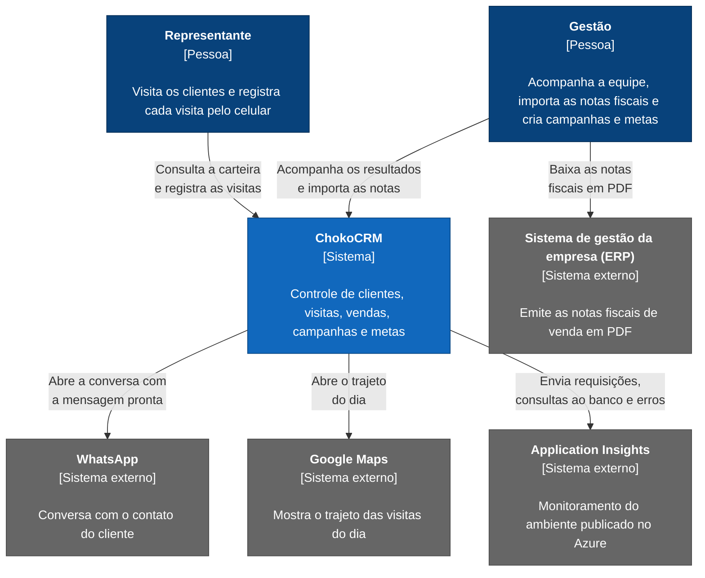
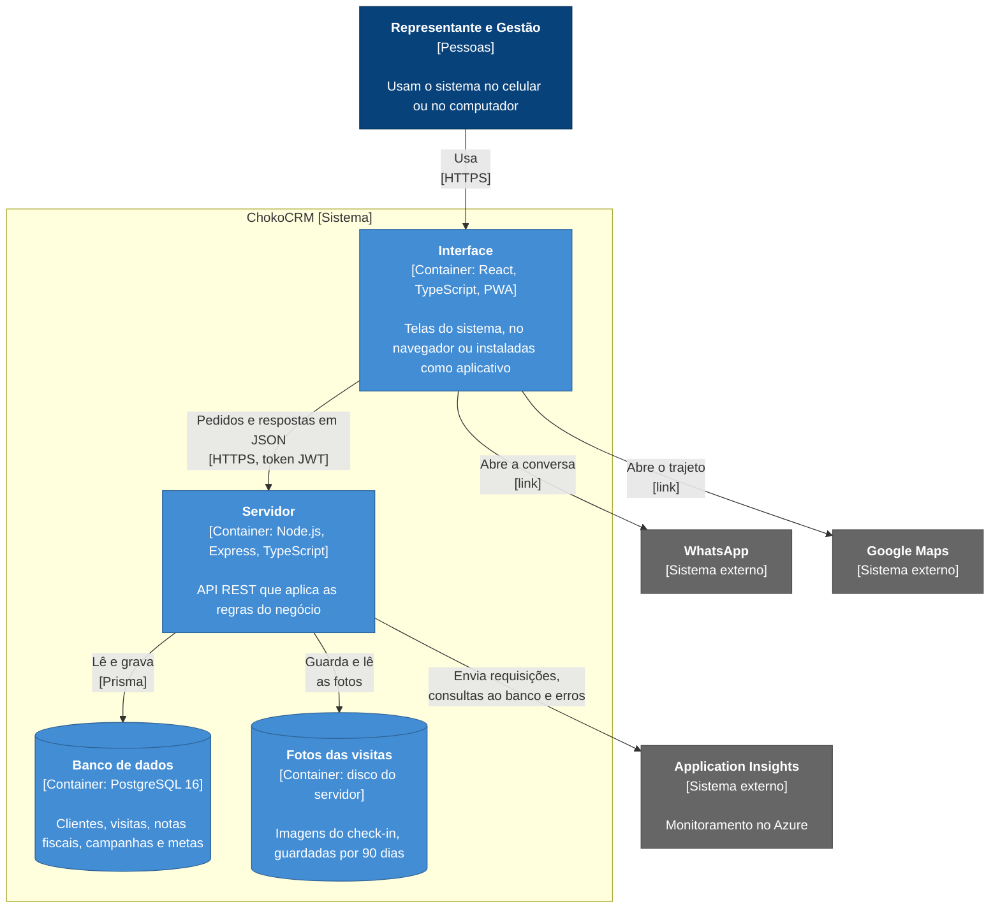
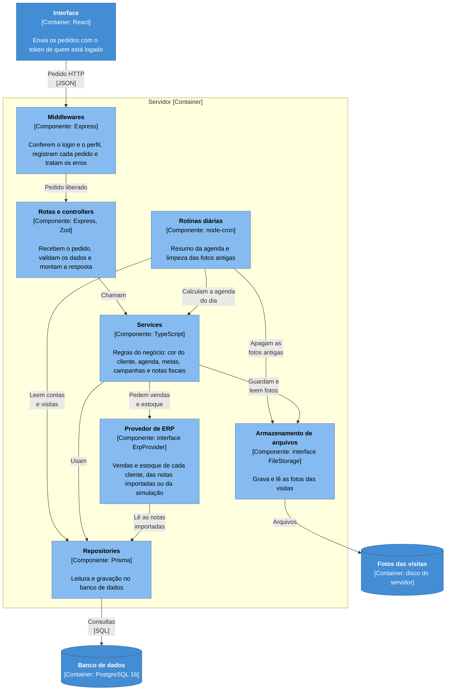

# Arquitetura

Este documento explica como o ChokoCRM é construído: quais são as partes do sistema, como o código está organizado, que decisões técnicas foram tomadas e quais endereços a API oferece.

## Sumário

1. [Visão geral](#1-visão-geral)
2. [Camadas do servidor](#2-camadas-do-servidor)
3. [Organização da interface](#3-organização-da-interface)
4. [Estrutura de pastas](#4-estrutura-de-pastas)
5. [Decisões técnicas](#5-decisões-técnicas)
6. [API](#6-api)
7. [Publicação e monitoramento](#7-publicação-e-monitoramento)

## 1. Visão geral

O sistema tem três partes. A interface é executada no navegador do representante ou do gestor. O servidor recebe os pedidos da interface, aplica as regras do negócio e responde. O banco de dados guarda clientes, visitas, notas fiscais e o restante das informações.

Os desenhos deste documento seguem o modelo C4, que mostra a arquitetura em níveis, como um mapa em que a imagem é aproximada aos poucos. O nível 1 mostra o sistema inteiro e quem se relaciona com ele. O nível 2 abre o sistema nas partes que o formam. O nível 3 abre uma dessas partes por dentro. Os níveis 1 e 2 estão nesta seção, e o nível 3 está na [seção 2](#2-camadas-do-servidor).

Em todos os desenhos, cada caixa traz o nome, o tipo entre colchetes e uma descrição curta. As cores seguem o padrão do C4: azul-escuro para pessoas, azul para o que faz parte do ChokoCRM e cinza para os sistemas externos.

### Nível 1: contexto

O primeiro nível responde quem usa o ChokoCRM e com quais sistemas ele se relaciona.



Quatro sistemas externos aparecem no desenho. O sistema de gestão da empresa (ERP) emite as notas fiscais, que a gestão baixa em PDF e importa para alimentar o histórico de compras dos clientes. O WhatsApp é usado pela própria pessoa: o ChokoCRM monta o texto e abre a conversa com o contato escolhido, e quem envia a mensagem é ela. O Google Maps recebe, por um link, os endereços dos clientes das visitas do dia e mostra o trajeto. O Application Insights, do Azure, recebe as requisições, as consultas ao banco e os erros do servidor no ambiente publicado.

### Nível 2: containers

O segundo nível abre o ChokoCRM. No C4, container é cada parte que é executada ou guarda dados de forma independente, como a interface, o servidor e o banco. Não é o mesmo que um container do Docker.



A interface conversa apenas com o servidor, por uma API REST que troca dados em JSON. Cada pedido leva o token de quem está logado. O servidor é o único que acessa o banco de dados e o único que conhece as regras: a interface mostra o que ele calcula.

As notas fiscais não aparecem como ligação entre sistemas porque não há conexão direta com o sistema de gestão da empresa. O arquivo PDF é escolhido pela gestão na interface e enviado ao servidor como qualquer outro pedido.

No computador de desenvolvimento, as três partes sobem juntas com o Docker Compose. No ambiente publicado, o servidor e a interface ficam no mesmo endereço, em um App Service do Azure, o banco fica em um PostgreSQL gerenciado e o Application Insights recebe as requisições, as consultas ao banco e os erros do servidor.

## 2. Camadas do servidor

O servidor é dividido em camadas. Cada camada tem uma responsabilidade e, em regra, só se comunica com a camada imediatamente abaixo dela. As poucas exceções estão descritas depois da tabela.

### Nível 3: componentes do servidor

O terceiro nível do C4 abre o servidor e mostra os componentes dele, que são os grupos de código com uma mesma responsabilidade. O pedido entra por cima e desce camada por camada.



A tabela descreve cada camada e a pasta em que ela fica:

| Camada | Pasta | O que faz | O que não faz |
|--------|-------|-----------|---------------|
| Apresentação | `routes`, `controllers`, `schemas` | Liga cada endereço da API a uma função, valida os dados recebidos e devolve a resposta com o código HTTP certo | Não contém regra de negócio nem acessa o banco, com exceção do `/health`, que confere a conexão |
| Negócio | `services` | Calcula a cor do cliente, a agenda, as sugestões, os indicadores, o resultado das campanhas e das metas, e aplica a regra de carteira | Não conhece o Express. As consultas ficam nos repositories; o service só abre a transação quando várias gravações precisam entrar juntas, e há uma única leitura direta, na criação do cliente pela nota |
| Acesso a dados | `repositories`, `prisma` | Lê e grava as tabelas por meio do Prisma | Não decide nada: grava o que a camada de negócio determinou |
| Integrações | `providers/erp`, `storage` | Entrega as vendas e o estoque de um cliente e guarda as fotos, sempre por trás de uma interface | Não é chamada por controllers. Quem chama é a camada de negócio e, no caso das fotos, também a rotina diária de limpeza |

Ao redor das camadas ficam as peças de apoio: os `middlewares` (login, permissão por perfil, tratamento de erros e registro de cada pedido), os `jobs` (rotinas diárias), a pasta `config` (variáveis de ambiente e os limites usados nas regras), a pasta `lib` (conexão com o banco, registro de logs e o relógio do sistema) e a pasta `seed`, com o gerador dos dados de demonstração, que grava direto no banco e é usado pelo carregamento inicial e pelo modo demonstração.

A regra das camadas tem exceções pequenas e conhecidas. O endereço `/health` consulta o banco no próprio controller, porque a função dele é conferir a conexão. O middleware que confirma se o gestor continua ativo lê a conta no repositório de usuários. A rotina da agenda lê a lista de representantes no repositório de usuários, e a rotina de limpeza das fotos usa o repositório de visitas e o armazenamento de arquivos sem passar por um service. A importação de notas e a criação do cliente pela nota abrem a transação do banco no próprio service, para que todas as gravações entrem juntas ou nenhuma entre. O relógio do sistema, na pasta `lib`, lê a data do modo demonstração por um repositório, e o provedor das notas importadas reaproveita funções da camada de negócio para tratar as datas e encontrar a visita candidata.

Dentro da camada de negócio, as regras que só fazem contas ficam em arquivos separados dos que buscam dados. Os arquivos terminados em `.regras.ts` não acessam banco nem ERP: recebem dados e devolvem o resultado. Isso permite testar cada regra sem iniciar o servidor nem o banco de dados.

Duas rotinas são executadas todos os dias. A primeira percorre a carteira de cada representante e registra em log as visitas atrasadas e as previstas para o dia. A segunda apaga do disco as fotos de visitas com mais de 90 dias.

## 3. Organização da interface

A interface é uma aplicação React de página única. Ela é dividida assim:

| Pasta | Conteúdo |
|-------|----------|
| `pages` | Uma tela por arquivo: login, clientes, ficha do cliente, check-in, agenda, painel, campanhas, importação de notas, usuários, cadastro de usuário e troca de senha |
| `components` | Peças reaproveitadas pelas telas. Em `ui` ficam os componentes básicos (botão, campo, menu), em `crm` as peças próprias do sistema (moldura, calendário, metas, roteiro, painel lateral, campo de arquivo), em `crm/graficos` os gráficos do painel e o mapa da página de clientes, em `crm/sazonalidade` os blocos das datas comemorativas e do estoque baixo e em `crm/checkin` as peças dos passos do check-in |
| `hooks` | Busca e atualização dos dados do servidor, com cache, usando TanStack Query |
| `services` | As chamadas à API, com o envio do token de login |
| `auth` | Controle de quem está logado e proteção das telas |
| `representante` | O representante escolhido pela gestão no seletor que filtra clientes, agenda e painel |
| `pwa` | Convite para instalar, aviso de falta de internet e aviso de versão nova |
| `lib` | Funções de apoio: formatação de datas e valores, cálculo do roteiro, mapa, calendário, geração de planilha, estado dos blocos recolhíveis e abertura do painel lateral |
| `config` | Cópia dos três limites citados nos textos da interface: os dias de cada cor, o período de vendas das datas comemorativas e o prazo para ligar nota e visita |

A interface não repete os cálculos do negócio. A cor de um cliente, a ordem da agenda e os números do painel chegam prontos do servidor. Ela guarda apenas, em `config`, uma cópia dos limites citados nos textos explicativos.

O layout se adapta ao tamanho da tela. No celular, a navegação fica em uma barra inferior. A partir de 768 pixels de largura, ela passa para um menu lateral. A partir de 1024 pixels, a lista de clientes e a ficha aparecem lado a lado.

Os gráficos do painel são desenhados no próprio projeto, sem biblioteca de gráficos. O gráfico de vendas por mês e o mapa da página de clientes usam SVG. Os gráficos de barras (distribuição por cor, resultado por representante e ritmo de visitas) usam HTML e CSS. Esses quatro gráficos do painel têm uma tabela equivalente para leitores de tela, e o ranking é uma lista numerada em que os números já aparecem como texto.

Três peças são compartilhadas por várias telas:

| Peça | Arquivo | O que faz |
|------|---------|-----------|
| Painel lateral | `components/crm/PainelLateral.tsx` | Abre, ao lado, os clientes ou as visitas por trás de uma barra, fatia, linha ou indicador. É o mesmo diálogo das outras telas (`Dialogo`) na variante `lateral`: prende o foco, fecha com Esc ou com um clique fora e devolve o foco a quem o abriu. No celular ocupa a tela inteira |
| Bloco recolhível | `Cartao` com a opção `recolhivel`, em `components/crm/ui.tsx` | Põe no título do cartão um botão que recolhe e expande o conteúdo. O estado fica no `localStorage` do navegador, por identificador de bloco (`lib/blocoRecolhivel.ts`). Sem armazenamento disponível, o bloco fica no estado inicial dele: aberto, com exceção do mapa da página de Clientes, que começa recolhido |
| Campo de arquivo | `components/crm/CampoDeArquivo.tsx` | Mostra um botão e um texto próprios ("Anexar arquivos", "Nenhum arquivo selecionado") no lugar do texto nativo do navegador, que sai no idioma dele. O campo nativo continua na página, invisível sobre o botão, e é ele que o teclado e o leitor de tela alcançam |

As abas da agenda, do painel, da ficha e da tela de Campanhas guardam a aba aberta no endereço da página (`?aba=`).

## 4. Estrutura de pastas

```
CHOKOCRM/
├── backend/
│   ├── prisma/
│   │   ├── schema.prisma       tabelas do banco de dados
│   │   ├── migrations/         alterações do banco, em ordem
│   │   └── seed.ts             entrada do carregamento dos dados de demonstração
│   ├── src/
│   │   ├── routes/             endereços da API
│   │   ├── controllers/        entrada e saída de cada endereço
│   │   ├── schemas/            validação dos dados recebidos
│   │   ├── services/           regras do negócio
│   │   │   └── importacao-nf/  leitura das notas fiscais em PDF e ligação com as visitas
│   │   ├── repositories/       acesso ao banco de dados
│   │   ├── providers/erp/      fontes de vendas e estoque
│   │   ├── storage/            gravação das fotos
│   │   ├── middlewares/        login, permissões, erros e registro dos pedidos
│   │   ├── jobs/               rotinas diárias
│   │   ├── seed/               gerador dos dados de demonstração
│   │   ├── config/             variáveis de ambiente e limites das regras
│   │   ├── errors/             erros da aplicação e seus códigos
│   │   ├── lib/                banco, logs e relógio do sistema
│   │   ├── types/              tipos compartilhados
│   │   ├── app.ts              montagem do servidor
│   │   ├── server.ts           inicialização
│   │   └── telemetria.ts       monitoramento no Azure
│   └── tests/                  testes do servidor
├── frontend/
│   ├── public/                 logo e ícones do aplicativo
│   ├── scripts/                geração dos ícones e dos dados do mapa
│   └── src/                    telas, componentes e seus testes
├── docs/                       documentação
├── scripts/                    roteiro de criação do ambiente no Azure
├── .github/workflows/          verificação e publicação automáticas
├── docker-compose.yml          ambiente local
└── sonar-project.properties    configuração da análise de código
```

## 5. Decisões técnicas

A tabela resume o que foi escolhido em cada assunto e o motivo. As cinco primeiras linhas tratam das tecnologias, que também estão entre as indicadas pelo curso.

| Assunto | O que escolhemos | Por quê |
|---------|------------------|---------|
| Interface | React com TypeScript, montada com Vite e estilizada com Tailwind CSS | As telas são feitas de peças reaproveitadas, o TypeScript acusa erros de tipo antes de o código ser executado e o resultado pode ser instalado como aplicativo |
| Servidor | Node.js com Express e TypeScript | É a mesma linguagem da interface, o que facilita manter os dois lados. O Express é pequeno e deixa a organização em camadas por conta do projeto |
| Comunicação | API REST com dados em JSON | Interface e servidor ficam independentes. Outra interface ou outro sistema pode usar os mesmos endereços no futuro |
| Banco de dados | PostgreSQL | Os dados são muito ligados entre si (cliente, contato, visita, nota fiscal). Um banco relacional garante essas ligações com chaves e restrições |
| Organização do servidor | Arquitetura em camadas | Cada regra fica em um único lugar, as regras são testadas sem banco de dados e a fonte dos dados de compra pode ser trocada sem alterar as telas |
| Repositório | Um só, público, com servidor, interface e documentação | Uma mudança que envolve os dois lados entra de uma vez, e quem avalia encontra tudo em um lugar |
| Acesso ao banco | Prisma, com o arquivo `schema.prisma` como única descrição das tabelas | As alterações do banco ficam versionadas e os tipos do código saem do mesmo arquivo |
| Clientes | Só a gestão cria cliente, a partir de uma nota fiscal importada. Só a gestão inativa | O cadastro oficial é o do sistema de gestão da empresa. Assim não há cliente duplicado nem inventado |
| Carteira | Cada cliente pertence a um representante, que só vê e altera a própria carteira | Reflete como a equipe trabalha. A regra é conferida no servidor, em um único módulo (`services/carteira.ts`) |
| Compras dos clientes | Notas fiscais em PDF importadas pela gestão. Quem não tem nota usa dados simulados | A empresa não liberou acesso direto ao sistema de gestão durante o projeto |
| Valor das vendas | O representante marca só o resultado da visita. O valor chega pela nota fiscal vinculada | A nota é o registro oficial da venda. Evita digitar o pedido duas vezes |
| Cálculos | Cor do cliente, agenda, indicadores, metas e campanhas são calculados na hora da consulta, nunca gravados | Não existe dado desatualizado: uma visita nova muda a cor do cliente no mesmo instante |
| Pendências das notas | A visita candidata de cada nota é calculada na consulta (`services/importacao-nf/visita-candidata.ts`). Na nota ficam gravadas a situação dela, as ligações (a automática do mesmo dia e a feita pela gestão) e a recusa. Enquanto a gestão não decide, a situação gravada é provisória, e a consulta recalcula se existe visita candidata | A lista de pendências acompanha as visitas e nunca aponta para uma visita que deixou de existir |
| Nota no modo demonstração | O dia de emissão é gravado deslocado pelo mesmo número de dias do relógio | A nota importada durante a simulação fica na mesma linha do tempo das visitas e entra no volume de compras dos últimos 90 dias |
| Login | Usuário e senha, com dois perfis (representante e gestor). O acesso vale por oito horas | Simples para quem usa em campo. O e-mail não teria utilidade no sistema |
| Senha esquecida | O gestor define uma senha provisória e a pessoa troca depois, no próprio perfil | Dispensa um serviço de envio de e-mails |
| WhatsApp | O sistema monta o texto e abre a conversa com o contato escolhido. Nada é registrado | Não usa a API paga do WhatsApp. Quem envia é o representante, que pode alterar o texto antes |
| Fotos das visitas | Gravadas no disco do servidor e apagadas depois de 90 dias | Comprovam a visita sem acumular arquivos. Só usuários com acesso ao cliente veem a foto |
| Lembretes | Cada lembrete é uma tarefa com data, aberta até ser concluída | Um lembrete não pode desaparecer apenas porque houve uma visita nova |
| Aplicativo | Instalável no celular (PWA), sem gravação offline | Evita publicar em loja de aplicativos. Gravar offline exigiria resolver conflitos de sincronização |
| Visual | Protótipo aprovado pela empresa, com Tailwind CSS e componentes shadcn | O visual já estava validado com o gestor da empresa |
| Painel | A mesma tela para os dois perfis, com os dados limitados pelo servidor | O representante acompanha a própria carteira com os mesmos indicadores da gestão |
| Mapa e roteiro | Coordenadas dos 295 municípios de Santa Catarina guardadas no código. O trajeto abre no Google Maps por link | Não depende de chave de API nem tem custo por uso |
| Data do sistema | Um módulo de mesmo nome em cada lado (`lib/relogio.ts`, no servidor e na interface) responde que dia é hoje | Permite o modo demonstração, que simula outra data. Um teste impede o uso direto do relógio do computador |
| Ambientes | Docker Compose no computador de desenvolvimento e Azure na publicação | Qualquer pessoa executa o sistema com poucos comandos. No Azure, servidor e interface ficam no mesmo endereço |
| Qualidade | SonarCloud a cada envio de código e Application Insights no ambiente publicado | Defeitos e trechos sem teste aparecem antes da publicação, e falhas em uso geram aviso |

### De onde vêm os dados de compra

Hoje o sistema trabalha com dados de demonstração, e as compras de cada cliente vêm de uma de duas fontes:

| Fonte | Quando vale | O que traz |
|-------|-------------|------------|
| Notas fiscais importadas | Para o cliente que tem nota importada no CNPJ dele | As vendas reais, com produtos e valores. Não traz estoque |
| Simulação | Para o cliente sem nota importada | Vendas e estoque gerados por um algoritmo, sempre os mesmos para o mesmo cliente, com variação conforme a época do ano |

O sistema usa uma fonte por cliente e nunca soma as duas. A escolha é automática.

No código, as duas fontes ficam atrás de uma mesma interface, `ErpProvider`. As regras do sistema pedem "as vendas deste cliente" a essa interface, sem saber de onde elas vêm. A variável `ERP_PROVIDER` permite forçar uma fonte só, o que é usado nos testes.

### Melhoria futura: integração com o sistema de gestão

A evolução planejada para depois deste projeto é ligar o ChokoCRM diretamente ao sistema de gestão da empresa. Com a integração:

- os clientes cadastrados pela gestão no sistema de gestão chegam ao ChokoCRM automaticamente, sem importação de notas;
- as vendas e o estoque passam a ser sempre os reais;
- o modo demonstração e os dados fictícios deixam de existir. O sistema começa zerado, e cada representante inicia o próprio controle com clientes reais.

No código, as vendas e o estoque do sistema de gestão entram como mais uma fonte atrás da interface `ErpProvider`: uma classe nova em `providers/erp`, mais uma opção na variável `ERP_PROVIDER` e a escolha do identificador do cliente em `services/erp.service.ts`. As telas e as regras de cálculo não mudam. A chegada automática dos clientes é uma parte nova, porque a interface de hoje entrega apenas vendas e estoque.

## 6. API

Todos os endereços respondem em JSON. Os que exigem login esperam o token no cabeçalho `Authorization: Bearer <token>`. Sem token válido, a resposta é 401. Com token de um perfil sem permissão, é 403. O representante que tenta ler um cliente de outra carteira recebe 404, como se o cliente não existisse. A exceção é a proposta de mensagem de estoque, que responde 403 nesse caso.

Na coluna "Quem", R significa representante e G significa gestor.

### Login e conta

| Método | Endereço | Quem | O que faz |
|--------|----------|------|-----------|
| POST | `/auth/login` | público | Confere usuário e senha e devolve o token |
| GET | `/auth/me` | R e G | Devolve os dados de quem está logado |
| PUT | `/auth/password` | R e G | Troca a própria senha, pedindo a atual |

### Clientes e contatos

| Método | Endereço | Quem | O que faz |
|--------|----------|------|-----------|
| GET | `/clients` | R e G | Lista os clientes, com busca e filtros por cor e representante |
| GET | `/clients/:id` | R e G | Ficha do cliente |
| PUT | `/clients/:id` | R e G | Edita os dados e a data da próxima visita. Só o gestor transfere de carteira, inativa e reativa |
| PUT | `/clients/:id/recurrence` | R | Altera o intervalo entre visitas, com justificativa |
| POST | `/clients/:id/contacts` | R e G | Adiciona um contato ao cliente |
| PUT | `/contacts/:id` | R e G | Edita um contato |
| DELETE | `/contacts/:id` | R e G | Remove um contato |

### Visitas, agenda e lembretes

| Método | Endereço | Quem | O que faz |
|--------|----------|------|-----------|
| POST | `/clients/:id/visits` | R | Registra a visita, com resultado, próxima visita e lembrete |
| GET | `/clients/:id/visits` | R e G | Histórico de visitas do cliente |
| PATCH | `/visits/:id` | R | Corrige a descrição ou o resultado de uma visita própria |
| PUT | `/visits/:id/foto` | R | Envia a foto da visita |
| GET | `/visits/:id/foto` | R e G | Devolve a foto da visita |
| GET | `/agenda/today` | R e G | Visitas atrasadas, de hoje e dos próximos sete dias, e lembretes |
| GET | `/agenda/calendario` | R e G | Calendário do mês |
| GET | `/clients/:id/lembretes` | R e G | Lembretes abertos do cliente |
| PATCH | `/lembretes/:id/concluir` | R e G | Marca um lembrete como concluído |

### Vendas, estoque e notas fiscais

| Método | Endereço | Quem | O que faz |
|--------|----------|------|-----------|
| GET | `/clients/:id/erp` | R e G | Última venda, volume de compras dos últimos 90 dias com o início e o fim do período somado (`volume90Dias.inicio` e `volume90Dias.fim`), estoque e vendas recentes do cliente |
| GET | `/erp/produtos` | R e G | Catálogo de produtos com preço |
| POST | `/erp/importacoes/leitura` | G | Lê um PDF de notas e devolve o conteúdo para conferência, sem gravar. Cada nota traz `dataEmissao`, o dia com que ela entra no sistema, e `dataEmissaoDanfe`, o dia impresso na nota. Os dois só diferem com o modo demonstração ativo |
| POST | `/erp/importacoes` | G | Importa um PDF de notas |
| GET | `/erp/importacoes` | G | Lista as importações recentes, com a situação de cada nota calculada na consulta |
| GET | `/erp/pendencias` | G | Notas sem decisão da gestão que têm uma visita candidata, cada uma com o dia da visita, o resultado dela e quantos dias antes da nota ela aconteceu |
| POST | `/erp/vendas/:id/vinculo` | G | Liga a nota a uma visita |
| DELETE | `/erp/vendas/:id/vinculo` | G | Desfaz a ligação ou recusa a visita candidata. A nota fica como recusada e conta só como compra |
| GET | `/erp/sem-cliente` | G | Notas de empresas que ainda não são clientes |
| POST | `/erp/sem-cliente/:cnpj/cliente` | G | Cria o cliente a partir dos dados da nota. É a única forma de criar cliente |

### Mensagens e sugestões

| Método | Endereço | Quem | O que faz |
|--------|----------|------|-----------|
| GET | `/clients/:id/stock-message/proposta` | R | Texto sugerido para a mensagem de estoque e contatos do cliente |
| GET | `/clients/:id/insights` | R e G | Sugestões do que oferecer ao cliente na época. A ação é `AUMENTAR_OFERTA`, `OFERTAR_DESCONTO` ou `MANTER_OFERTA`, e cada sugestão traz as campanhas do período de vendas da data (`campanhas`) |
| GET | `/insights/manager-alerts` | R e G | Clientes com estoque baixo dos produtos indicados para as datas comemorativas próximas. A interface lê o estoque baixo de `/insights/sazonalidade` |

Em `/clients/:id/insights`, a lista `campanhas` vem em cada sugestão e em cada data sem histórico (`eventosSemHistorico`). Ela pode vir vazia. Cada item tem `id`, `nome`, `tipo` (`CAMPANHA`, `PROMOCAO` ou `EVENTO`), `inicio`, `fim`, `desconto` (em porcentagem, ou nulo) e `situacao` (`EM_ANDAMENTO` ou `PROGRAMADA`). Campanha encerrada não entra.

### Painel

| Método | Endereço | Quem | O que faz |
|--------|----------|------|-----------|
| GET | `/dashboard/kpis` | R e G | Indicadores do período |
| GET | `/dashboard/kpis/por-representante` | R e G | Resultado, receita e ritmo de visitas por representante |
| GET | `/dashboard/kpis/visitas` | R e G | Visitas do período, uma a uma, e clientes ativos sem visita. Alimenta o painel lateral |
| GET | `/dashboard/vendas-mensais` | R e G | Vendas mês a mês, com as datas comemorativas. Pode estender a série até o mês da próxima data comemorativa |
| GET | `/insights/sazonalidade` | R e G | Datas comemorativas do horizonte, com as vendas da carteira no período de cada uma, as campanhas e o estoque baixo por produto |
| GET | `/dashboard/relatorio` | R e G | Dados da planilha, uma linha por cliente |

Todos esses endereços exigem login e valem para os dois perfis. O representante recebe sempre a própria carteira, e o `representanteId` que ele envia é ignorado. O gestor recebe a empresa inteira ou, com `representanteId`, a carteira daquele representante. Parâmetro inválido responde 400 com o código `VALIDATION_ERROR`.

Os endereços em `/dashboard` recebem o período de um de dois modos, nunca os dois juntos: `periodoDias` (30, 90 ou 365) ou `inicio` e `fim` (datas no formato AAAA-MM-DD). A opção "Este mês" do painel vai como `inicio` e `fim`, do dia 1º do mês até hoje. Sem nenhum dos dois, valem os últimos 30 dias. A data de fim não pode ser posterior a hoje, e o período máximo é de 365 dias, exceto em `/dashboard/relatorio`, que não tem limite.

#### `GET /dashboard/kpis/visitas`

| Parâmetro | Valores | Para quê |
|-----------|---------|----------|
| `periodoDias` ou `inicio` e `fim` | Os mesmos de `/dashboard/kpis` | Período das visitas |
| `representanteId` | UUID, opcional | Carteira de um representante |

A resposta tem:

| Campo | Conteúdo |
|-------|----------|
| `periodo` | `dias`, `inicio` e `fim`, o mesmo período dos indicadores |
| `granularidade` | `SEMANA` em períodos de até 91 dias, `MES` nos maiores. É a mesma do ritmo de visitas |
| `visitas` | Todas as visitas do período, da mais recente para a mais antiga. Cada uma tem `visitaId`, `clienteId`, `nomeFantasia`, `cidade`, `clienteAtivo`, `representanteId` e `representanteNome` (o dono da carteira do cliente), `dataHora`, `faixaInicio` (a segunda-feira da semana ou o dia 1 do mês, igual ao início de uma faixa do ritmo), `resultado` e `valor` (total dos produtos nas visitas com venda, zero nas outras) |
| `naoVisitados` | Clientes ativos da carteira sem visita no período, do que está há mais tempo sem visita ao que está há menos. Cada um tem `id`, `nomeFantasia`, `cidade`, `representanteId`, `representanteNome`, `ultimaVisita` e `diasSemVisita`, os dois últimos nulos para quem nunca foi visitado |
| `simulado` | Verdadeiro somente quando o servidor está configurado para usar apenas a simulação (`ERP_PROVIDER=mock`). Na configuração padrão, que escolhe a fonte por cliente, vem falso |

Os números coincidem com os dos indicadores para os mesmos parâmetros: a quantidade de `visitas` é o número de visitas, as que têm resultado `VENDA` são as da conversão, e os clientes ativos distintos são os clientes visitados.

#### `GET /dashboard/vendas-mensais`

| Parâmetro | Valores | Para quê |
|-----------|---------|----------|
| `periodoDias` ou `inicio` e `fim` | Os mesmos de `/dashboard/kpis` | Período, que define os meses da série |
| `representanteId` | UUID, opcional | Carteira de um representante |
| `ateProximaData` | `true` ou `false`, opcional. Ausente, vale `false` | Estende a série até o mês da próxima data comemorativa |
| `horizonteDias` | Inteiro de 30 a 180. O padrão é 90 | Até quantos dias à frente procurar a próxima data. Só tem efeito com `ateProximaData=true` |

A série só é estendida quando o último mês do período é o mês atual. Com um período que termina antes, a opção é ignorada.

A resposta tem `periodo`, `meses`, `eventos` (as datas comemorativas que caem na série), `simulado`, `clientesConsultados`, `clientesIndisponiveis` e `proximaData`. Cada item de `meses` tem `mes` (AAAA-MM), `total`, `clientesComDados`, `clientes` e `futuro`. Os meses depois do mês atual vêm com `futuro` verdadeiro, `total` e `clientesComDados` nulos e `clientes` vazio. `proximaData` traz `id`, `nome`, `chave` e `data` da data até cujo mês a série vai, ou nulo sem a opção, com o período terminando antes do mês atual ou sem data comemorativa no horizonte. Quando a próxima data cai no mês atual, ela vem preenchida e a série não ganha mês.

#### `GET /insights/sazonalidade`

| Parâmetro | Valores | Para quê |
|-----------|---------|----------|
| `horizonteDias` | Inteiro de 30 a 180. O padrão é 90 | Até quantos dias à frente uma data comemorativa entra na resposta |
| `representanteId` | UUID, opcional | Carteira de um representante |

A resposta tem, para a carteira toda:

| Campo | Conteúdo |
|-------|----------|
| `hoje` | O dia de hoje do sistema, que segue a data simulada |
| `horizonteDias` | O horizonte aplicado |
| `simulado` | Verdadeiro somente quando o servidor está configurado para usar apenas a simulação (`ERP_PROVIDER=mock`). Na configuração padrão, que escolhe a fonte por cliente, vem falso |
| `limiteEstoqueBaixo` | Quantidade abaixo da qual o estoque de um produto é baixo. Vale 10 |
| `clientesDaCarteira` | Clientes ativos da carteira |
| `clientesConsultados` | Dos ativos, os que foram consultados na fonte de vendas |
| `clientesComEstoque` | Dos consultados, os que têm estoque estimado |
| `estoqueIndisponivel` | Verdadeiro quando a fonte em uso não tem estoque estimado de nenhum cliente |
| `clientesIndisponiveis` | `vendas` e `estoque`: quantos clientes ficaram sem resposta em cada consulta e, por isso, fora das somas |
| `datas` | Uma entrada por data comemorativa do horizonte, da mais próxima à mais distante |

Cada entrada de `datas` tem:

| Campo | Conteúdo |
|-------|----------|
| `id`, `nome`, `chave`, `data` | A data comemorativa e o dia dela |
| `diasAte` | Dias de hoje até a data |
| `janela` | `inicio` e `fim` do período de vendas deste ano: dos 30 dias antes da data até o dia dela |
| `janelaAnoAnterior` | O mesmo período no ano anterior, calculado pela data real daquele ano |
| `vendasAnoAnterior` | Total vendido pela carteira no período do ano anterior |
| `vendasNaJanelaAtual` | Total vendido no período deste ano até hoje. Nulo enquanto o período não começa |
| `campanhas` | Campanhas em andamento ou programadas com algum dia no período, no mesmo formato de `/clients/:id/insights` |
| `clientesComEstoqueBaixo` | Clientes com estoque baixo de pelo menos um produto da data, cada um contado uma vez |
| `estoqueBaixo` | Um item por produto indicado para a data, com `sku`, `nome`, `totalClientes` e `clientes` (`id`, `nomeFantasia`, `cidade` e `quantidade`, da menor quantidade para a maior) |

Sem nenhuma data no horizonte, `datas` vem vazia e a fonte de vendas não é consultada.

### Campanhas e metas

| Método | Endereço | Quem | O que faz |
|--------|----------|------|-----------|
| GET | `/campaigns` | R e G | Campanhas com situação e resultados |
| POST | `/campaigns` | G | Cria uma campanha |
| PUT | `/campaigns/:id` | G | Edita uma campanha e ajusta as metas dela ao novo período |
| POST | `/campaigns/:id/encerrar` | G | Encerra uma campanha em andamento: a data de fim passa a ser o dia anterior |
| DELETE | `/campaigns/:id` | G | Exclui uma campanha e as metas dela |
| GET | `/goals` | R e G | Metas com o realizado: as comuns e as das campanhas em andamento ou, com `campanhaId`, as daquela campanha. O representante vê as próprias |
| POST | `/goals` | G | Cria uma meta |
| PUT | `/goals/:id` | G | Edita uma meta |
| DELETE | `/goals/:id` | G | Exclui uma meta |

### Usuários

| Método | Endereço | Quem | O que faz |
|--------|----------|------|-----------|
| GET | `/users` | G | Lista as contas |
| POST | `/users` | G | Cria uma conta |
| PATCH | `/users/:id` | G | Edita nome, usuário, telefone e perfil, ativa ou inativa a conta |
| POST | `/users/:id/transferir-carteira` | G | Passa todos os clientes de um representante para outro |
| PUT | `/users/:id/senha` | G | Define uma senha provisória |

### Sistema

| Método | Endereço | Quem | O que faz |
|--------|----------|------|-----------|
| GET | `/health` | público | Confere se o servidor e o banco estão respondendo |
| GET | `/sistema/relogio` | público | Informa se o modo demonstração está ativo e em que data |
| POST | `/sistema/demonstracao` | público, com usuário e senha de gestor no pedido | Define a data de demonstração e recria os dados |

## 7. Publicação e monitoramento

A cada envio de código para a branch `main`, o GitHub Actions executa a análise de estilo, os testes e a compilação do servidor e da interface, e envia o resultado ao SonarCloud. Se não houver falhas, a nova versão é publicada no Azure e conferida automaticamente. As alterações do banco são aplicadas na inicialização do servidor.

O servidor registra cada pedido em log estruturado, com um identificador por pedido e sem expor o token. O endereço `/health` é usado pela conferência da publicação e pelo teste de disponibilidade do Application Insights, que avisa por e-mail quando o servidor para de responder. Esse teste fica pausado quando não é necessário, por ser o item de maior custo do ambiente.

Os detalhes de operação estão em [Instalação e configuração](instalacao-e-configuracao.md#9-ambiente-publicado-no-azure), e a descrição dos testes em [Testes](testes.md).
