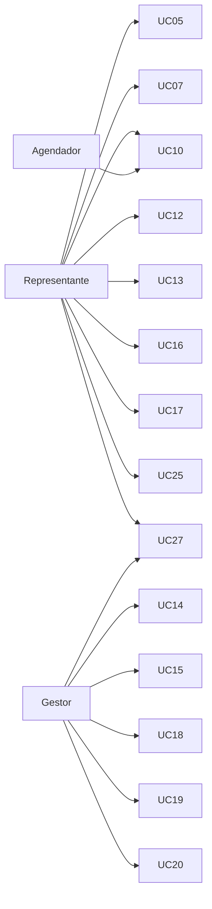

# ChokoCRM — Casos de Uso

Este documento descreve os casos de uso do ChokoCRM. Complementa a [especificação técnica](especificacao-tecnica.md), que prevalece em caso de divergência.

---

## 1. Introdução e escopo

Este documento especifica os casos de uso do ChokoCRM, cobrindo os fluxos de cadastro e gestão de clientes, registro de visitas, classificação por cores, cruzamento com dados de ERP, geração de mensagens de consulta de estoque, insights de sazonalidade e indicadores gerenciais, conforme descrito nos objetivos do produto e nas regras de negócio da especificação técnica (seções 2 e 6).

Os identificadores **UC01 a UC15** definidos aqui são referenciados pelo protótipo navegável (`docs/prototipo/`) e pela matriz de rastreabilidade das etapas 2 a 7 do cronograma da disciplina. Os **UC16 a UC26** nasceram na Etapa 8, com a revisão pelo protótipo do Lovable aprovado pela parceira: pedido, próxima visita, campanhas, metas, usuários e senhas, calendário, roteiro e exportação. O **UC27** nasceu na Etapa 9, com os ajustes que a parceira trouxe depois de validar o app ([spec da etapa](superpowers/specs/2026-10-25-etapa-9-ajustes-pos-validacao-design.md)): o lembrete passou a ser uma tarefa que o representante conclui.

## 2. Atores

| Ator | Tipo | Descrição |
|---|---|---|
| **Representante Comercial** | Principal, humano | Usuário de campo. Cadastra e mantém os clientes da própria carteira, realiza check-ins de visita (com pedido e próxima visita, desde a Etapa 8), consulta agenda, calendário, roteiro, histórico, dados de ERP, insights, campanhas, as próprias metas e, desde a Etapa 8, o próprio painel; desde a Etapa 9, conclui os lembretes dos próprios clientes — sempre restrito aos clientes da própria carteira (desde a Etapa 7). |
| **Gestor** | Principal, humano | Acompanha KPIs de vendas e visitas e recebe alertas de produção. Consulta, em modo somente leitura e para todas as carteiras — ou para a de um representante, escolhido no seletor de representante —, a lista de clientes, a ficha, o histórico e a agenda do dia, além da recorrência de visitas e seu histórico de alterações; pode transferir um cliente entre representantes. Desde a Etapa 8, gerencia os usuários, as campanhas e as metas; desde a Etapa 9, também conclui lembretes (UC27). |
| **Sistema (Agendador)** | Secundário, automatizado | Processo executado diariamente (job agendado, sem intervenção humana) que recalcula a lista de visitas previstas e atrasadas por representante e registra os alertas em log, sem persistir nada. |

**Observação sobre permissões do Gestor:** o Gestor **não** possui todas as permissões do Representante Comercial. Ele autentica-se no sistema (UC01); consulta, em modo somente leitura e para todas as carteiras, a lista de clientes com classificação por cores (UC05), a ficha do cliente (UC06), o histórico de interações (UC08), a agenda do dia (UC10) e as sugestões sazonais da ficha (UC13); visualiza a recorrência de visitas e seu histórico de alterações, sem poder alterá-la; possui o painel de KPIs (UC14) e recebe os alertas de produção (UC15) — desde a Etapa 8 o representante também tem o painel e os alertas, limitados à própria carteira —; pode transferir um cliente entre representantes através de `PUT /clients/:id` (campo `representanteId`); e, desde a Etapa 8, é o único que gerencia usuários (UC20), transfere carteiras inteiras (UC23), dispara a redefinição de senha (UC22) e cria ou altera campanhas (UC18) e metas (UC19). O Gestor **não** cadastra clientes (UC02 responde 400), não registra check-ins de visita (UC07) e não altera a recorrência de visitas (UC09 responde 403).

**Observação sobre a carteira do Representante (Etapa 7):** o Representante Comercial só enxerga e altera os clientes da própria carteira (`Client.representanteId`), regra concentrada em `backend/src/services/carteira.ts` ([ADR-011](arquitetura.md#adr-011--carteira-por-representante-e-agenda-calculada-em-tempo-de-consulta)). Nas leituras — lista (UC05), ficha (UC06), histórico e foto de visita (UC08), dados do ERP (UC11), insights (UC13) e histórico de mensagens de estoque (UC12) —, um cliente de outra carteira responde como inexistente (404, com a mesma mensagem de um registro que não existe — "Cliente não encontrado." ou, na foto, "Visita não encontrada."), para não revelar que existe; a listagem de mensagens de estoque simplesmente não traz as de outra carteira; nas escritas — edição do cliente (UC03), contatos (UC04), check-in, correção de descrição e foto (UC07 e UC08), recorrência (UC09) e mensagem de estoque (UC12) —, a API responde 403 `FORBIDDEN` com a mensagem "Cliente de outra carteira.". O Gestor continua vendo todas as carteiras.

## 3. Diagrama de visão geral

O diagrama acima destaca, de forma simplificada, os fluxos centrais de cada ator no uso cotidiano do sistema. A tabela a seguir complementa a visão geral, associando **todos** os 27 casos de uso ao(s) ator(es) principal(is), para fins de rastreabilidade:

| UC | Nome | Ator(es) |
|---|---|---|
| UC01 | Autenticar no sistema | Representante, Gestor |
| UC02 | Cadastrar cliente | Representante |
| UC03 | Editar e inativar cliente | Representante |
| UC04 | Gerenciar contatos do cliente | Representante |
| UC05 | Visualizar lista de clientes com classificação por cores | Representante; Gestor |
| UC06 | Visualizar ficha do cliente | Representante; Gestor |
| UC07 | Realizar check-in de visita | Representante |
| UC08 | Consultar histórico de interações | Representante; Gestor |
| UC09 | Ajustar recorrência de visitas | Representante |
| UC10 | Visualizar agenda do dia | Representante; Gestor; Sistema (Agendador) |
| UC11 | Consultar dados de venda/estoque do cliente | Representante; Gestor |
| UC12 | Gerar mensagem de consulta de estoque | Representante; Gestor (só consulta o histórico) |
| UC13 | Visualizar insights e sugestões | Representante; Gestor (só consulta) |
| UC14 | Visualizar painel de KPIs (Gestor) | Gestor; Representante (própria carteira, desde a Etapa 8) |
| UC15 | Receber alertas de produção (Gestor) | Gestor; Representante (própria carteira, desde a Etapa 8) |
| UC16 | Registrar pedido no check-in | Representante |
| UC17 | Prever a próxima visita | Representante; Gestor (só consulta); Sistema (Agendador) |
| UC18 | Gerenciar campanhas e eventos | Gestor; Representante (consulta e vínculo no check-in) |
| UC19 | Gerenciar metas de visitas e vendas | Gestor; Representante (só as próprias, consulta) |
| UC20 | Gerenciar usuários | Gestor |
| UC21 | Alterar a própria senha | Representante, Gestor |
| UC22 | Redefinir senha por link | Representante, Gestor (quem esqueceu); Gestor (pede o link) |
| UC23 | Transferir carteira | Gestor |
| UC24 | Ver o calendário da agenda | Representante; Gestor |
| UC25 | Ver o roteiro do dia | Representante; Gestor (com um representante escolhido) |
| UC26 | Exportar o relatório do Painel | Gestor; Representante (própria carteira) |
| UC27 | Concluir lembrete | Representante (própria carteira); Gestor |

## 4. Especificação dos casos de uso

Cada caso de uso é descrito com: identificador e nome, ator principal (e secundário, quando houver), pré-condições, fluxo principal numerado, fluxos alternativos e/ou de exceção (identificados como A*n* e E*n*, referenciando o passo do fluxo principal em que ocorrem) e regras de negócio associadas.

---

### UC01 — Autenticar no sistema

**Ator principal:** Representante Comercial e Gestor.

**Pré-condições:** o ator possui conta previamente cadastrada no sistema (usuário com e-mail, senha e papel definidos).

**Fluxo principal:**
1. O ator acessa a tela de login.
2. O ator informa e-mail e senha.
3. O sistema valida as credenciais informadas.
4. O sistema emite um token JWT contendo o identificador do usuário e o seu papel (Representante ou Gestor).
5. O sistema redireciona o ator para a tela inicial correspondente ao seu papel (desde a Etapa 8: o gestor para o Painel e o representante para a Agenda).

**Fluxo de exceção:**
- **E1** (passo 3): credenciais inválidas — o sistema exibe mensagem de erro ("E-mail ou senha inválidos"), mantém o ator na tela de login e não emite token.
- **E2** (passo 3, Etapa 8): conta inativada pelo gestor (UC20) — a API responde 403 "Conta inativa. Fale com o gestor." e não emite token.

**Regras de negócio associadas:**
- Autenticação por e-mail e senha, com emissão de token JWT no login.
- Toda rota subsequente da API exige token válido; o papel do usuário (Representante ou Gestor) determina o acesso a funcionalidades restritas (ex.: UC14 e UC15).

---

### UC02 — Cadastrar cliente

**Ator principal:** Representante Comercial.

**Pré-condições:** o representante está autenticado (UC01).

**Fluxo principal:**
1. O representante seleciona a opção "novo cliente".
2. O sistema apresenta o formulário de cadastro.
3. O representante informa razão social, nome fantasia, CNPJ, cidade, endereço, telefone, e-mail e, quando já disponível, o identificador do cliente no ERP.
4. O representante informa ao menos um contato do cliente, marcando-o como principal (ver UC04).
5. O sistema atribui a recorrência de visitas padrão de 15 dias, ajustável posteriormente (ver UC09).
6. O representante confirma o cadastro.
7. O sistema valida os dados informados.
8. O sistema persiste o cliente com status ativo e exibe a ficha do cliente recém-criado (UC06).

**Fluxo de exceção:**
- **E1** (passo 7): dados obrigatórios ausentes ou inválidos (ex.: CNPJ mal formatado, nenhum contato marcado como principal) — o sistema bloqueia o salvamento e sinaliza os campos pendentes ou inválidos.

**Regras de negócio associadas:**
- Cadastro exige, no mínimo: razão social, nome fantasia, CNPJ, cidade, endereço, telefone e e-mail.
- O identificador do cliente no ERP é **opcional** no cadastro — seu preenchimento é recomendado assim que disponível, mas a ausência não impede o cadastro do cliente. Sem esse identificador, a consulta de dados de venda/estoque (UC11) fica indisponível para o cliente até que o campo seja preenchido (ver fluxo de exceção de UC11).
- Recorrência de visitas padrão de 15 dias na criação do cliente.
- Cadastro exige ao menos um contato principal (ver UC04).

---

### UC03 — Editar e inativar cliente

**Ator principal:** Representante Comercial.

**Pré-condições:** o cliente já está cadastrado no sistema.

**Fluxo principal (edição):**
1. O representante acessa a ficha do cliente (UC06) e seleciona "editar".
2. O sistema apresenta os dados atuais do cliente em formulário editável.
3. O representante altera os campos desejados.
4. O representante confirma a alteração.
5. O sistema valida e persiste as mudanças.

**Fluxo alternativo:**
- **A1** (a partir do passo 1): inativação do cliente.
  1. O representante seleciona "inativar cliente" na ficha do cliente.
  2. O sistema solicita confirmação da inativação.
  3. O representante confirma.
  4. O sistema marca o cliente com a flag `ativo = false` (inativação lógica).
  5. O cliente deixa de aparecer nas listagens padrão (UC05), mas seu cadastro, contatos e histórico de visitas permanecem preservados e consultáveis.

**Fluxo de exceção:**
- **E1** (passo 5 do fluxo principal): dados inválidos informados na edição — o sistema bloqueia o salvamento e sinaliza os campos pendentes ou inválidos.

**Regras de negócio associadas:**
- A inativação de cliente é sempre lógica, por meio da flag `ativo`; não há, em nenhum fluxo do sistema, exclusão física do registro do cliente.
- Desde a Etapa 7, o representante só edita clientes da própria carteira: `PUT /clients/:id` em cliente de outra carteira responde 403 `FORBIDDEN` ("Cliente de outra carteira."). Os botões "Editar dados" e "Inativar cliente" ficam na aba "Cadastro" da ficha (UC06); até a Etapa 8 ficavam num grupo "Dados cadastrais" recolhido.

---

### UC04 — Gerenciar contatos do cliente

**Ator principal:** Representante Comercial.

**Pré-condições:** o cliente já está cadastrado no sistema.

**Fluxo principal:**
1. O representante acessa a seção de contatos na ficha do cliente (UC06).
2. O representante adiciona um novo contato, informando nome, cargo, telefone e e-mail.
3. O sistema persiste o contato associado ao cliente.
4. O representante marca um dos contatos do cliente como principal.
5. O sistema garante que exatamente um contato permaneça marcado como principal, desmarcando automaticamente qualquer outro contato anteriormente definido como tal.

**Fluxos alternativos:**
- **A1** (a partir do passo 1): edição de um contato existente — o representante altera os dados do contato e o sistema persiste a alteração.
- **A2** (a partir do passo 1): remoção de um contato existente que não seja o principal — o sistema remove o contato normalmente.

**Fluxo de exceção:**
- **E1** (variação do passo 2): tentativa de remover o único contato marcado como principal sem antes designar outro contato como principal — o sistema bloqueia a remoção e solicita a definição de um novo contato principal antes de prosseguir.

**Regras de negócio associadas:**
- O cliente pode ter múltiplos contatos (nome, cargo, telefone, e-mail).
- Exatamente um contato deve estar marcado como principal a qualquer momento.
- Desde a Etapa 7, só se gerenciam contatos de clientes da própria carteira: `POST /clients/:id/contacts`, `PUT /contacts/:id` e `DELETE /contacts/:id` em cliente de outra carteira respondem 403 `FORBIDDEN` ("Cliente de outra carteira."). A seção de contatos fica na aba "Cadastro" da ficha (UC06), junto dos dados do cliente.

---

### UC05 — Visualizar lista de clientes com classificação por cores

**Ator principal:** Representante Comercial. **Ator secundário:** Gestor (somente consulta).

**Pré-condições:** o representante está autenticado; existem clientes cadastrados na carteira dele.

**Fluxo principal:**
1. O representante acessa a lista de clientes.
2. O sistema seleciona os clientes ativos da carteira do representante e calcula, para cada um, a cor de classificação em tempo de consulta, conforme a tabela de regras abaixo.
3. O sistema exibe a lista ordenada por urgência, com nome, cidade, etiqueta de situação — um texto que diz o que a cor significa e há quanto tempo (ex.: "Atrasado · 40 dias sem visita") — e selo (badge) de cor de cada cliente.
4. O sistema agrupa os clientes em abas por ação, cada uma com a contagem ("Prioridade · 7"): **Prioridade** (laranja e vermelho), **Atenção** (amarelo), **Em dia** (verde) e **Todos**. A lista abre em Prioridade quando ela tem ao menos um cliente; senão, em Todos.
5. O representante busca por nome ou cidade.
6. O representante troca de aba.
7. O sistema atualiza a lista conforme a busca e a aba escolhida, mantendo a ordem por urgência.

**Fluxos alternativos:**
- **A1** (passos 5–6): nenhum cliente corresponde à busca ou à aba — o sistema exibe lista vazia com mensagem informativa ("Nenhum cliente nesta aba." ou "Nenhum cliente encontrado para esta busca ou filtro.").
- **A2** (passo 4): o ator toca no botão "?" ao lado das abas — o sistema abre a legenda com a régua das situações (regras abaixo).
- **A3** (passo 1, Gestor): a lista do gestor traz todas as carteiras e, enquanto o seletor de representante está em "Todos", cada cliente mostra também "Rep.: {nome do representante}". O gestor escolhe um representante no seletor no topo da tela (pílulas "Todos · Eduarda · Rafael…", com o primeiro nome de cada representante) e o sistema passa a listar só a carteira dele. A escolha vale também na agenda (UC10) e no painel (UC14) e volta para "Todos" ao recarregar a página ou sair.
- **A4** (passo 1, tela ≥ 768 px): a lista ocupa a coluna da esquerda e, ao tocar num cliente, a ficha dele (UC06) abre na coluna da direita, na mesma rota `/clientes/:id`, com o cliente aberto destacado na lista.

**Regras de negócio associadas — classificação por cores:**

| Cor | Critério |
|---|---|
| 🟢 Verde | Última visita ≤ 15 dias, **com** venda |
| 🟡 Amarelo | Última visita ≤ 15 dias, **sem** venda |
| 🟠 Laranja | Entre 15 e 30 dias sem visita |
| 🔴 Vermelho | Mais de 30 dias sem visita |

- Cliente que nunca recebeu visita é classificado como vermelho.
- A cor do cliente é **calculada em tempo de consulta**, nunca armazenada.
- Clientes inativos (UC03) não aparecem na listagem padrão.
- **Regra composta (Etapa 5):** além do tempo sem visita, a cor também considera a data da última venda do cliente no ERP (UC11). Se a cor calculada pela tabela acima for verde ou amarela e a última venda estiver há mais de 60 dias, o cliente é **rebaixado** um degrau, para laranja; laranja e vermelho não mudam. Sem última venda no ERP — cliente sem identificador de ERP, identificador desconhecido no provedor, ou provedor indisponível —, a cor da tabela acima permanece intacta: a regra só rebaixa, nunca promove. O limiar (60 dias) fica em `config/`, para ajuste fino junto à empresa.
- **Carteira (Etapa 7):** o representante vê só os clientes da própria carteira (`GET /clients` filtra por `Client.representanteId`, inclusive na busca); o gestor vê todos ou, com `?representanteId=`, a carteira de um representante. Para o representante, o parâmetro é ignorado.
- **Abas:** a separação por aba é feita na tela, sobre a lista já carregada; o filtro `?color=` da API continua disponível.
- **Etiqueta de situação** (`frontend/src/lib/descreverSituacao.ts`), com "{n} dias" (ou "há {n} dias") de visita virando "hoje" para 0 e "ontem" para 1:

| Situação | Texto |
|---|---|
| Vermelho, nunca visitado | "Nunca visitado" |
| Vermelho | "Atrasado · {n} dias sem visita" |
| Laranja por rebaixamento (sem compra no ERP) | "Sem compra há {n} dias" na ficha (UC06); na lista, que não traz o número, "Rebaixado: sem compra há mais de 60 dias" |
| Laranja | "Vencendo · {n} dias sem visita" |
| Amarelo | "Visitado sem venda · há {n} dias" |
| Verde | "Em dia · visita há {n} dias, com venda" |

- **Ordem por urgência** (`frontend/src/lib/ordenarPorUrgencia.ts`), em todas as abas, inclusive Todos: vermelho → laranja → amarelo → verde; dentro da mesma cor, "nunca visitado" primeiro, depois quem está há mais dias sem visita; empate pelo nome.
- **Legenda** ("?"): "Em dia: visitado há até 15 dias, com venda. Atenção: visitado há até 15 dias, sem venda. Vencendo: 16 a 30 dias sem visita. Atrasado: mais de 30 dias ou nunca visitado. Cliente sem compra no ERP há mais de 60 dias cai para Vencendo." Os números vêm de `frontend/src/config/classificacao.ts`, espelho de `backend/src/config/classificacao.ts`.
- A cor continua visível no selo à direita de cada cliente: a etiqueta não a substitui, só a explica.

---

### UC06 — Visualizar ficha do cliente

**Ator principal:** Representante Comercial. **Ator secundário:** Gestor (somente consulta).

**Pré-condições:** o cliente está cadastrado no sistema e, para o representante, pertence à carteira dele.

**Fluxo principal:**
1. O representante seleciona um cliente na lista (UC05) ou na agenda do dia (UC10); o gestor também pode abri-la pela lista de clientes esfriando do painel (UC14).
2. O sistema exibe o cabeçalho da ficha: nome fantasia, cidade, selo de cor, etiqueta de situação (UC05), o telefone do contato principal (ou, sem ele, o do cliente) com os atalhos "Ligar" (link `tel:`) e "WhatsApp" (link `wa.me`) e, para o gestor, o representante da carteira ("Rep.: {nome}").
3. Para o representante, o sistema exibe o botão "Novo check-in" (UC07), a ação principal da tela.
4. Abaixo do cabeçalho, o sistema exibe o aviso da próxima visita — a data marcada no check-in e a campanha dela, quando há — e a lista "Lembretes" com os lembretes abertos do cliente, cada um com o texto, o prazo e "Concluir" (UC17 e UC27). Sem data marcada e sem lembrete aberto, o aviso não aparece.
5. Abaixo do aviso, o sistema divide a ficha em três abas, guardadas na URL (`?aba=`; sem o parâmetro, abre em "Visitas"):
   - **Visitas**: o histórico de visitas em ordem cronológica reversa (UC08) e a recorrência de visitas com o histórico de alterações dela (UC09);
   - **ERP e sugestões** (`?aba=erp`): o card "Mensagem de estoque" (UC12), o card "Insights e sugestões", com as sugestões do cliente para os eventos sazonais próximos (UC13), e os dados de venda e estoque obtidos do ERP (UC11);
   - **Cadastro** (`?aba=cadastro`): os dados do cliente (razão social, CNPJ, endereço, telefone, e-mail, identificador no ERP), com "Editar dados" e "Inativar cliente" (UC03), e os contatos (UC04).
6. O ator troca de aba e o sistema mostra só o painel dela.

**Fluxos alternativos:**
- **A1** (passo 3): cliente inativo — no lugar do botão, o sistema informa "Cliente inativo não recebe check-in novo.".
- **A2** (passo 1, tela ≥ 768 px): a ficha aberta pela lista de clientes aparece na coluna da direita, ao lado da lista (UC05 A4), sem a barra "Voltar"; aberta em tela estreita, ocupa a tela inteira, como antes. As abas valem para a ficha sozinha e para a embutida ao lado da lista.

**Fluxo de exceção:**
- **E1** (passo 5, aba "ERP e sugestões"): dados do ERP indisponíveis (ex.: provedor fora do ar) — o sistema exibe a seção correspondente (insights ou dados do ERP) com mensagem de indisponibilidade, sem impedir a visualização do restante da ficha.
- **E2** (passo 1): o representante abre, pela URL, um cliente de outra carteira — a API responde 404, exatamente como para um cliente inexistente ("Cliente não encontrado."), e a ficha não é exibida.

**Regras de negócio associadas:**
- A ficha do cliente consolida dados próprios do cliente e informações provenientes de UC04 (contatos), UC08 (histórico), UC09 (recorrência), UC11 (ERP), UC12 (mensagem de estoque) e UC13 (insights).
- Este caso de uso é **evolutivo**: a seção de contatos e dados básicos é entregue na Etapa 2, a timeline de visitas na Etapa 3, a cor de classificação na Etapa 4, a seção de ERP na Etapa 5, a mensagem de consulta de estoque (UC12) na Etapa 6A e a seção de insights na Etapa 6B. Na Etapa 7, a ficha foi reorganizada para abrir pelo que se usa em campo — cabeçalho com atalhos de contato, check-in, mensagem, insights e ERP — e os dados cadastrais foram recolhidos num `
` no fim; nada foi removido, só reordenado e agrupado. Na Etapa 9, a ficha ganhou as três abas do fluxo principal, para facilitar a visualização (decisão da parceira): o `
` recolhido saiu, porque a aba "Cadastro" já isola o conteúdo, e os dados do cliente e os contatos abrem expandidos. Só o painel da aba aberta é montado: as consultas de ERP e de insights só rodam quando a aba "ERP e sugestões" é aberta, e o cache do TanStack Query guarda o resultado ao trocar de aba. Voltar do check-in cai na aba "Visitas". No celular, as três abas dividem a largura, com 44 px de altura.
- O card de insights fica na ficha entre a mensagem de estoque e os dados do ERP e é visível a qualquer papel (representante ou gestor).
- Desde a Etapa 7, o representante só abre fichas de clientes da própria carteira; o gestor abre qualquer ficha.

---

### UC07 — Realizar check-in de visita

**Ator principal:** Representante Comercial.

**Pré-condições:** o cliente está cadastrado e pertence à carteira do representante; o representante está autenticado.

**Fluxo principal:**
1. O representante acessa "novo check-in" a partir da ficha do cliente (UC06) ou da agenda do dia (UC10).
2. O sistema preenche automaticamente a data e a hora atuais.
3. O representante pode ajustar manualmente a data/hora, se necessário.
4. O representante informa a descrição da visita, numa área de texto que cresce com o conteúdo e mostra a contagem de caracteres.
5. O representante escolhe o resultado da visita entre **houve venda**, **em negociação** e **sem venda**, em três botões lado a lado ("Venda", "Negociação" e "Sem venda").
6. O representante pode selecionar o contato atendido, de forma opcional. Desde a Etapa 8, com resultado Venda, ele registra o pedido (UC16), pode vincular a visita a uma campanha não encerrada ("Campanha da visita (opcional)", UC18) e confirma ou muda a próxima visita, com a campanha dela opcional, e pode deixar um lembrete com data própria, que não depende da próxima visita (UC17).
7. O representante pode, opcionalmente, anexar uma foto de comprovação de presença, tirada na hora pela câmera do celular.
8. O representante confirma o check-in.
9. O sistema valida os dados informados.
10. O sistema persiste a visita e atualiza a timeline de interações (UC08) e a cor de classificação do cliente (UC05), agora recalculada.

O fluxo acima é o da tela única, até a Etapa 9. **Desde a Etapa 10**, o check-in é feito em quatro passos na mesma tela, com o indicador "Passo N de 4" no topo; os mesmos campos e regras, só apresentados de outro jeito:
- **Passo 1 — "A visita":** data e hora (padrão agora), contato atendido (com "+ Novo contato…" na própria tela) e campanha da visita, opcional.
- **Passo 2 — "Resultado":** Venda, Negociação ou Sem venda; com Venda, o bloco "Pedido" aparece no mesmo passo.
- **Passo 3 — "O que aconteceu":** a descrição, obrigatória, com o texto de apoio "Registre o que aconteceu na visita" (Etapa 10d), e a foto, opcional.
- **Passo 4 — "Próximos passos":** duas perguntas de sim ou não, "Deseja marcar a data prevista da próxima visita?" (com sim, a data e a campanha da próxima visita) e "Deseja anotar um lembrete?" (com sim, o texto e "Para quando"; desde a Etapa 10d, o campo do lembrete abre vazio, sem exemplo escrito). As duas começam em "não", exceto quando o cliente já tem data marcada ou campanha da próxima visita: aí a primeira começa em "sim", com os valores atuais.
- **Botões:** "Voltar" (do passo 2 em diante), "Continuar" (passos 1 a 3), "Salvar check-in" (passo 4) e "Cancelar", que volta à ficha sem salvar. O "Continuar" valida só o passo atual: data e hora não futuras, contato novo fechado (adicionado ou cancelado) e descrição com pelo menos 3 caracteres. Voltar não perde nada do que foi digitado.
- O que o "Salvar check-in" envia não muda, inclusive a regra da Etapa 8: com "não" na próxima visita, vai `proximaVisita: null`; com "não" no lembrete, o lembrete não vai. Se a API devolver erro de validação de um campo, a tela volta ao passo desse campo com a mensagem nele.

**Fluxo de exceção:**
- **E1** (passo 9): tentativa de salvar o check-in sem informar a descrição da visita — o sistema bloqueia o salvamento e exibe mensagem indicando que a descrição é obrigatória. Desde a Etapa 10, a descrição é validada no passo 3, e o "Continuar" fica bloqueado até ela ser informada.
- **E2** (passo 10): a visita é gravada, mas o envio da foto falha (sinal instável em campo) — o check-in permanece registrado e a timeline oferece anexar a foto depois.
- **E3** (passo 9): o cliente é de outra carteira — a API responde 403 `FORBIDDEN` com a mensagem "Cliente de outra carteira." e não grava a visita. Pela interface o caso não ocorre, porque o representante só vê clientes da própria carteira (UC05).

**Regras de negócio associadas:**
- Desde a Etapa 7, o check-in só é aceito em cliente da carteira do representante (`Client.representanteId` igual ao usuário).
- A descrição da visita é **obrigatória**, com validação tanto no frontend quanto no backend.
- O resultado da visita é **obrigatório** e assume um de três valores: houve venda, em negociação, sem venda. Apenas "houve venda" conta como venda para a classificação por cores (UC05); "em negociação" registra visita realizada com negócio em andamento.
- O contato atendido é opcional; quando informado, precisa pertencer ao próprio cliente.
- A data/hora é preenchida automaticamente no momento do check-in, mas admite ajuste manual pelo representante (ex.: registro posterior de uma visita já ocorrida). **A data/hora informada não pode estar no futuro.**
- A foto de comprovação é **opcional**: o check-in é registrado sem ela e a foto pode ser anexada depois, pela timeline. A foto **não pode ser substituída**, para preservar seu valor de comprovação. Desde a Etapa 9, a ajuda do campo "Foto (opcional)" diz "Registra que você esteve no cliente." — a frase "Pode salvar sem foto." saiu; a regra não mudou.
- Desde a Etapa 9, o check-in pode criar um lembrete (UC17) e **não** conclui os lembretes que o cliente já tem abertos (UC27).
- Desde a Etapa 10, o check-in é apresentado em quatro passos (decisão da parceira, 26/10/2026). Nada muda na API nem nas regras de negócio acima; só a apresentação.
- O check-in é exclusivo do representante; o gestor não registra visitas.
- Cliente inativo não recebe check-in novo.

---

### UC08 — Consultar histórico de interações

**Ator principal:** Representante Comercial. **Ator secundário:** Gestor (somente consulta).

**Pré-condições:** o cliente está cadastrado no sistema.

**Fluxo principal:**
1. O representante acessa a timeline de visitas na ficha do cliente (UC06).
2. O sistema lista as visitas do cliente em ordem cronológica reversa (mais recente primeiro). Desde a Etapa 10, a última visita aparece em destaque, com o rótulo "Última visita", e as anteriores ficam atrás do filtro "Mostrar", com as opções "Últimas 3", "Últimas 6" e "Todas" (padrão "Últimas 3" = o destaque mais as 3 anteriores), com a contagem "N visitas no total". A escolha do filtro não vai para a URL.
3. Para cada visita, o sistema exibe data, hora, descrição, contato atendido (quando informado), autor do check-in, resultado e a foto de comprovação, quando houver. Desde a Etapa 10, a etiqueta do resultado tem só o contorno colorido — verde ("Houve venda"), azul ("Em negociação") e vermelho claro ("Sem venda") — sobre o fundo do cartão.
4. O autor de uma visita pode corrigir a descrição dela no próprio item da timeline.
5. O sistema grava a data/hora da edição e passa a exibi-la junto da descrição.

**Fluxo alternativo:**
- **A1** (passo 2): o cliente não possui visitas registradas — o sistema exibe mensagem informando que não há visitas registradas.
- **A2** (passo 3): a visita não tem foto e o usuário é o autor — o sistema oferece anexar a foto de comprovação naquele momento.
- **A3** (passo 2): o cliente tem uma visita só — o sistema exibe só o destaque "Última visita", sem o filtro.

**Regras de negócio associadas:**
- A listagem segue sempre ordenação cronológica reversa, também com o destaque e o filtro da Etapa 10.
- Todos os campos da visita (data/hora, descrição, contato, resultado, autor) são exibidos integralmente.
- **Somente o autor** da visita pode editar a descrição dela, e **somente a descrição** é editável: data/hora, resultado, contato atendido e foto permanecem como foram gravados.
- Não há prazo limite para a edição da descrição.
- O gestor consulta a timeline, inclusive as fotos, mas não registra nem edita visitas.
- A timeline de um cliente inativado continua legível e editável; o que se bloqueia é o registro de visita nova.
- Desde a Etapa 7, o representante só consulta a timeline (`GET /clients/:id/visits`) e as fotos (`GET /visits/:id/foto`) de clientes da própria carteira — fora dela, a API responde 404, como para um registro inexistente. Corrigir a descrição (`PATCH /visits/:id`) e anexar a foto (`PUT /visits/:id/foto`) exigem, além de ser o autor, que o cliente ainda seja da carteira dele: se o cliente foi transferido depois do check-in, a API responde 403 ("Cliente de outra carteira.").

---

### UC09 — Ajustar recorrência de visitas

**Ator principal:** Representante Comercial.

**Pré-condições:** o cliente está cadastrado no sistema e pertence à carteira do representante.

**Fluxo principal:**
1. O representante acessa a opção de ajuste de recorrência na ficha do cliente (UC06).
2. O sistema exibe a recorrência atual, em dias, informando a faixa sugerida de 15 a 30 dias.
3. O representante escolhe o novo valor nos atalhos "15 dias", "20 dias" e "30 dias" ou em "Outro", que abre um campo numérico (de 1 a 365).
4. O representante informa a justificativa da alteração.
5. O representante confirma a alteração.
6. O sistema valida os dados informados.
7. O sistema grava a alteração em histórico (quem alterou, quando, valor anterior, novo valor e justificativa).
8. O sistema atualiza a recorrência vigente do cliente.

**Fluxo alternativo:**
- **A1** (passo 3): o valor informado está fora da faixa sugerida (15–30 dias) — o sistema exibe um alerta informando que o valor foge da faixa recomendada; o representante pode prosseguir mesmo assim, mediante confirmação, respeitada a exigência de justificativa (passo 4).

**Fluxo de exceção:**
- **E1** (passo 6): justificativa não informada — o sistema bloqueia a alteração e exibe mensagem indicando que a justificativa é obrigatória.
- **E2** (passo 6): o cliente é de outra carteira — a API responde 403 `FORBIDDEN` ("Cliente de outra carteira.") e nada é gravado.

**Regras de negócio associadas:**
- Faixa sugerida de recorrência: 15 a 30 dias.
- Desde a Etapa 7, só o representante dono da carteira altera a recorrência do cliente (`PUT /clients/:id/recurrence`).
- Toda alteração de recorrência exige justificativa registrada.
- Toda alteração é gravada em histórico auditável, contendo quem alterou, quando, o valor anterior, o novo valor e a justificativa.

---

### UC10 — Visualizar agenda do dia

**Ator principal:** Representante Comercial. **Atores secundários:** Gestor (somente consulta, vê a agenda de todos os representantes) e Sistema (Agendador).

**Pré-condições:** existem clientes cadastrados com recorrência de visitas definida.

**Fluxo principal:**
1. O Sistema (Agendador) executa diariamente, por meio de um job agendado, o cálculo das visitas previstas para o dia (data da última visita + recorrência do cliente) e das visitas atrasadas, por representante.
2. O representante acessa a tela "Agenda do dia".
3. O sistema apresenta, em duas seções ("Atrasadas" e "Hoje"), os clientes com visita atrasada e os com visita prevista para hoje, priorizados pela cor de classificação do cliente (vermelho e laranja com prioridade sobre amarelo e verde). Cada cliente traz a etiqueta de situação (UC05) e, abaixo dela, a cidade e o prazo ("Próxima visita venceu há 25 dias" ou "Visita prevista para hoje").
4. O representante seleciona um cliente da agenda para acessar sua ficha (UC06) ou registrar um check-in (UC07).

**Fluxos alternativos:**
- **A1** (passo 3): não há visitas previstas ou atrasadas para o representante no dia — o sistema exibe a agenda vazia, com mensagem informativa.
- **A2** (passo 2, Gestor): a agenda do gestor traz todas as carteiras e, enquanto o seletor de representante está em "Todos", cada cliente mostra "Rep.: {nome do representante}"; ao escolher um representante no seletor (o mesmo de UC05 A3), a agenda passa a mostrar só a carteira dele. O gestor não tem o atalho de check-in.
- **A3** (passo 3, tela ≥ 1024 px desde a Etapa 8; antes, 768 px): "Atrasadas" e "Hoje" aparecem lado a lado, mesmo quando uma delas está vazia.
- **A4** (passo 3, Etapa 9): havendo lembretes abertos com data até hoje, o sistema exibe, entre "Hoje" e "Próximos 7 dias" e na largura toda, a seção "Lembretes". Cada linha traz o avatar e o nome do cliente (link para a ficha, UC06), o texto, o prazo ("para hoje" ou "venceu há N dias (dd/mm)"), "Rep.: {nome}" para o gestor com o seletor em "Todos" e o botão "Concluir" (UC27). Sem lembretes, a seção não aparece.

**Regras de negócio associadas:**
- Próxima visita prevista = a data marcada no check-in (UC17), quando existe; senão, data da última visita (ou do cadastro) + recorrência (em dias) do cliente. Desde a Etapa 10d, a data marcada só vale enquanto não foi cumprida: com check-in no dia dela ou depois, a agenda volta à recorrência (UC17).
- Desde a Etapa 8, a agenda ganha a seção "Próximos 7 dias" (data prevista de amanhã a 7 dias, em ordem de data), o roteiro do dia (UC25) e o calendário do mês (UC24), escolhido em "Agenda do dia | Calendário"; Atrasadas e Hoje ficam lado a lado a partir de 1024 px.
- A agenda é sempre calculada em tempo de consulta, restrita à carteira do representante (`Client.representanteId`, atribuído automaticamente a quem cadastra o cliente; só o gestor transfere um cliente para outro representante); o gestor vê a agenda de todos os representantes ou, com `GET /agenda/today?representanteId=`, a de um só (para o representante o parâmetro é ignorado). Cada item da agenda traz o representante da carteira (`representante: { id, nome }`).
- Um job diário (executado pelo Sistema/Agendador) roda o mesmo cálculo por representante e registra os alertas de visita atrasada/prevista em log estruturado, sem persistir nada; notificação por push ou e-mail fica fora do escopo desta etapa.
- A priorização da lista segue a cor de classificação do cliente (UC05).
- **Lembretes (Etapa 9):** `GET /agenda/today` ganha `lembretes`: os lembretes abertos com `data` até hoje, do mais antigo ao mais novo, cada um com `{ id, clienteId, nomeFantasia, cidade, texto, data, diasAtraso, representante }`, no escopo da carteira como o resto da agenda (o gestor, de todos ou do representante escolhido). Lembrete é item próprio: as linhas de visita (Atrasadas, Hoje, Próximos 7 dias) deixaram de mostrar o texto do lembrete, e um cliente com visita e lembrete no mesmo dia aparece duas vezes, uma em cada tipo. As seções de visita continuam pela data prevista, com a recorrência. O job diário não muda e não avisa de lembretes.
- **Roteiro (Etapa 9):** o roteiro do dia (UC25) usa só a seção "Hoje"; as atrasadas ficam na seção delas, fora do roteiro.

---

### UC11 — Consultar dados de venda/estoque do cliente

**Ator principal:** Representante Comercial e Gestor — consulta idêntica para os dois papéis; o representante, desde a Etapa 7, só para clientes da própria carteira.

**Pré-condições:** o representante ou o gestor está autenticado; o cliente está cadastrado (o identificador de ERP é opcional em UC02 — ver fluxos de exceção quando ele está ausente ou não é reconhecido pelo provedor).

**Fluxo principal:**
1. O ator acessa a seção "Dados do ERP" na ficha do cliente (UC06).
2. O sistema consulta o provedor de ERP (`GET /clients/:id/erp`; provedor simulado, enquanto a integração real não estiver disponível) utilizando o identificador de ERP do cliente.
3. Encontrado dado no provedor, o sistema exibe a última venda (data e valor), o volume de compras dos últimos 90 dias e o nível de estoque estimado do cliente, com os itens em falta quando o nível for baixo.
4. O sistema exibe um aviso informando que os dados apresentados são simulados sempre que o provedor sinalizar isso (campo `simulado` do `ErpProvider`, verdadeiro no provedor simulado atual).

**Fluxo de exceção:**
- **E1** (passo 2): cliente sem identificador de ERP cadastrado (`status: SEM_ERP_ID`) — o sistema exibe mensagem orientando a preencher o identificador em "Editar dados", sem impedir a visualização do restante da ficha.
- **E2** (passo 2): identificador de ERP cadastrado, mas desconhecido pelo provedor (`status: NAO_ENCONTRADO`) — o sistema exibe mensagem informando que o identificador não foi encontrado no ERP.
- **E3** (passo 2): provedor de ERP indisponível (`status: INDISPONIVEL`) — o sistema exibe mensagem de indisponibilidade, sem impedir a visualização do restante da ficha do cliente.

**Regras de negócio associadas:**
- O acesso a dados de ERP é sempre realizado por meio de uma interface de integração (provedor de ERP), permitindo a substituição futura do provedor simulado pela integração real sem alterar as demais camadas do sistema.
- A consulta responde em quatro estados, conforme os fluxos acima: `OK`, `SEM_ERP_ID`, `NAO_ENCONTRADO` e `INDISPONIVEL`.
- Os dados de venda e estoque não são persistidos no banco do ChokoCRM; são consultados sob demanda a cada acesso.
- O aviso "dados simulados" não é um texto fixo da tela: é exibido sempre que o campo `simulado`, informado pelo próprio provedor, for verdadeiro, e desaparece automaticamente quando uma integração real for adotada.
- A consulta é acessível a qualquer usuário autenticado, representante ou gestor, sem restrição de papel; desde a Etapa 7, o representante só consulta clientes da própria carteira — para um cliente de outra carteira, `GET /clients/:id/erp` responde 404, como para um cliente inexistente.
- **A partir da Etapa 5**, a última venda consultada aqui alimenta a regra de classificação por cor composta descrita em UC05: clientes visitados recentemente mas sem venda registrada há mais de 60 dias são rebaixados na classificação.

---

### UC12 — Gerar mensagem de consulta de estoque

**Ator principal:** Representante Comercial. **Ator secundário:** Gestor (não gera mensagens; consulta o histórico na ficha do cliente, junto com o representante).

**Pré-condições:** o cliente está cadastrado no sistema e pertence à carteira do representante; a geração de mensagem exige, além disso, que o cliente esteja ativo.

**Fluxo principal:**
1. O representante aciona "Gerar mensagem" no card "Mensagem de estoque" da ficha do cliente (UC06), disponível apenas quando o cliente está ativo.
2. O sistema identifica o evento sazonal vigente, quando houver, monta o texto sugerido com os produtos sugeridos do evento e devolve a lista de contatos do cliente (com o contato principal pré-selecionado) e o telefone do cliente como alternativa.
3. O representante escolhe, em uma lista, o destinatário da mensagem — um dos contatos cadastrados ou o telefone do cliente — e revisa/edita o texto sugerido.
4. O representante confirma a mensagem.
5. O sistema normaliza o telefone escolhido, monta o link `wa.me` com o texto final e registra a geração (`StockMessage`: cliente, representante responsável, evento sazonal vigente quando houver, texto final e data/hora).
6. O sistema exibe o link como botão "Abrir no WhatsApp" e o abre automaticamente em uma nova aba.
7. O representante utiliza o link para enviar a mensagem pelo próprio WhatsApp; não há confirmação de envio nem envio automático via API.
8. O histórico de mensagens geradas para o cliente (data/hora, autor, evento e texto) fica visível na ficha do cliente (UC06) para qualquer usuário autenticado, representante ou gestor.

**Fluxo alternativo:**
- **A1** (passo 2): não há evento sazonal vigente — o sistema propõe um template genérico ("Como está o estoque de chocolates..."), sem produtos sazonais específicos.
- **A2** (passo 2): cliente sem contatos cadastrados — a única opção de destinatário é o telefone do cliente.

**Fluxo de exceção:**
- **E1** (passo 1): cliente inativo — o sistema não oferece a opção de gerar mensagem na ficha; se acionada mesmo assim, a geração responde com erro (cliente inativo não recebe mensagem de estoque).
- **E2** (passo 3): o contato escolhido não pertence ao cliente da ficha — o sistema rejeita a geração com mensagem informando que o contato informado não pertence a aquele cliente.
- **E3** (passo 5): o telefone do destinatário (contato ou cliente) é telefone inválido (sem DDD, prefixo 0800/0300 ou fora do padrão brasileiro) — o sistema rejeita a geração com mensagem informando o telefone inválido, sem registrar a mensagem.
- **E4** (passos 2 e 5): o cliente é de outra carteira — tanto a proposta (`GET /clients/:id/stock-message/proposta`) quanto a geração (`POST /clients/:id/stock-message`) respondem 403 `FORBIDDEN` ("Cliente de outra carteira."), sem registrar nada.

**Regras de negócio associadas:**
- O destinatário é um contato do cliente ou o telefone do próprio cliente; este último é sempre oferecido como opção explícita ("Telefone do cliente") e é a única opção quando não há contatos cadastrados (A2). O contato principal do cliente, quando existir, vem pré-selecionado, e a saudação do texto sugerido acompanha o destinatário escolhido — trocar o destinatário troca o nome usado na saudação.
- O sistema propõe o texto; o representante pode editá-lo livremente antes de confirmar — é o texto final editado que é gravado e que compõe o link.
- A mensagem é enviada por meio de um link `wa.me` com texto pré-preenchido; o próprio representante revisa e envia pelo WhatsApp, sem envio automático via API e sem confirmação de envio pelo sistema.
- Toda geração de mensagem é registrada em `StockMessage`, para fins de auditoria e de cálculo da taxa de registro (KPI); o telefone e o contato escolhidos não são persistidos, apenas o texto final.
- O histórico de mensagens geradas é visível a qualquer papel na ficha do cliente. Desde a Etapa 7, a listagem `GET /stock-messages` respeita a carteira: o representante recebe só as mensagens de clientes da própria carteira (com `?clientId=` de outra carteira, a lista vem vazia), e o gestor recebe todas.

---

### UC13 — Visualizar insights e sugestões

**Ator principal:** Representante Comercial. **Ator secundário:** Gestor (somente consulta — o card de insights aparece na ficha do cliente para qualquer papel).

**Pré-condições:** o cliente possui histórico de vendas disponível via ERP (o identificador de ERP é opcional em UC02 — ver fluxos de exceção quando ele está ausente ou o provedor está indisponível).

**Fluxo principal:**
1. O representante acessa a seção "Insights e sugestões" na ficha do cliente (UC06). O horizonte de "evento próximo" começa em 90 dias.
2. O sistema (`GET /clients/:id/insights?horizonteDias=`) identifica os eventos sazonais cadastrados (`SeasonalEvent`) cuja data cai entre hoje e hoje + horizonte e obtém do provedor de ERP, em uma única consulta, as vendas do cliente que cobrem, para cada um desses eventos, a janela do mesmo evento no ano anterior e o período de base que a antecede.
3. Para cada evento, o sistema compara as compras do cliente na janela do mesmo evento no ano anterior com a média do cliente no período de base e calcula a variação; a variação define a ação sugerida (regras abaixo).
4. O sistema exibe, para cada evento, o título (ex.: "Natal em 79 dias"), a etiqueta da ação (Aumentar oferta, Criar promoção ou Ofertar desconto), o texto da sugestão (ex.: "Comprou 85% a mais no mesmo período do ano passado. Aumentar a oferta de …") e, em "Como calculamos", o período comparado, as compras no período, a média do cliente e os produtos mais comprados.
5. O representante troca o horizonte entre 30, 60, 90 e 180 dias e o sistema recalcula e exibe as sugestões do novo horizonte.

**Fluxo alternativo:**
- **A1** (passo 3): dados insuficientes para gerar uma sugestão para determinado evento sazonal — sem compras no período de base ou sem compras na janela do ano anterior (inclui o identificador de ERP desconhecido pelo provedor, cujo histórico vem vazio) — o sistema não gera sugestão para aquele evento, sem gerar erro: o evento aparece na lista de eventos sem histórico (`eventosSemHistorico`), com a mensagem "sem histórico de compras no mesmo período do ano passado".
- **A2** (passo 2): nenhum evento sazonal dentro do horizonte — o sistema não consulta o ERP e exibe "Nenhum evento sazonal nos próximos N dias.".

**Fluxo de exceção:**
- **E1** (passo 2): cliente sem identificador de ERP cadastrado (`status: SEM_ERP_ID`) — o sistema exibe mensagem orientando a preencher o identificador em "Editar dados", sem impedir a visualização do restante da ficha.
- **E2** (passo 2): provedor de ERP indisponível (`status: INDISPONIVEL`) — o sistema exibe mensagem de indisponibilidade, sem impedir a visualização do restante da ficha.

**Regras de negócio associadas:**
- As sugestões são baseadas no cruzamento entre vendas do cliente (ERP), eventos sazonais (`SeasonalEvent`) e calendário, e são calculadas a cada consulta: nada é persistido.
- **Horizonte:** `?horizonteDias=`, inteiro de 30 a 180, padrão 90; um valor fora da faixa ou não numérico é rejeitado com 400 (`VALIDATION_ERROR`). Na tela, o horizonte é escolhido nas opções 30 · 60 · 90 · 180 dias e vale só para a tela aberta — a preferência não é salva. Um evento está no horizonte quando a sua data (`data_fim`) cai entre hoje e hoje + horizonte, inclusive.
- **Janela de comparação:** o mesmo evento no ano anterior, dos 30 dias antes da data do evento naquele ano até a própria data (31 dias, inclusive). A janela parte da data real do evento no ano anterior, e não da janela deste ano deslocada em um ano, porque a Páscoa muda até cinco semanas de um ano para o outro — por isso o `SeasonalEvent` guarda a `chave` do evento (modelo de dados, seção 3.7). O **período de base** são os 365 dias imediatamente anteriores à janela.
- **Variação:** média do cliente na janela = compras no período de base × 31 ÷ 365; variação = compras na janela ÷ média − 1. A variação é exibida como percentual inteiro arredondado, e a ação é decidida sobre esse inteiro, para o número exibido e a ação nunca discordarem.
- **Ações sugeridas:** variação de +20% ou mais → *Aumentar oferta*; de −20% ou menos → *Ofertar desconto*; entre os dois limiares → *Criar promoção* (texto "as compras … ficaram na média"). Os produtos mais comprados na janela (os três de maior quantidade) entram no texto da sugestão. Os limiares ficam em `config/sazonalidade.ts` (`LIMIAR_VARIACAO_ALTA` e `LIMIAR_VARIACAO_BAIXA`), para ajuste fino junto à empresa, e não são editáveis na tela.
- A consulta responde em três estados — `OK`, `SEM_ERP_ID` e `INDISPONIVEL` — e, diferentemente de UC11, não há `NAO_ENCONTRADO`: o identificador desconhecido no provedor cai em A1.
- Os dados vêm do provedor de ERP; o aviso "dados simulados" aparece sempre que a consulta traz dados e o provedor o sinalizar (como em UC11).
- A consulta é acessível a qualquer usuário autenticado, representante ou gestor, sem restrição de papel; desde a Etapa 7, o representante só consulta clientes da própria carteira — para um cliente de outra carteira, `GET /clients/:id/insights` responde 404, como para um cliente inexistente.
- Premissa: o período de base precisa de cerca de 26 meses de histórico antes do evento (≈ 760 dias; até ≈ 795 para a Páscoa). O provedor simulado gera 24 meses e só cobre a base por inteiro para eventos a mais de ~2 meses de distância; para eventos mais próximos a base fica truncada, a média é subestimada e a variação, inflada. Um ERP real com 26 meses ou mais de histórico não tem esse limite. Sem nenhuma compra no período de base a sugestão não é gerada.

---

### UC14 — Visualizar painel de KPIs (Gestor)

**Ator principal:** Gestor.

**Pré-condições:** o gestor está autenticado (UC01).

**Fluxo principal:**
1. O gestor acessa a aba "Painel" (`/painel`) — desde a Etapa 8 também do representante, ver A6. No topo ficam o seletor de representante (o mesmo da lista de clientes, UC05 A3, em "Todos" por padrão) e o filtro "Período" (30 · 90 · 365 dias ou "Personalizado", A8), que começa em 30 dias.
2. O sistema obtém, para a carteira escolhida (todas, ou a do representante selecionado): os indicadores (`GET /dashboard/kpis?periodoDias=&representanteId=`), calculando a cor de cada cliente ativo pelo mesmo caminho da lista de clientes (UC05, regra composta com o ERP); o comparativo por representante (`GET /dashboard/kpis/por-representante?periodoDias=&representanteId=`); as vendas mês a mês (`GET /dashboard/vendas-mensais?representanteId=`); os alertas de produção (UC15); e a lista de clientes (`GET /clients?representanteId=`).
3. O sistema organiza a tela em três blocos, cada um com o título em forma de pergunta (desde a Etapa 9, em duas abas — A9 —, com a ordem descrita lá):
   - **"Quem está visitando pouco?"** — o período analisado, o número de clientes ativos e os quatro indicadores (visitas no período, com a média por cliente ativo; taxa de registro; conversão em vendas; clientes inativos), seguidos de um gráfico de barras horizontais com uma barra por representante, de comprimento igual às visitas no período e o rótulo "5 visitas · 40% com venda". Desde a Etapa 8, a barra de cada representante é empilhada pelo resultado (Venda, Negociação, Sem venda), e o gráfico "Ritmo de visitas" mostra uma coluna por semana (de segunda a domingo) ou por mês, com a parte das vendas, dentro do período escolhido (Etapa 9; na Etapa 8 eram sempre as últimas 8 semanas), no lugar do gráfico de visitas por semana do representante escolhido.
   - **"O próximo evento está chegando e o estoque acompanha?"** — um gráfico de linha com as vendas da carteira mês a mês nos últimos 12 meses, com um marcador vertical em cada mês de evento sazonal e outro no mês de hoje — o mês de hoje ainda não fechou, então o ponto dele é vazado e o tooltip e a tabela dizem "(em curso)"; abaixo, os alertas de produção (UC15), com uma barra por produto proporcional ao número de clientes com estoque baixo.
   - **"Quais clientes estão esfriando?"** — a distribuição dos clientes ativos por cor, hoje, em uma barra com legenda, e os cinco clientes mais urgentes entre laranja e vermelho, na ordem da aba Prioridade da lista (UC05), cada um com a etiqueta de situação, o representante (com o seletor em "Todos") e o link para a ficha (UC06).

   No fim, o card "Época do ano" (UC15). Desde a Etapa 8, os blocos seguem a ordem do protótipo — indicadores (4 em linha a partir de 1024 px, 2 × 2 abaixo), metas (UC19), resultado das visitas, ritmo de visitas e clientes esfriando à esquerda; vendas mensais com os alertas de produção, mapa de clientes por cidade e "Época do ano" à direita —, com duas colunas a partir de 1024 px, e a barra traz "Planilha" e "PDF" (UC26).
4. O gestor troca o período entre 30, 90 e 365 dias — ou escolhe um período personalizado (A8) — e o sistema recalcula e exibe os indicadores, as metas, o resultado das visitas, o ritmo e os rankings do novo período; o gráfico de vendas mensais não depende do período.
5. O gestor troca o representante no seletor e o sistema recalcula todos os blocos para a carteira escolhida.

**Fluxo alternativo:**
- **A1** (passo 3): não há dados no período selecionado — nenhuma visita e nenhuma mensagem de estoque registrada (`semDados`) — o sistema exibe os indicadores zerados — a conversão em vendas aparece como "—" ("sem visitas no período"), não como 0 —, com a mensagem "Nenhuma visita ou mensagem registrada no período — indicadores zerados."; a distribuição por cor, que reflete a carteira de hoje, continua na tela.
- **A2** (passo 3): não há clientes ativos — a taxa de registro não tem denominador e aparece como "—", e o indicador de visitas mostra o total com o apoio "sem clientes ativos" (sem média por cliente); no lugar da barra o sistema exibe "Nenhum cliente ativo.".
- **A3** (passo 3): nenhuma visita no período (no gráfico por representante ou por semana) ou nenhuma venda nos 12 meses — o gráfico correspondente dá lugar a "Sem dados no período." (no de vendas, "Sem vendas nos últimos 12 meses.").
- **A4** (passo 3): o ERP não responde para parte dos clientes — o gráfico de vendas mensais soma só os que responderam e informa, abaixo, "N clientes sem dados do ERP".
- **A5** (passo 3): nenhum cliente laranja ou vermelho — no lugar da lista dos mais urgentes, o sistema exibe "Nenhum cliente esfriando.".
- **A6** (passo 1, representante, Etapa 8): o representante abre o Painel pela navegação e vê "Como está a minha carteira?", com os mesmos blocos calculados só para a própria carteira, sem o seletor de representante e com as próprias metas sem edição.
- **A7** (passo 3, Etapa 8): o mapa de clientes por cidade põe uma bolha por cidade (tamanho pelo número de clientes, cor pela situação mais urgente); clicar numa bolha (ou Enter) abre o cliente mais urgente dela. No celular, desde a Etapa 9, o primeiro toque abre o balão da cidade (A10) e o segundo toque na mesma bolha abre a ficha.
- **A8** (passo 1, Etapa 9): o ator marca "Personalizado" no período e informa duas datas, "De" e "Até" (`type="date"`, com `max` = hoje; o padrão é a janela que estava marcada). Os blocos só trocam de período quando as duas datas são válidas e `De ≤ Até ≤ hoje`; fora disso, a mensagem de erro fica junto dos campos e os blocos continuam no último período válido. Com mais de 365 dias entre as datas, o Painel não troca: a mensagem "O Painel mostra até 365 dias por vez. Para um período maior, use a Planilha." aparece junto dos campos e o botão "Planilha" exporta a janela digitada, sem limite (UC26).
- **A9** (passo 3, Etapa 9): a tela tem duas abas abaixo da barra do topo, guardadas na URL (`?aba=producao` para a segunda; sem o parâmetro, "Metas e resultados"), para voltar da ficha de um cliente na mesma aba. **Metas e resultados**: o título "Quem está visitando pouco?" (gestor) ou "Como está a minha carteira?" (representante) com o período e os quatro indicadores; as metas (UC19); o resultado das visitas por representante e o ritmo de visitas; e, só para o gestor, o "Ranking dos representantes" (A11). **Produção e sazonalidade**: primeiro "O próximo evento está chegando e o estoque acompanha?" (vendas mensais e alertas de produção, na largura toda) e, depois, "Quais clientes estão esfriando?", "Época do ano" e o mapa de clientes por cidade. Só o painel da aba aberta é montado, e o botão "PDF" imprime a aba aberta ("PDF da aba aberta").
- **A10** (passo 3, Etapa 9): em todos os gráficos de barras, linha e mapa, passar o mouse, focar pelo teclado ou tocar numa barra, segmento, ponto ou bolha abre um balão com os clientes daquela fatia (até 8 nomes e "+N clientes", cada um com o detalhe do gráfico: visitas, "(venda)", R$ ou quantidade); Escape, sair do foco ou tocar fora fecha. O balão é um texto sobre o cartão, sem links e sem mudar o layout, e o mesmo conteúdo vai para a coluna "Clientes" da tabela visualmente oculta de cada gráfico, para o leitor de tela não depender do hover.
- **A11** (passo 3, Etapa 9, só o gestor): o cartão "Ranking dos representantes" traz três listas — Visitas, Conversão em vendas e Receita —, cada uma com posição, primeiro nome, o valor e uma barra proporcional ao primeiro colocado. Só aparece com o seletor em "Todos os representantes" (com um representante escolhido, o cartão pede para escolher "Todos"); todo representante entra, mesmo zerado, e na conversão quem não visitou vai para o fim com "—".
- **A12** (passo 3, Etapa 10): o mapa de clientes por cidade desenha, atrás das bolhas, o contorno de Santa Catarina e dos municípios com clientes (malha do IBGE convertida uma vez para um arquivo estático; nada é baixado em tempo de execução). Os botões "Aproximar", "Afastar" e "Ajustar" ficam no canto do cartão: cada toque em "Aproximar" ou "Afastar" muda o zoom por 1,5, de 0,5× — ou menos, até o estado inteiro caber — a 6×, e "Ajustar" volta ao enquadramento inicial. Arrastar com o mouse ou com um dedo move o mapa; a roda do mouse com Ctrl aproxima e afasta (sem Ctrl, a página rola); no celular, a pinça com dois dedos também aproxima e afasta. Bolhas, números e nomes mantêm o tamanho na tela com o zoom — só as posições se afastam, e é isso que separa as cidades amontoadas do Vale do Itajaí. O balão, o clique ou Enter que abrem a ficha e o foco pelo teclado continuam como em A7 e A10, e o nível de zoom não vai para a URL. Abaixo do mapa, a dica: "Arraste para mover; use + e − para aproximar." (computador) ou "Toque e arraste; use + e −." (celular). ([spec da parte 10c](superpowers/specs/2026-10-26-etapa-10c-mapa-com-contorno-e-zoom-e-vendas-da-campanha-design.md))

**Fluxo de exceção:**
- **E1** (passo 1): até a Etapa 7, usuário que não é gestor recebia 403 e não via a aba "Painel"; desde a Etapa 8, o representante tem o próprio painel (A6) e a API ignora o `representanteId` que ele mandar.
- **E2** (passo 2): falha ao carregar os indicadores — o sistema exibe "Não foi possível carregar os indicadores." (ou a mensagem devolvida pela API), sem esconder o filtro de período.

**Regras de negócio associadas:**
- Os indicadores são calculados a cada consulta, a partir de `Visit`, `StockMessage` e da classificação por cor; nada é persistido ([ADR-006](arquitetura.md#adr-006--classificação-por-cor-calculada-em-tempo-de-consulta)).
- **Período:** `?periodoDias=` aceita só 30, 90 ou 365, com padrão 30; qualquer outro valor (ou não numérico) é rejeitado com 400 (`VALIDATION_ERROR`). O período vai de hoje − (N − 1) até hoje, inclusive — 30 dias inclui hoje —, em dias de calendário de `America/Sao_Paulo`. Na tela, o período é escolhido nas opções 30 · 90 · 365 dias ou em "Personalizado", vale só para a tela aberta e não é salvo. Os valores ficam em `config/kpis.ts`.
- **Período por datas (Etapa 9):** `GET /dashboard/kpis`, `GET /dashboard/kpis/por-representante` e `GET /dashboard/relatorio` (e, no UC19, `GET /goals`) aceitam, no lugar de `?periodoDias=`, `?inicio=AAAA-MM-DD&fim=AAAA-MM-DD`, sempre as duas juntas. Datas e `periodoDias` ao mesmo tempo respondem 400 "Informe o período em dias ou por datas, não os dois."; só uma das datas, 400 "Informe o início e o fim do período."; data inválida, fim antes do início ou fim depois de hoje (São Paulo) também respondem 400. Nos dois endpoints do Painel (`/kpis` e `/kpis/por-representante`), um período de mais de 365 dias (`fim − início + 1`) responde 400 "O período de visualização é de até 365 dias; para mais, use a Planilha."; `/relatorio` e `/goals` não limitam o tamanho. A resposta mantém `periodo: { dias, inicio, fim }`, com `dias` igual ao número de dias da janela.
- **Por representante (Etapa 7):** `?representanteId=` (identificador uuid, opcional; formato inválido responde 400 `VALIDATION_ERROR`) restringe os indicadores, o comparativo, as vendas mensais, os alertas e a lista à carteira daquele representante. "Por representante" é sempre **pela carteira do cliente** (`Client.representanteId`), nunca pelo autor da visita. Um identificador que não é de nenhum representante não casa com nenhum cliente: os números vêm zerados e o comparativo vem vazio.
- **Visitas no período:** número de check-ins do período, de qualquer cliente da carteira considerada; a média é esse total ÷ clientes ativos, com uma casa decimal.
- **Taxa de registro:** clientes ativos com pelo menos um check-in **ou** uma mensagem de estoque gerada no período ÷ clientes ativos; cada cliente conta uma vez, e o percentual é inteiro arredondado.
- **Conversão em vendas:** visitas do período com resultado `VENDA` ÷ visitas do período, também em percentual inteiro arredondado; negociação e visita sem venda não contam como venda.
- **Clientes inativos:** clientes ativos hoje em LARANJA ou VERMELHO (`CORES_INATIVAS`); a contagem reflete as cores de hoje, independentemente do período escolhido (apoio "laranja e vermelho, hoje"); a distribuição traz as quatro cores, com zero nas que não têm clientes. A cor é a mesma da lista e da ficha, inclusive o rebaixamento por última compra no ERP (UC05); com o ERP indisponível, a cor cai na regra base de visitas, sem derrubar a consulta.
- Proporção sem denominador (nenhum cliente ativo, nenhuma visita) não tem percentual: a tela mostra "—".
- Cliente inativado no cadastro (UC03) fica fora da taxa de registro e da distribuição por cor, mas as visitas que ele teve no período ainda contam em "visitas no período" e na conversão.
- **Época do ano:** não é um filtro destes indicadores; a leitura por sazonalidade é feita pelo card "Época do ano" da mesma tela (UC15), com o horizonte próprio "Próximos".
- **Comparativo por representante** (`GET /dashboard/kpis/por-representante`): o mesmo período de `?periodoDias=`; para cada usuário com papel REPRESENTANTE — inclusive quem não tem cliente nem visita —, os clientes ativos da carteira, as visitas no período e a conversão em vendas, com as mesmas regras acima, só agrupadas; ordem por visitas (decrescente) e, no empate, pelo nome. Desde a Etapa 8, cada linha traz também as contagens por resultado (`vendas`, `negociacoes`, `semVenda`), e a resposta traz `ritmoSemanal`: as visitas à carteira considerada e, delas, as com venda, em cada uma das últimas 8 semanas (de segunda a domingo, a última contendo hoje), com zero nas semanas sem visita, independentemente do período. Com `?representanteId=`, só aquele representante. **Etapa 9:** o `ritmoSemanal` deu lugar ao `ritmo`, que acompanha o período escolhido — `{ granularidade: 'SEMANA' | 'MES', faixas: [{ inicio, fim, parcial, visitas, vendas, clientes }] }`: até 91 dias (`DIAS_MAXIMOS_DO_RITMO_SEMANAL`, em `config/kpis.ts`), uma faixa por semana (segunda a domingo) que cruza o período, no máximo 14; acima disso, uma por mês, no máximo 13. A primeira e a última faixa podem ser parciais (`parcial: true`; o balão diz "semana parcial" ou "mês parcial"), e cada visita conta no dia de calendário de São Paulo. Cada linha de `representantes` ganha `receita` (a soma, em reais, de quantidade × preço dos itens dos pedidos das visitas com resultado `VENDA` no período, pela carteira do cliente, como o resto do cartão) e `clientes` (os clientes com visita no período e as visitas de cada um por resultado: `{ id, nomeFantasia, vendas, negociacoes, semVenda }`), que alimentam o balão do resultado das visitas e o ranking de receita.
- **Vendas mensais** (`GET /dashboard/vendas-mensais`): soma do valor das vendas no ERP dos clientes ativos com identificador de ERP, mês a mês ('AAAA-MM'), nos 12 meses que terminam no mês atual, com quantos clientes compraram em cada mês — e, desde a Etapa 9, quais (`meses[].clientes: { id, nomeFantasia, total }[]`, em ordem de valor, só os que compraram no mês), para o balão do gráfico; os marcadores de evento são as datas de `dataDoEvento` (`config/sazonalidade.ts`) do ano atual e do anterior que caem na janela. A janela é fixa e independe do período. Cliente cujo ERP não responde fica fora da soma e é contado em `clientesIndisponiveis`, sem derrubar a resposta.
- A pergunta é o título (h2) de cada bloco; dentro dele, cada gráfico tem uma legenda (figcaption) que descreve o que ele mostra, rótulos nos próprios dados e, para leitores de tela, um resumo dos números e uma tabela visualmente oculta com os mesmos valores.
- Até a Etapa 7 os indicadores eram exclusivos do Gestor. Desde a Etapa 8, `GET /dashboard/kpis`, `GET /dashboard/kpis/por-representante`, `GET /dashboard/vendas-mensais` e `GET /dashboard/relatorio` servem os dois papéis: o representante recebe sempre só a própria carteira, e o `?representanteId=` que ele mandar é ignorado (ADR-015 do documento de arquitetura).
- O aviso "dados simulados" aparece sempre que a consulta traz dados e o provedor o sinalizar (como em UC11), pois a cor composta e as vendas mensais consultam o ERP.
- **Sazonalidade (Etapa 9):** o gráfico de vendas mensais segue o formato do protótipo — subtítulo "Vendas mensais dos últimos 12 meses (R$ mil)", eixo em valores compactos que parte do zero, marcas tracejadas com o nome do evento na horizontal no topo (o seguinte desce para uma segunda linha quando o nome anterior o invade; no celular o nome é encurtado, com o inteiro no balão) e a linha laranja "Hoje" com o rótulo junto da base. O mês em curso continua vazado e "(em curso)".
- Fora do escopo: comparação com o período anterior e a evolução dos inativos ao longo do tempo (a "redução de inativos" da especificação entra aqui como a contagem atual por cor). Os indicadores por representante, fora do escopo na Etapa 6C, entraram na Etapa 7, a exportação, na Etapa 8 (UC26), e o intervalo livre de até 365 dias, na Etapa 9 (A8). Os gráficos novos que a parceira vai discutir com o Maicon ficam fora da Etapa 9.

---

### UC15 — Receber alertas de produção (Gestor)

**Ator principal:** Gestor.

**Pré-condições:** o gestor está autenticado; existem dados de estoque disponíveis via ERP e eventos sazonais cadastrados.

**Fluxo principal:**
1. O gestor acessa a aba "Painel" (`/painel`) — desde a Etapa 8 também o representante, com os alertas da própria carteira —, onde os "Alertas de produção" ficam no bloco "O próximo evento está chegando e o estoque acompanha?" (UC14). O horizonte de "evento próximo" começa em 90 dias.
2. O sistema (`GET /insights/manager-alerts?horizonteDias=&representanteId=`) identifica os eventos sazonais cuja data cai entre hoje e hoje + horizonte e, para cada cliente ativo com identificador de ERP — da carteira escolhida no seletor de representante, ou de todas —, obtém do provedor de ERP o estoque mais recente.
3. O sistema cruza os itens em nível BAIXO de cada cliente com os produtos sugeridos para cada evento do horizonte (por SKU do catálogo do ERP) e identifica as ocorrências em que estoque baixo coincide com alta demanda sazonal prevista.
4. O sistema exibe um alerta por produto e evento (ex.: "Caixa presente sortida — Natal 2026 em 79 dias"), com o número de clientes com estoque baixo — também em uma barra, proporcional ao maior alerta (Etapa 7) — e, no balão da barra (desde a Etapa 9, UC14 A10; antes, numa lista com links abaixo dela), os clientes com a quantidade em estoque, do estoque mais crítico para o menos crítico. Os alertas vêm do evento mais próximo para o mais distante e, dentro do mesmo evento, do produto com mais clientes afetados para o com menos.
5. O sistema exibe também o card "Época do ano", com os eventos do horizonte (data, prazo e produtos sugeridos).
6. O gestor troca o horizonte entre 30, 60, 90 e 180 dias e o sistema recalcula e exibe os alertas do novo horizonte.

**Fluxo alternativo:**
- **A1** (passo 3): nenhuma coincidência identificada no período analisado — o sistema informa que não há alertas de produção ("Nenhum alerta de produção para os próximos N dias.").
- **A2** (passo 2): nenhum evento sazonal dentro do horizonte — o sistema não consulta clientes nem o ERP, e o painel exibe o mesmo aviso de A1 e, em "Época do ano", "Nenhum evento sazonal nos próximos N dias.".

**Fluxo de exceção:**
- **E1** (passo 2): provedor de ERP indisponível para parte dos clientes — o sistema segue com os demais, deixa os indisponíveis fora do cruzamento (não se sabe o estoque deles) e exibe o aviso "ERP indisponível para X de Y clientes.", pois a lista de alertas pode estar incompleta.
- **E2** (passo 1): até a Etapa 7, usuário que não é gestor recebia 403; desde a Etapa 8, o representante recebe os alertas só dos clientes da própria carteira.

**Regras de negócio associadas:**
- Um alerta é sinalizado quando estoque baixo coincide com alta demanda sazonal prevista: o item está em nível BAIXO no estoque mais recente do cliente e o seu SKU está entre os produtos sugeridos de um evento que cai no horizonte. Os SKUs de cada evento ficam em `SKUS_SUGERIDOS` (`config/sazonalidade.ts`), por SKU do catálogo do ERP — o texto de `produtos_sugeridos` do evento não entra no cruzamento. O Natal, por exemplo, considera só `CX-PRESENTE` e `BOMB-SORT`, porque o panetone não existe no catálogo do provedor simulado.
- **Horizonte:** as mesmas regras de UC13 (30 a 180 dias, padrão 90, escolhido na tela e não persistido; fora da faixa a API responde 400 `VALIDATION_ERROR`).
- **Por representante (Etapa 7):** `?representanteId=` (opcional) restringe o cruzamento aos clientes da carteira daquele representante, pela carteira do cliente; sem ele, entram todas as carteiras.
- Só entram clientes ativos com identificador de ERP. Cliente inativo ou sem identificador é ignorado; identificador desconhecido no provedor não tem item em nível baixo e, portanto, não gera alerta nem conta como indisponível.
- Os alertas refletem o estoque do cliente (a loja), não o da fábrica: "produção" aqui é a leitura do gestor sobre a demanda de reposição que vem.
- Os alertas de produção apoiam as decisões do Gestor sobre a produção; desde a Etapa 8, `GET /insights/manager-alerts` serve também o representante, limitado à própria carteira, para ele ver quais clientes dele estão com estoque baixo antes do evento.
- Os alertas são calculados a cada consulta, sem persistir nada, e aparecem apenas na tela do painel: notificação por push ou e-mail e alertas no job diário (UC10) ficam fora do escopo desta etapa.
- O aviso "dados simulados" aparece sempre que a consulta traz dados e o provedor o sinalizar (como em UC11).

---

### UC16 — Registrar pedido no check-in

**Ator principal:** Representante Comercial.

**Pré-condições:** o representante está fazendo o check-in (UC07) de um cliente da própria carteira.

**Fluxo principal:**
1. O representante escolhe o resultado **Venda** no check-in.
2. O sistema mostra o bloco "Pedido", com uma linha vazia e o total à direita, e carrega o catálogo de produtos do ERP (`GET /erp/produtos`: SKU, nome e preço unitário).
3. Em cada linha, o representante escolhe o produto (nome e preço) e informa a quantidade; "Adicionar item" acrescenta uma linha e o botão de remover tira a linha.
4. O sistema atualiza o total do pedido (quantidade × preço de cada linha).
5. O representante salva o check-in.
6. O sistema descarta as linhas sem quantidade, junta o mesmo produto escolhido em duas linhas, busca nome e preço no catálogo e grava os itens junto com a visita (`VisitItem`).
7. A timeline de visitas (UC08) mostra o pedido da visita com o total.

**Fluxos alternativos:**
- **A1** (passo 1): resultado Negociação ou Sem venda — o bloco "Pedido" não aparece e nenhum item é enviado.
- **A2** (passo 5): nenhuma linha preenchida — o check-in com venda é gravado sem pedido (pedido vazio é permitido, como no protótipo).

**Fluxo de exceção:**
- **E1** (passo 6): itens enviados sem resultado VENDA, ou SKU fora do catálogo — a API responde 400 e não grava a visita.

**Regras de negócio associadas:**
- Nome e preço são copiados do catálogo no momento do check-in: o pedido não muda se o catálogo mudar depois.
- Quantidade inteira maior que zero (até 99.999 por linha); preço não negativo — o banco também recusa (`CHECK`).
- A correção da descrição (`PATCH /visits/:id`, UC08) não mexe no pedido.
- O total do pedido entra nas vendas das metas (UC19), nas vendas vinculadas às campanhas (UC18) e na planilha do Painel (UC26).

---

### UC17 — Prever a próxima visita

**Ator principal:** Representante Comercial. **Ator secundário:** Gestor (somente consulta) e Sistema (Agendador).

**Pré-condições:** o representante está fazendo o check-in (UC07) de um cliente da própria carteira.

**Fluxo principal:**
1. O sistema sugere, no campo "Próxima visita", a data da visita + a recorrência do cliente (UC09).
2. O representante mantém ou muda a data e, com data, escolhe opcionalmente a "Campanha da próxima visita (opcional)" entre as campanhas não encerradas (UC18).
3. Independentemente da próxima visita, o representante pode escrever um "Lembrete (opcional)" — o texto — e dizer "Para quando" (data). O campo de data começa na próxima visita, quando marcada, ou vazio, e não aceita dia anterior a hoje.
4. O representante salva o check-in e o sistema grava a próxima visita no cliente (`proximaVisita` e `proximaCampanhaId`) e, havendo lembrete, cria um lembrete aberto ligado à visita, na mesma transação (UC27 o conclui).
5. A agenda do dia (UC10), o calendário (UC24) e a ficha (UC06) passam a usar a data prevista — "Prevista para dd/mm", "Visita prevista para hoje" ou "Visita prevista venceu há N dias", com a etiqueta da campanha — e mostram o lembrete como item próprio, com a data dele.

**Fluxos alternativos:**
- **A1** (passo 2): o representante apaga a data — o cliente volta à data prevista pela recorrência (última visita + recorrência) e a campanha da próxima visita é apagada; os lembretes não são tocados.
- **A2** (UC09): a recorrência do cliente é alterada — a data marcada é apagada e a data prevista volta a ser calculada pela recorrência nova; a campanha da próxima visita continua e os lembretes não são tocados.

**Fluxo de exceção:**
- **E1** (passo 4): lembrete com texto e sem data — o formulário mostra "Informe a data do lembrete." junto do campo e a API responde 400 com a mesma mensagem; data anterior a hoje, 400 "A data do lembrete não pode ser antes de hoje.".

**Regras de negócio associadas:**
- Cada check-in regrava a próxima visita: um check-in sem data substitui a marcação anterior, e a agenda volta à recorrência.
- **Visita marcada cumprida (Etapa 10d, [spec da parte 10d](superpowers/specs/2026-10-27-etapa-10d-visita-marcada-cumprida-e-textos-do-checkin-design.md)):** desde a Etapa 10, uma data marcada conta como cumprida quando há check-in no dia dela ou depois: a agenda, o calendário e a ficha voltam à recorrência e a campanha da próxima visita deixa de aparecer; a data no cadastro só muda no check-in. É regra de leitura (`proximaVisitaVigente`): `Client.proximaVisita` continua na coluna até o próximo check-in, e a classificação por cor segue pela última visita.
- **Lembrete como tarefa (Etapa 9, [ADR-017](arquitetura.md#adr-017--lembrete-como-tarefa-própria-tabela-reminder)):** o lembrete é uma linha própria (`Reminder`, tabela `lembretes`) com texto de até 200 caracteres, data, autor, visita de origem e conclusão; o cliente pode ter vários abertos ao mesmo tempo. O check-in manda `lembrete?: { texto, data: 'AAAA-MM-DD' }` (no lugar do texto solto da Etapa 8), com `data` a partir de hoje em São Paulo. **O texto decide se há lembrete**: texto em branco é sem lembrete, qualquer que seja a data, e o formulário não envia o campo.
- Um check-in novo **não** conclui lembretes abertos: eles só saem ao ser concluídos (UC27). Apagar a próxima visita ou mudar a recorrência também não os apaga. A ajuda do campo da próxima visita diz "Sem data, a agenda segue a recorrência.".
- A data prevista é a marcada quando existe; senão, a última visita (ou o cadastro) + a recorrência. A cor de classificação (UC05) **não** muda por causa dela.
- O job diário do Agendador usa a mesma data prevista e não avisa de lembretes.
- Fora do escopo: criar ou editar lembrete fora do check-in, e histórico de lembretes concluídos (os concluídos não aparecem em lugar nenhum).

---

### UC18 — Gerenciar campanhas e eventos

**Ator principal:** Gestor. **Ator secundário:** Representante Comercial (consulta e vínculo no check-in).

**Pré-condições:** o ator está autenticado (UC01).

**Fluxo principal:**
1. O ator abre "Campanhas" na navegação.
2. O sistema lista as campanhas, promoções e eventos em cartões, em ordem de início, com o tipo, o status (Programada, Em andamento ou Encerrada), o desconto, o período, a descrição, os produtos em destaque, as vendas vinculadas por representante (para o representante, "Minhas vendas vinculadas", só a própria linha) e as metas da campanha (UC19). No topo, o filtro "Campanha" separa os dados por campanha (A4).
3. O gestor escolhe "Nova campanha ou evento" e informa nome, tipo, início, fim, desconto (opcional), descrição e produtos em destaque do catálogo.
4. O sistema valida e grava a campanha e mostra o aviso "Campanha criada — os representantes já podem ver".
5. No check-in (UC07), o representante vincula a visita a uma campanha não encerrada ("Campanha da visita (opcional)") e, se quiser, a próxima visita (UC17).

**Fluxos alternativos:**
- **A1** (passo 3): o gestor edita uma campanha existente — mesmo formulário, aviso "Campanha atualizada".
- **A2** (passo 3): o gestor exclui uma campanha, depois de confirmar — as metas da campanha são apagadas e as visitas e próximas visitas vinculadas ficam sem campanha.
- **A3** (passo 2): na Agenda, as campanhas em andamento aparecem em chips ao lado do seletor "Agenda do dia | Calendário", com link para Campanhas.
- **A4** (passo 2, Etapa 9): o ator escolhe uma campanha no filtro "Campanha" do topo da tela — um `select` com "Todas as campanhas" e cada campanha ("Nome · Em andamento"), na ordem de início, guardado na URL (`?campanha=`; para o gestor fica ao lado de "Nova campanha ou evento"). Com "Todas", a lista de cartões segue como no passo 2. Com uma campanha, só o cartão dela aparece, com o cabeçalho de sempre (tipo, status, desconto, período, descrição, produtos e, para o gestor, editar e excluir) e, abaixo:
  1. **"Resultados por representante"** (para o representante, "Meus resultados", só a própria linha): uma tabela com Representante, Visitas vinculadas, Clientes atendidos, Vendas (R$) e Conversão, no lugar da lista resumida de vendas vinculadas; conversão sem visitas aparece como "—";
  2. **"Produtos mais vendidos na campanha"**: os 5 produtos de maior quantidade nos pedidos das visitas vinculadas com venda, com a quantidade e o total em R$ (sem pedido, "Nenhum pedido vinculado ainda."); para o representante, só dos pedidos dele;
  3. **"Metas da campanha"** (UC19): uma meta por representante, com as visitas e as vendas realizadas e o percentual de cada uma.
- **A5** (passo 2, Etapa 10): na campanha escolhida pelo filtro, depois de "Produtos mais vendidos na campanha", a seção **"Vendas vinculadas"** lista uma venda por linha — data, cliente (link para a ficha, na aba Visitas), "Rep.: Nome" (só o gestor), os itens como "Nome × qtd" (ou "sem itens") e o total —, da mais recente para a mais antiga. Entram só as visitas vinculadas com resultado Venda, no escopo de quem pede: o representante vê só as dele. Com mais de 10 vendas, aparecem as 10 mais recentes e o botão "Mostrar todas" (depois, "Mostrar menos"); sem vendas, "Nenhuma venda vinculada ainda.". Na lista "Todas as campanhas" nada muda.

**Fluxo de exceção:**
- **E1** (passo 4): nome vazio, fim antes do início, desconto fora de 0 a 100 ou SKU fora do catálogo — a API responde 400 com a mensagem do campo.
- **E2** (passo 3): o representante tenta criar, editar ou excluir pela API — 403; na tela ele não vê esses botões.

**Regras de negócio associadas:**
- O status é calculado pelo dia de hoje em `America/Sao_Paulo`, com início e fim inclusivos; nunca é gravado.
- Vendas vinculadas = soma dos pedidos (UC16) das visitas com venda vinculadas à campanha, por autor da visita.
- **Resultados (Etapa 9):** `GET /campaigns` traz, em `resultados[]` (por representante, por nome), `visitas`, `clientesAtendidos` (clientes distintos das visitas vinculadas: duas visitas ao mesmo cliente contam um), `vendas` e `conversao` (visitas vinculadas com resultado `VENDA` ÷ visitas vinculadas, no formato `{ numerador, denominador, percentual }`, `percentual` nulo sem visitas); e, em `produtosMaisVendidos: { sku, nome, quantidade, total }[]`, o top 5 por quantidade (depois total e nome), somando o mesmo SKU entre as visitas e contando só pedidos de visitas com `VENDA`. No escopo de quem pede: o representante recebe só a própria linha e só os produtos dos pedidos dele. Nada muda na escrita.

---

### UC19 — Gerenciar metas de visitas e vendas

**Ator principal:** Gestor. **Ator secundário:** Representante Comercial (só consulta as próprias metas).

**Pré-condições:** o ator está autenticado (UC01); existe ao menos um representante ativo.

**Fluxo principal:**
1. O gestor abre o bloco "Metas de visitas e vendas" no Painel (UC14) — ou "Metas da campanha" num cartão de Campanhas (UC18).
2. O sistema lista as metas (sem campanha, no Painel, filtradas pelo representante escolhido no seletor e, desde a Etapa 9, só as que cruzam o período escolhido no Painel), cada uma com o período, a meta e o realizado de visitas e de vendas e uma barra de progresso, verde a partir de 100 %. Passar o mouse, focar ou tocar numa barra abre o balão com os clientes do realizado (UC14 A10): na de visitas, os clientes visitados com a quantidade de visitas de cada um; na de vendas, os clientes com venda e o R$ de cada um.
3. O gestor cria uma meta: representante, período (semanal, mensal, personalizado ou da campanha), data de início (e de fim, no personalizado), meta de visitas e meta de vendas.
4. O sistema valida, grava e mostra o aviso "Meta salva".

**Fluxos alternativos:**
- **A1** (passo 3): o gestor edita ou exclui uma meta (aviso "Meta excluída").
- **A2** (passo 1, representante): o representante vê só as próprias metas, sem os botões de criar, editar e excluir. No Painel dele (Etapa 9), o bloco mantém a borda externa, mas com a largura do conteúdo: a partir de 768 px, os cartões de meta ficam em colunas de 20 rem, no máximo duas; com uma meta, o bloco fica com cerca de 22 rem; abaixo de 768 px, a largura toda.
- **A3** (passo 1, Etapa 9): em "Metas da campanha" (UC18 A4), cada representante tem a sua meta com o realizado dele; "Nova meta" continua só para o gestor, com o formulário sem representante escolhido.

**Fluxo de exceção:**
- **E1** (passo 4): fim antes do início, meta negativa ou meta de campanha fora do período da campanha — a API responde 400 com a mensagem do campo.
- **E2** (passo 3): o representante tenta gravar pela API — 403.

**Regras de negócio associadas:**
- Semanal = de segunda a domingo da semana do início; mensal = do primeiro ao último dia do mês do início (o backend recalcula o fim); personalizado = período livre; campanha = dentro do período da campanha.
- Realizado = visitas feitas pelo representante (autor) no período — e vinculadas à campanha, na meta de campanha — e soma dos pedidos (UC16) das que tiveram venda; calculado a cada leitura.
- O percentual exibido só chega a 100 % com a meta atingida (199 de 200 aparece como 99 %).
- **Período e clientes (Etapa 9):** `GET /goals` aceita `?periodoDias=` ou `?inicio=&fim=` (as regras de UC14, sem teto de dias): com período, devolve só as metas cujo período cruza a janela (`meta.inicio ≤ fim` e `meta.fim ≥ início`); sem período, todas, como antes (a tela de Campanhas não passa período). O `realizado` de cada meta ganha `clientes: { id, nomeFantasia, visitas, vendas }[]`, em ordem de vendas, visitas e nome, para o balão das barras.

---

### UC20 — Gerenciar usuários

**Ator principal:** Gestor.

**Pré-condições:** o gestor está autenticado (UC01) e a conta dele está ativa.

**Fluxo principal:**
1. O gestor abre "Usuários" na navegação.
2. O sistema lista as contas: avatar, nome, "e-mail · telefone", papel, Ativo/Inativo e "N clientes" na carteira, com um menu por linha.
3. O gestor escolhe "Novo usuário" e informa nome, e-mail, telefone, papel e a senha inicial com a confirmação.
4. O sistema valida, cria a conta e mostra o aviso "Usuário criado"; o gestor passa o e-mail e a senha inicial à pessoa, que pode trocá-la em "Alterar senha" (UC21).

**Fluxos alternativos:**
- **A1** (menu da linha, "Editar dados"): o gestor muda nome, e-mail, telefone e — para os outros — o papel; aviso "Dados atualizados". Se editar a si mesmo, o menu da conta passa a mostrar os dados novos.
- **A2** (menu da linha, "Transferir carteira"): ver UC23.
- **A3** (menu da linha, "Redefinir senha"): ver UC22.
- **A4** (menu da linha, "Inativar"): o sistema pede confirmação ("Fulano tem N clientes na carteira; eles continuam na carteira até você transferi-los. Inativar?"), com as opções de manter a carteira ou transferi-la antes; aviso "Usuário inativado". "Reativar" devolve o acesso (aviso "Usuário reativado").
- **A5** (passo 1, representante): a navegação não mostra "Usuários"; aberta pelo endereço, a tela mostra "Esta tela é exclusiva do gestor." e a API responde 403.

**Fluxo de exceção:**
- **E1** (passo 4 e A1): e-mail já usado por outra conta — 409 "Já existe um usuário com este e-mail."; senha com menos de 6 caracteres ou confirmação diferente — erro junto do campo.
- **E2** (A1 e A4): o gestor tenta inativar a si mesmo ou mudar o próprio papel — 400; um representante com clientes na carteira não vira gestor — 400 "Transfira a carteira antes de mudar o papel.".

**Regras de negócio associadas:**
- E-mail guardado e comparado em minúsculas.
- Conta inativa não entra (UC01 E2), sai do seletor de representante e da transferência e é ignorada pelo job diário; os clientes dela continuam aparecendo para o gestor em "Todos".
- A inativação vale a partir do próximo login: o token vigente expira em até 8 h. Nas rotas de usuários, o sistema confere no banco que quem chama continua ativo e gestor.

---

### UC21 — Alterar a própria senha

**Ator principal:** Representante Comercial e Gestor.

**Pré-condições:** o ator está autenticado (UC01).

**Fluxo principal:**
1. O ator abre o menu da conta (iniciais no canto superior) e escolhe "Alterar senha".
2. O sistema mostra os campos senha atual, nova senha e confirmação.
3. O ator preenche e confirma.
4. O sistema confere a senha atual, grava a nova e mostra o aviso "Senha alterada".

**Fluxo de exceção:**
- **E1** (passo 4): senha atual errada — a API responde 400 "Senha atual incorreta." (não 401, para não derrubar a sessão) e o erro aparece junto do campo.
- **E2** (passo 3): nova senha com menos de 6 caracteres ou confirmação diferente — erro junto do campo, sem chamar a API.

**Regras de negócio associadas:**
- A sessão continua; a senha nova vale no próximo login.

---

### UC22 — Redefinir senha por link

**Ator principal:** Representante Comercial e Gestor (quem esqueceu a senha). **Ator secundário:** Gestor (pede o link).

**Pré-condições:** a conta está ativa e tem e-mail válido; o envio de e-mail está configurado (ou, em desenvolvimento, o link sai no log da API).

**Fluxo principal:**
1. Em "Usuários" (UC20), o gestor escolhe "Redefinir senha" na linha da pessoa.
2. O sistema gera um link de uso único, válido por 24 horas, envia por e-mail ao endereço de cadastro ("Olá, Nome. O gestor do ChokoCRM pediu a redefinição da sua senha…") e mostra ao gestor o aviso "Link de redefinição enviado para fulano@…".
3. A pessoa abre o link, que leva à página pública "Redefinir senha" (fora do login, sem menu).
4. A pessoa informa a nova senha e a confirmação.
5. O sistema grava a senha nova, invalida o link e mostra "Senha redefinida. Entre com a nova senha.", levando ao login.

**Fluxos alternativos:**
- **A1** (passo 1): o gestor pede um link novo — os anteriores ainda não usados deixam de valer.

**Fluxo de exceção:**
- **E1** (passo 3 ou 5): link inválido, já usado ou vencido — "Este link não vale mais. Peça um novo ao gestor.".
- **E2** (passo 2): conta inativa — 400 "Reative a conta antes de redefinir a senha.".
- **E3** (passo 2): produção sem SMTP configurado — 503 "Envio de e-mail não configurado.", mostrado ao gestor.

**Regras de negócio associadas:**
- O token (32 bytes aleatórios) vai no fragmento da URL (`/redefinir-senha#<token>`), que o navegador não envia ao servidor; a página o lê e o tira da barra de endereço. O banco guarda só o hash (ADR-014 do documento de arquitetura).
- Redefinir não desloga ninguém à força: o token de sessão vigente expira sozinho.

---

### UC23 — Transferir carteira

**Ator principal:** Gestor.

**Pré-condições:** o representante de origem tem clientes na carteira e existe outro representante ativo.

**Fluxo principal:**
1. Em "Usuários" (UC20), o gestor escolhe "Transferir carteira" na linha do representante.
2. O sistema lista os representantes ativos como destino.
3. O gestor escolhe o destino e confirma.
4. O sistema passa todos os clientes da carteira para o destino e mostra o aviso "N clientes transferidos".

**Fluxos alternativos:**
- **A1** (UC20 A4): ao inativar um representante com clientes, o gestor escolhe "Transferir para…" e o sistema transfere antes de inativar.
- **A2** (um cliente só): a transferência de um único cliente continua na ficha (UC03), pelo campo do representante.

**Fluxo de exceção:**
- **E1** (passo 4): destino inativo, que não é representante ou o próprio dono — 400.

**Regras de negócio associadas:**
- Depois da transferência, os clientes passam a valer para a carteira do destino em todas as telas (ADR-011); visitas e pedidos já registrados continuam com o autor original.

---

### UC24 — Ver o calendário da agenda

**Ator principal:** Representante Comercial. **Ator secundário:** Gestor.

**Pré-condições:** o ator está autenticado (UC01).

**Fluxo principal:**
1. Na Agenda, o ator escolhe "Calendário" no seletor "Agenda do dia | Calendário".
2. O sistema mostra o mês em grade de 7 × 6 a partir do domingo, com "‹ Hoje ›" para navegar, o dia de hoje em círculo e até 3 itens por dia ("+N" para o resto): só o que foi agendado de fato — as visitas marcadas no check-in (UC17), cada uma no dia marcado, e os lembretes abertos (UC17, UC27), no dia de cada um —, mais as campanhas e eventos (só para o gestor) e as datas sazonais. A legenda distingue "Visita marcada", "Lembrete", "Campanha/evento" e "Data sazonal", cada um com cor própria.
3. O ator escolhe um dia e o sistema mostra a lista do dia ao lado (desktop) ou abaixo da grade (celular), com o detalhe de cada item: a visita marcada (e, se o dia já passou, "Visita marcada venceu há N dias"), o lembrete ("Lembrete", o cliente, o texto, "Lembrete venceu há N dias" quando já passou e, para o gestor com o seletor em "Todos", "Rep.: {nome}"), a campanha ou a data sazonal.
4. O ator escolhe um cliente da lista e o sistema abre a ficha (UC06).

**Fluxos alternativos:**
- **A1** (passo 2, celular): as células mostram o número e até 3 pontos coloridos, um por tipo, em vez dos rótulos.
- **A2** (passo 2, gestor): com o seletor de representante em "Todos", a agenda de todos; com um representante, só a dele.
- **A3** (passo 4): o item de lembrete abre a ficha do cliente, como o de visita; o "Concluir" não fica aqui, e sim na agenda do dia (UC10 A4) e na ficha (UC06), onde se conclui (UC27).

**Regras de negócio associadas:**
- Mesmo escopo da agenda do dia (UC10): o representante vê a própria carteira (`GET /agenda/calendario?mes=AAAA-MM`).
- **Marcada cumprida (Etapa 10d):** a visita marcada vencida só aparece no calendário enquanto não foi cumprida; com check-in no dia marcado ou depois, ela sai (UC17).
- **Só o que foi marcado (Etapa 9):** a visita entra só quando tem data marcada no check-in (`proximaVisita`), no dia marcado — inclusive se já passou, com o `detalhe` "Visita marcada venceu há N dias"; a visita prevista pela recorrência **não** entra no calendário (ela é da agenda do dia), nem as vencidas se empilham mais no dia de hoje (até a Etapa 8 entravam, com "Visita prevista pela recorrência" na legenda). O lembrete entra no dia da data dele e sai quando é concluído. `ItemCalendario` ganha o tipo `LEMBRETE`, com `lembreteId` e `texto`, e perde `origem` e `recorrenciaDias`, porque só há uma origem.

---

### UC25 — Ver o roteiro do dia

**Ator principal:** Representante Comercial. **Ator secundário:** Gestor (com um representante escolhido).

**Pré-condições:** a agenda do dia (UC10) tem pelo menos um cliente previsto para hoje (seção "Hoje").

**Fluxo principal:**
1. Na "Agenda do dia", o sistema mostra o cartão "Roteiro do dia" acima das seções.
2. O sistema monta as paradas com os 10 primeiros clientes da seção "Hoje" da agenda, na ordem de urgência: a parada 1 é a mais urgente e, dali em diante, a cidade mais próxima. Desde a Etapa 9, as visitas atrasadas ficam na seção delas e fora do roteiro (até a Etapa 8 entravam, antes das de hoje).
3. O sistema mostra os chips "1 Nome · Cidade" ligados pela distância ("→ 12 km →" ou "mesma cidade") e o resumo "N paradas · cerca de X km".
4. O ator escolhe "Abrir no Google Maps" e o sistema abre, em nova aba (no celular, o app do Google Maps), o trajeto pelos endereços completos. Como o Google Maps do celular aceita só 3 paradas intermediárias por link, o roteiro vira trechos de até 5 paradas, com um botão por trecho ("Trecho 1 de 3"): a origem de cada trecho é o destino do anterior.

**Fluxos alternativos:**
- **A1** (passo 2): a seção "Hoje" tem mais de 10 clientes — o cartão avisa "+N clientes da agenda fora do roteiro".
- **A2** (passo 1, gestor): o roteiro só aparece com um representante escolhido no seletor.
- **A3** (passo 2): cidade fora da tabela de municípios de SC — o cliente vai para o fim, sem distância.
- **A4** (passo 1, Etapa 9): sem visita prevista para hoje — mesmo que haja atrasadas —, o roteiro não aparece.

**Regras de negócio associadas:**
- Distância = reta entre as cidades × 1,3, arredondada, com as coordenadas estáticas dos municípios de SC (ADR-016 do documento de arquitetura); sem serviço externo de geocodificação.

---

### UC26 — Exportar o relatório do Painel

**Ator principal:** Gestor e Representante Comercial.

**Pré-condições:** o ator está no Painel (UC14).

**Fluxo principal:**
1. O ator escolhe "Planilha" na barra do Painel.
2. O sistema busca as linhas do relatório (`GET /dashboard/relatorio`) para o período (inclusive o personalizado, UC14 A8) e a carteira da tela e baixa `chokocrm-relatorio-AAAA-MM-DD.csv`, com o aviso "Planilha gerada".
3. A planilha traz uma linha por cliente ativo, em ordem de urgência: Cliente, Cidade, Representante, Situação, Dias sem visita ("nunca"), Visitas no período e Vendas no período (R$).

**Fluxo alternativo:**
- **A1** (passo 1): o ator escolhe "PDF" — o sistema abre a impressão do navegador com a página do Painel, sem menu, barra superior, navegação nem botões. Desde a Etapa 9, imprime a aba aberta (o botão se chama "PDF da aba aberta").
- **A2** (passo 1, Etapa 9): o ator informou um período personalizado de mais de 365 dias (UC14 A8) — o Painel segue no período anterior, mas "Planilha" continua ativa e exporta a janela digitada.

**Fluxo de exceção:**
- **E1** (passo 2): falha ao buscar o relatório — aviso de erro, sem baixar arquivo.

**Regras de negócio associadas:**
- Os números vêm do backend; o representante exporta só a própria carteira.
- O período da planilha é o da tela e, diferentemente do Painel, não tem limite de 365 dias: `GET /dashboard/relatorio` aceita `?periodoDias=` ou `?inicio=&fim=` (fim não depois de hoje) de qualquer tamanho.
- CSV com BOM e `;`, todo campo entre aspas; texto que começa com `=`, `+`, `-`, `@`, tabulação ou retorno de carro ganha um `'` na frente, para a planilha não o tratar como fórmula.

---

### UC27 — Concluir lembrete

**Ator principal:** Representante Comercial (dono da carteira do cliente). **Ator secundário:** Gestor.

**Pré-condições:** o ator está autenticado (UC01); existe um lembrete aberto (criado no check-in, UC17) de um cliente da carteira do representante — o gestor conclui o de qualquer carteira.

**Fluxo principal:**
1. O ator vê o lembrete aberto na seção "Lembretes" da agenda do dia (UC10 A4), quando a data dele é hoje ou já passou, ou na lista "Lembretes" do aviso do topo da ficha do cliente (UC06), que mostra todos os abertos, por data.
2. O ator escolhe "Concluir" na linha do lembrete.
3. O sistema (`PATCH /lembretes/:id/concluir`) grava o momento da conclusão e responde `{ id, concluidoEm }`.
4. O sistema avisa "Lembrete concluído" e recarrega a agenda e a ficha: o lembrete some das duas e do calendário (UC24).

**Fluxos alternativos:**
- **A1** (passo 1): o ator conclui pela ficha do cliente (UC06), na lista "Lembretes" do aviso do topo, em vez de pela agenda do dia; vale para qualquer lembrete aberto do cliente, inclusive os de data futura, que a agenda ainda não mostra.
- **A2** (passo 2, gestor): o gestor conclui um lembrete da carteira de um representante — na agenda do dia (com o seletor em "Todos" ou com o representante escolhido) ou na ficha — sem ser o dono dela.

**Fluxo de exceção:**
- **E1** (passo 3): o lembrete não existe, ou o representante tenta concluir o de um cliente de outra carteira — a API responde 404 "Lembrete não encontrado.", como para um registro inexistente, para não revelar que existe (para o gestor, só o lembrete inexistente responde 404).
- **E2** (passo 3): o lembrete já foi concluído (por exemplo, o gestor concluiu enquanto o representante olhava a mesma tela) — a API responde 409 "Lembrete já concluído." e a data da conclusão original não muda.
- **E3** (passo 3): falha de rede ou da API — o aviso de erro "Não foi possível concluir o lembrete." (ou a mensagem devolvida pela API) aparece e o lembrete continua aberto.

**Regras de negócio associadas:**
- Só o representante dono da carteira atual do cliente e o gestor concluem; o gestor que acompanha a agenda do representante pode fechar o que já foi resolvido. Se o cliente for transferido (UC23), os lembretes vão com ele.
- Um lembrete só nasce no check-in (UC17) e só termina no "Concluir": não há criar lembrete avulso nem editá-lo, e um check-in novo **não** conclui os abertos.
- Os concluídos continuam gravados (`concluidoEm`, auditável), mas não aparecem na agenda, no calendário nem na ficha; `GET /clients/:id/lembretes` devolve só os abertos do cliente, por data.
- O gestor não cria lembretes (não registra check-ins, UC07); o lembrete usa o dono atual da carteira para o escopo, não o autor.

---

## 5. Matriz de rastreabilidade (UC × Etapa de entrega)

| UC | Nome | Etapa de entrega |
|---|---|---|
| UC01 | Autenticar no sistema | Etapa 2 |
| UC02 | Cadastrar cliente | Etapa 2 |
| UC03 | Editar e inativar cliente | Etapa 2 |
| UC04 | Gerenciar contatos do cliente | Etapa 2 |
| UC05 | Visualizar lista de clientes com classificação por cores | Etapa 4 |
| UC06 | Visualizar ficha do cliente | Etapas 2 a 6 (evolutivo) |
| UC07 | Realizar check-in de visita | Etapa 3 |
| UC08 | Consultar histórico de interações | Etapa 3 |
| UC09 | Ajustar recorrência de visitas | Etapa 4 |
| UC10 | Visualizar agenda do dia | Etapa 4 |
| UC11 | Consultar dados de venda/estoque do cliente | Etapa 5 |
| UC12 | Gerar mensagem de consulta de estoque | Etapa 6 |
| UC13 | Visualizar insights e sugestões | Etapa 6 |
| UC14 | Visualizar painel de KPIs (Gestor) | Etapa 6 |
| UC15 | Receber alertas de produção (Gestor) | Etapa 6 |
| UC16 | Registrar pedido no check-in | Etapa 8 |
| UC17 | Prever a próxima visita | Etapa 8 |
| UC18 | Gerenciar campanhas e eventos | Etapa 8 |
| UC19 | Gerenciar metas de visitas e vendas | Etapa 8 |
| UC20 | Gerenciar usuários | Etapa 8 |
| UC21 | Alterar a própria senha | Etapa 8 |
| UC22 | Redefinir senha por link | Etapa 8 |
| UC23 | Transferir carteira | Etapa 8 |
| UC24 | Ver o calendário da agenda | Etapa 8 |
| UC25 | Ver o roteiro do dia | Etapa 8 |
| UC26 | Exportar o relatório do Painel | Etapa 8 |
| UC27 | Concluir lembrete | Etapa 9 |

A Etapa 7 (refino de UX, gráficos e PWA — seção 11 da [especificação técnica](especificacao-tecnica.md#11-plano-de-entregas-cronograma-da-disciplina)) não cria caso de uso novo; revisa os existentes: a regra de carteira do representante vale para UC03 a UC09 e UC11 a UC13; a lista (UC05) ganha abas por ação, etiqueta de situação e ordem por urgência; a ficha (UC06) é reordenada; o check-in (UC07) e a recorrência (UC09) ganham controles de toque; a agenda (UC10), o painel (UC14) e os alertas (UC15) ganham o seletor de representante do gestor; e o painel (UC14) ganha os gráficos.

A Etapa 8 (revisão pelo protótipo Lovable — seção 11 da [especificação técnica](especificacao-tecnica.md#11-plano-de-entregas-cronograma-da-disciplina)) cria os UC16 a UC26 e revisa: o login (UC01) ganha a conta inativa e a tela inicial por papel; o check-in (UC07) ganha o pedido, a campanha e a próxima visita; a agenda (UC10) passa a usar a data prevista e ganha "Próximos 7 dias", calendário e roteiro; o painel (UC14) e os alertas (UC15) passam a servir também o representante, com a própria carteira, e o painel ganha metas, ritmo semanal, mapa e exportação. Todas as telas passam à base de interface do protótipo, sem mudar as regras de cor, os limiares nem os KPIs.

A Etapa 9 (ajustes pós-validação, 25/10/2026 — seção 11 da [especificação técnica](especificacao-tecnica.md#11-plano-de-entregas-cronograma-da-disciplina) e [spec da etapa](superpowers/specs/2026-10-25-etapa-9-ajustes-pos-validacao-design.md)) cria o UC27 e revisa: a ficha (UC06) ganha as abas Visitas, ERP e sugestões e Cadastro; o check-in (UC07) perde a frase "Pode salvar sem foto." e passa a criar o lembrete (UC17), que vira tarefa com data própria, independente da próxima visita e concluída no UC27; a agenda do dia (UC10) ganha a seção "Lembretes" e o roteiro (UC25) passa a usar só as visitas de hoje; o painel (UC14) ganha o período personalizado de até 365 dias, duas abas, o balão com os clientes em todos os gráficos, a sazonalidade no formato do protótipo e o ranking dos representantes, e as metas (UC19) e os alertas (UC15) entram no balão; as campanhas (UC18) ganham o filtro, os resultados por representante, os produtos mais vendidos e as metas por representante; o calendário (UC24) mostra só as visitas marcadas e os lembretes; e a exportação (UC26) aceita períodos maiores que 365 dias.

A Etapa 10 (26/10/2026 — [spec da parte 10b](superpowers/specs/2026-10-26-etapa-10b-checkin-em-passos-e-filtro-de-visitas-design.md)) não cria caso de uso novo; revisa o UC07 (check-in em quatro passos) e o UC08 (última visita em destaque e filtro de quantidade). A parte 10c ([spec](superpowers/specs/2026-10-26-etapa-10c-mapa-com-contorno-e-zoom-e-vendas-da-campanha-design.md)) revisa o UC14 (contorno e zoom do mapa de clientes, A12) e o UC18 (vendas vinculadas na campanha, A5) e dá ao resultado da visita no UC08 a etiqueta só com contorno.

## 6. Cobertura das regras de negócio da especificação (seção 6)

Esta seção verifica que cada regra de negócio principal descrita na seção 6 da especificação técnica está coberta por ao menos um caso de uso deste documento.

| Subseção da especificação | Regra de negócio | Caso(s) de uso |
|---|---|---|
| 6.1 | Classificação por cores (regra base) e evolução para regra composta na Etapa 5 | UC05 (regra base **e** regra composta a partir da Etapa 5), UC06 (exibição), UC10 (priorização), UC11 (fonte do dado de última venda usado pela regra composta) |
| 6.2 | Lembretes de próxima visita (última visita + recorrência; job diário) e, desde a Etapa 9, lembretes como tarefa (criar no check-in, concluir) | UC09 (recorrência), UC10 (agenda do dia), UC17 (próxima visita e lembrete), UC24 (calendário), UC27 (concluir lembrete) |
| 6.3 | Mensagem de consulta de estoque (template + link `wa.me` + registro) | UC12 |
| 6.4 | Módulo de insights (sugestões ao representante, alertas ao gestor, painel de KPIs e, na Etapa 7, gráficos por representante e de vendas mensais) | UC13 (sugestões), UC15 (alertas), UC14 (painel de KPIs e gráficos) |
| 6.5 | Carteira do representante (Etapa 7: leitura e escrita restritas à própria carteira; gestor vê todas e filtra por representante) | UC03 a UC09, UC11 a UC13 (restrição do representante), UC05, UC10, UC14 e UC15 (filtro do gestor; desde a Etapa 8, painel e alertas do representante limitados à própria carteira), UC24 a UC27 |
| 6.6 | Usuários, pedido, campanhas e metas (Etapa 8) | UC20 a UC23 (usuários e senhas), UC16 (pedido), UC17 (próxima visita), UC18 (campanhas), UC19 (metas) |

Todas as regras de negócio da seção 6 possuem caso de uso correspondente; não foram identificadas lacunas de cobertura.
