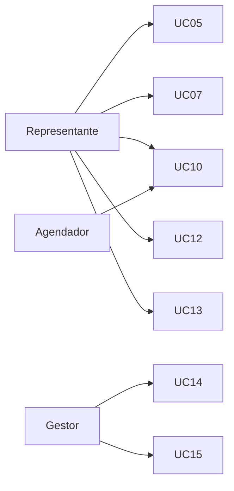

# ChokoCRM — Casos de Uso

Este documento descreve os casos de uso do ChokoCRM. Complementa a [especificação técnica](especificacao-tecnica.md), que prevalece em caso de divergência.

---

## 1. Introdução e escopo

Este documento especifica os casos de uso do ChokoCRM, cobrindo os fluxos de cadastro e gestão de clientes, registro de visitas, classificação por cores, cruzamento com dados de ERP, geração de mensagens de consulta de estoque, insights de sazonalidade e indicadores gerenciais, conforme descrito nos objetivos do produto e nas regras de negócio da especificação técnica (seções 2 e 6).

Os identificadores **UC01 a UC15** definidos aqui são referenciados pelo protótipo navegável (`docs/prototipo/`) e pela matriz de rastreabilidade das etapas 2 a 7 do cronograma da disciplina.

## 2. Atores

| Ator | Tipo | Descrição |
|---|---|---|
| **Representante Comercial** | Principal, humano | Usuário de campo. Cadastra e mantém os clientes da própria carteira, realiza check-ins de visita, consulta agenda, histórico, dados de ERP e insights — sempre restrito aos clientes da própria carteira (desde a Etapa 7). |
| **Gestor** | Principal, humano | Acompanha KPIs de vendas e visitas e recebe alertas de produção. Consulta, em modo somente leitura e para todas as carteiras — ou para a de um representante, escolhido no seletor de representante —, a lista de clientes, a ficha, o histórico e a agenda do dia, além da recorrência de visitas e seu histórico de alterações; pode transferir um cliente entre representantes. |
| **Sistema (Agendador)** | Secundário, automatizado | Processo executado diariamente (job agendado, sem intervenção humana) que recalcula a lista de visitas previstas e atrasadas por representante e registra os alertas em log, sem persistir nada. |

**Observação sobre permissões do Gestor:** o Gestor **não** possui todas as permissões do Representante Comercial. Ele autentica-se no sistema (UC01); consulta, em modo somente leitura e para todas as carteiras, a lista de clientes com classificação por cores (UC05), a ficha do cliente (UC06), o histórico de interações (UC08), a agenda do dia (UC10) e as sugestões sazonais da ficha (UC13); visualiza a recorrência de visitas e seu histórico de alterações, sem poder alterá-la; possui o painel de KPIs (UC14) e recebe os alertas de produção (UC15); e pode transferir um cliente entre representantes através de `PUT /clients/:id` (campo `representanteId`). O Gestor **não** cadastra clientes (UC02 responde 400), não registra check-ins de visita (UC07) e não altera a recorrência de visitas (UC09 responde 403).

**Observação sobre a carteira do Representante (Etapa 7):** o Representante Comercial só enxerga e altera os clientes da própria carteira (`Client.representanteId`), regra concentrada em `backend/src/services/carteira.ts` ([ADR-011](arquitetura.md#adr-011--carteira-por-representante-e-agenda-calculada-em-tempo-de-consulta)). Nas leituras — lista (UC05), ficha (UC06), histórico e foto de visita (UC08), dados do ERP (UC11), insights (UC13) e histórico de mensagens de estoque (UC12) —, um cliente de outra carteira responde como inexistente (404, com a mesma mensagem de um registro que não existe — "Cliente não encontrado." ou, na foto, "Visita não encontrada."), para não revelar que existe; a listagem de mensagens de estoque simplesmente não traz as de outra carteira; nas escritas — edição do cliente (UC03), contatos (UC04), check-in, correção de descrição e foto (UC07 e UC08), recorrência (UC09) e mensagem de estoque (UC12) —, a API responde 403 `FORBIDDEN` com a mensagem "Cliente de outra carteira.". O Gestor continua vendo todas as carteiras.

## 3. Diagrama de visão geral

O diagrama acima destaca, de forma simplificada, os fluxos centrais de cada ator no uso cotidiano do sistema. A tabela a seguir complementa a visão geral, associando **todos** os 15 casos de uso ao(s) ator(es) principal(is), para fins de rastreabilidade:

| UC | Nome | Ator(es) |
|---|---|---|
| UC01 | Autenticar no sistema | Representante, Gestor |
| UC02 | Cadastrar cliente | Representante |
| UC03 | Editar e inativar cliente | Representante |
| UC04 | Gerenciar contatos do cliente | Representante |
| UC05 | Visualizar lista de clientes com classificação por cores | Representante; Gestor |
| UC06 | Visualizar ficha do cliente | Representante; Gestor |
| UC07 | Realizar check-in de visita | Representante |
| UC08 | Consultar histórico de interações | Representante; Gestor |
| UC09 | Ajustar recorrência de visitas | Representante |
| UC10 | Visualizar agenda do dia | Representante; Gestor; Sistema (Agendador) |
| UC11 | Consultar dados de venda/estoque do cliente | Representante; Gestor |
| UC12 | Gerar mensagem de consulta de estoque | Representante; Gestor (só consulta o histórico) |
| UC13 | Visualizar insights e sugestões | Representante; Gestor (só consulta) |
| UC14 | Visualizar painel de KPIs (Gestor) | Gestor |
| UC15 | Receber alertas de produção (Gestor) | Gestor |

## 4. Especificação dos casos de uso

Cada caso de uso é descrito com: identificador e nome, ator principal (e secundário, quando houver), pré-condições, fluxo principal numerado, fluxos alternativos e/ou de exceção (identificados como A*n* e E*n*, referenciando o passo do fluxo principal em que ocorrem) e regras de negócio associadas.

---

### UC01 — Autenticar no sistema

**Ator principal:** Representante Comercial e Gestor.

**Pré-condições:** o ator possui conta previamente cadastrada no sistema (usuário com e-mail, senha e papel definidos).

**Fluxo principal:**
1. O ator acessa a tela de login.
2. O ator informa e-mail e senha.
3. O sistema valida as credenciais informadas.
4. O sistema emite um token JWT contendo o identificador do usuário e o seu papel (Representante ou Gestor).
5. O sistema redireciona o ator para a tela inicial correspondente ao seu papel.

**Fluxo de exceção:**
- **E1** (passo 3): credenciais inválidas — o sistema exibe mensagem de erro, mantém o ator na tela de login e não emite token.

**Regras de negócio associadas:**
- Autenticação por e-mail e senha, com emissão de token JWT no login.
- Toda rota subsequente da API exige token válido; o papel do usuário (Representante ou Gestor) determina o acesso a funcionalidades restritas (ex.: UC14 e UC15).

---

### UC02 — Cadastrar cliente

**Ator principal:** Representante Comercial.

**Pré-condições:** o representante está autenticado (UC01).

**Fluxo principal:**
1. O representante seleciona a opção "novo cliente".
2. O sistema apresenta o formulário de cadastro.
3. O representante informa razão social, nome fantasia, CNPJ, cidade, endereço, telefone, e-mail e, quando já disponível, o identificador do cliente no ERP.
4. O representante informa ao menos um contato do cliente, marcando-o como principal (ver UC04).
5. O sistema atribui a recorrência de visitas padrão de 15 dias, ajustável posteriormente (ver UC09).
6. O representante confirma o cadastro.
7. O sistema valida os dados informados.
8. O sistema persiste o cliente com status ativo e exibe a ficha do cliente recém-criado (UC06).

**Fluxo de exceção:**
- **E1** (passo 7): dados obrigatórios ausentes ou inválidos (ex.: CNPJ mal formatado, nenhum contato marcado como principal) — o sistema bloqueia o salvamento e sinaliza os campos pendentes ou inválidos.

**Regras de negócio associadas:**
- Cadastro exige, no mínimo: razão social, nome fantasia, CNPJ, cidade, endereço, telefone e e-mail.
- O identificador do cliente no ERP é **opcional** no cadastro — seu preenchimento é recomendado assim que disponível, mas a ausência não impede o cadastro do cliente. Sem esse identificador, a consulta de dados de venda/estoque (UC11) fica indisponível para o cliente até que o campo seja preenchido (ver fluxo de exceção de UC11).
- Recorrência de visitas padrão de 15 dias na criação do cliente.
- Cadastro exige ao menos um contato principal (ver UC04).

---

### UC03 — Editar e inativar cliente

**Ator principal:** Representante Comercial.

**Pré-condições:** o cliente já está cadastrado no sistema.

**Fluxo principal (edição):**
1. O representante acessa a ficha do cliente (UC06) e seleciona "editar".
2. O sistema apresenta os dados atuais do cliente em formulário editável.
3. O representante altera os campos desejados.
4. O representante confirma a alteração.
5. O sistema valida e persiste as mudanças.

**Fluxo alternativo:**
- **A1** (a partir do passo 1): inativação do cliente.
  1. O representante seleciona "inativar cliente" na ficha do cliente.
  2. O sistema solicita confirmação da inativação.
  3. O representante confirma.
  4. O sistema marca o cliente com a flag `ativo = false` (inativação lógica).
  5. O cliente deixa de aparecer nas listagens padrão (UC05), mas seu cadastro, contatos e histórico de visitas permanecem preservados e consultáveis.

**Fluxo de exceção:**
- **E1** (passo 5 do fluxo principal): dados inválidos informados na edição — o sistema bloqueia o salvamento e sinaliza os campos pendentes ou inválidos.

**Regras de negócio associadas:**
- A inativação de cliente é sempre lógica, por meio da flag `ativo`; não há, em nenhum fluxo do sistema, exclusão física do registro do cliente.
- Desde a Etapa 7, o representante só edita clientes da própria carteira: `PUT /clients/:id` em cliente de outra carteira responde 403 `FORBIDDEN` ("Cliente de outra carteira."). Os botões "Editar dados" e "Inativar cliente" ficam no grupo "Dados cadastrais" da ficha (UC06), recolhido por padrão.

---

### UC04 — Gerenciar contatos do cliente

**Ator principal:** Representante Comercial.

**Pré-condições:** o cliente já está cadastrado no sistema.

**Fluxo principal:**
1. O representante acessa a seção de contatos na ficha do cliente (UC06).
2. O representante adiciona um novo contato, informando nome, cargo, telefone e e-mail.
3. O sistema persiste o contato associado ao cliente.
4. O representante marca um dos contatos do cliente como principal.
5. O sistema garante que exatamente um contato permaneça marcado como principal, desmarcando automaticamente qualquer outro contato anteriormente definido como tal.

**Fluxos alternativos:**
- **A1** (a partir do passo 1): edição de um contato existente — o representante altera os dados do contato e o sistema persiste a alteração.
- **A2** (a partir do passo 1): remoção de um contato existente que não seja o principal — o sistema remove o contato normalmente.

**Fluxo de exceção:**
- **E1** (variação do passo 2): tentativa de remover o único contato marcado como principal sem antes designar outro contato como principal — o sistema bloqueia a remoção e solicita a definição de um novo contato principal antes de prosseguir.

**Regras de negócio associadas:**
- O cliente pode ter múltiplos contatos (nome, cargo, telefone, e-mail).
- Exatamente um contato deve estar marcado como principal a qualquer momento.
- Desde a Etapa 7, só se gerenciam contatos de clientes da própria carteira: `POST /clients/:id/contacts`, `PUT /contacts/:id` e `DELETE /contacts/:id` em cliente de outra carteira respondem 403 `FORBIDDEN` ("Cliente de outra carteira."). A seção de contatos fica no grupo "Dados cadastrais" da ficha (UC06).

---

### UC05 — Visualizar lista de clientes com classificação por cores

**Ator principal:** Representante Comercial. **Ator secundário:** Gestor (somente consulta).

**Pré-condições:** o representante está autenticado; existem clientes cadastrados na carteira dele.

**Fluxo principal:**
1. O representante acessa a lista de clientes.
2. O sistema seleciona os clientes ativos da carteira do representante e calcula, para cada um, a cor de classificação em tempo de consulta, conforme a tabela de regras abaixo.
3. O sistema exibe a lista ordenada por urgência, com nome, cidade, etiqueta de situação — um texto que diz o que a cor significa e há quanto tempo (ex.: "Atrasado · 40 dias sem visita") — e selo (badge) de cor de cada cliente.
4. O sistema agrupa os clientes em abas por ação, cada uma com a contagem ("Prioridade · 7"): **Prioridade** (laranja e vermelho), **Atenção** (amarelo), **Em dia** (verde) e **Todos**. A lista abre em Prioridade quando ela tem ao menos um cliente; senão, em Todos.
5. O representante busca por nome ou cidade.
6. O representante troca de aba.
7. O sistema atualiza a lista conforme a busca e a aba escolhida, mantendo a ordem por urgência.

**Fluxos alternativos:**
- **A1** (passos 5–6): nenhum cliente corresponde à busca ou à aba — o sistema exibe lista vazia com mensagem informativa ("Nenhum cliente nesta aba." ou "Nenhum cliente encontrado para esta busca ou filtro.").
- **A2** (passo 4): o ator toca no botão "?" ao lado das abas — o sistema abre a legenda com a régua das situações (regras abaixo).
- **A3** (passo 1, Gestor): a lista do gestor traz todas as carteiras e, enquanto o seletor de representante está em "Todos", cada cliente mostra também "Rep.: {nome do representante}". O gestor escolhe um representante no seletor no topo da tela (pílulas "Todos · Eduarda · Rafael…", com o primeiro nome de cada representante) e o sistema passa a listar só a carteira dele. A escolha vale também na agenda (UC10) e no painel (UC14) e volta para "Todos" ao recarregar a página ou sair.
- **A4** (passo 1, tela ≥ 768 px): a lista ocupa a coluna da esquerda e, ao tocar num cliente, a ficha dele (UC06) abre na coluna da direita, na mesma rota `/clientes/:id`, com o cliente aberto destacado na lista.

**Regras de negócio associadas — classificação por cores:**

| Cor | Critério |
|---|---|
| 🟢 Verde | Última visita ≤ 15 dias, **com** venda |
| 🟡 Amarelo | Última visita ≤ 15 dias, **sem** venda |
| 🟠 Laranja | Entre 15 e 30 dias sem visita |
| 🔴 Vermelho | Mais de 30 dias sem visita |

- Cliente que nunca recebeu visita é classificado como vermelho.
- A cor do cliente é **calculada em tempo de consulta**, nunca armazenada.
- Clientes inativos (UC03) não aparecem na listagem padrão.
- **Regra composta (Etapa 5):** além do tempo sem visita, a cor também considera a data da última venda do cliente no ERP (UC11). Se a cor calculada pela tabela acima for verde ou amarela e a última venda estiver há mais de 60 dias, o cliente é **rebaixado** um degrau, para laranja; laranja e vermelho não mudam. Sem última venda no ERP — cliente sem identificador de ERP, identificador desconhecido no provedor, ou provedor indisponível —, a cor da tabela acima permanece intacta: a regra só rebaixa, nunca promove. O limiar (60 dias) fica em `config/`, para ajuste fino junto à empresa.
- **Carteira (Etapa 7):** o representante vê só os clientes da própria carteira (`GET /clients` filtra por `Client.representanteId`, inclusive na busca); o gestor vê todos ou, com `?representanteId=`, a carteira de um representante. Para o representante, o parâmetro é ignorado.
- **Abas:** a separação por aba é feita na tela, sobre a lista já carregada; o filtro `?color=` da API continua disponível.
- **Etiqueta de situação** (`frontend/src/lib/descreverSituacao.ts`), com "{n} dias" (ou "há {n} dias") de visita virando "hoje" para 0 e "ontem" para 1:

| Situação | Texto |
|---|---|
| Vermelho, nunca visitado | "Nunca visitado" |
| Vermelho | "Atrasado · {n} dias sem visita" |
| Laranja por rebaixamento (sem compra no ERP) | "Sem compra há {n} dias" na ficha (UC06); na lista, que não traz o número, "Rebaixado: sem compra há mais de 60 dias" |
| Laranja | "Vencendo · {n} dias sem visita" |
| Amarelo | "Visitado sem venda · há {n} dias" |
| Verde | "Em dia · visita há {n} dias, com venda" |

- **Ordem por urgência** (`frontend/src/lib/ordenarPorUrgencia.ts`), em todas as abas, inclusive Todos: vermelho → laranja → amarelo → verde; dentro da mesma cor, "nunca visitado" primeiro, depois quem está há mais dias sem visita; empate pelo nome.
- **Legenda** ("?"): "Em dia: visitado há até 15 dias, com venda. Atenção: visitado há até 15 dias, sem venda. Vencendo: 16 a 30 dias sem visita. Atrasado: mais de 30 dias ou nunca visitado. Cliente sem compra no ERP há mais de 60 dias cai para Vencendo." Os números vêm de `frontend/src/config/classificacao.ts`, espelho de `backend/src/config/classificacao.ts`.
- A cor continua visível no selo à direita de cada cliente: a etiqueta não a substitui, só a explica.

---

### UC06 — Visualizar ficha do cliente

**Ator principal:** Representante Comercial. **Ator secundário:** Gestor (somente consulta).

**Pré-condições:** o cliente está cadastrado no sistema e, para o representante, pertence à carteira dele.

**Fluxo principal:**
1. O representante seleciona um cliente na lista (UC05) ou na agenda do dia (UC10); o gestor também pode abri-la pela lista de clientes esfriando do painel (UC14).
2. O sistema exibe o cabeçalho da ficha: nome fantasia, cidade, selo de cor, etiqueta de situação (UC05), o telefone do contato principal (ou, sem ele, o do cliente) com os atalhos "Ligar" (link `tel:`) e "WhatsApp" (link `wa.me`) e, para o gestor, o representante da carteira ("Rep.: {nome}").
3. Para o representante, o sistema exibe o botão "Novo check-in" (UC07), a ação principal da tela.
4. O sistema exibe o card "Mensagem de estoque" (UC12).
5. O sistema exibe o card "Insights e sugestões" (UC13), com as sugestões do cliente para os eventos sazonais próximos.
6. O sistema exibe os dados de venda e estoque obtidos do ERP (UC11).
7. O sistema exibe o histórico de visitas em ordem cronológica reversa (UC08).
8. O sistema exibe a recorrência de visitas e o histórico de alterações dela (UC09).
9. O sistema exibe, no fim da ficha e **recolhido por padrão**, o grupo "Dados cadastrais": os dados do cliente (razão social, CNPJ, endereço, telefone, e-mail, identificador no ERP), com "Editar dados" e "Inativar cliente" (UC03), e os contatos (UC04).

**Fluxos alternativos:**
- **A1** (passo 3): cliente inativo — no lugar do botão, o sistema informa "Cliente inativo não recebe check-in novo.".
- **A2** (passo 1, tela ≥ 768 px): a ficha aberta pela lista de clientes aparece na coluna da direita, ao lado da lista (UC05 A4), sem a barra "Voltar"; aberta em tela estreita, ocupa a tela inteira, como antes.

**Fluxo de exceção:**
- **E1** (passos 5 e 6): dados do ERP indisponíveis (ex.: provedor fora do ar) — o sistema exibe a seção correspondente (insights ou dados do ERP) com mensagem de indisponibilidade, sem impedir a visualização do restante da ficha.
- **E2** (passo 1): o representante abre, pela URL, um cliente de outra carteira — a API responde 404, exatamente como para um cliente inexistente ("Cliente não encontrado."), e a ficha não é exibida.

**Regras de negócio associadas:**
- A ficha do cliente consolida dados próprios do cliente e informações provenientes de UC04 (contatos), UC08 (histórico), UC09 (recorrência), UC11 (ERP), UC12 (mensagem de estoque) e UC13 (insights).
- Este caso de uso é **evolutivo**: a seção de contatos e dados básicos é entregue na Etapa 2, a timeline de visitas na Etapa 3, a cor de classificação na Etapa 4, a seção de ERP na Etapa 5, a mensagem de consulta de estoque (UC12) na Etapa 6A e a seção de insights na Etapa 6B. Na Etapa 7, a ficha foi reorganizada para abrir pelo que se usa em campo — cabeçalho com atalhos de contato, check-in, mensagem, insights e ERP — e os dados cadastrais foram recolhidos num `
` no fim; nada foi removido, só reordenado e agrupado.
- O card de insights fica na ficha entre a mensagem de estoque e os dados do ERP e é visível a qualquer papel (representante ou gestor).
- Desde a Etapa 7, o representante só abre fichas de clientes da própria carteira; o gestor abre qualquer ficha.

---

### UC07 — Realizar check-in de visita

**Ator principal:** Representante Comercial.

**Pré-condições:** o cliente está cadastrado e pertence à carteira do representante; o representante está autenticado.

**Fluxo principal:**
1. O representante acessa "novo check-in" a partir da ficha do cliente (UC06) ou da agenda do dia (UC10).
2. O sistema preenche automaticamente a data e a hora atuais.
3. O representante pode ajustar manualmente a data/hora, se necessário.
4. O representante informa a descrição da visita, numa área de texto que cresce com o conteúdo e mostra a contagem de caracteres.
5. O representante escolhe o resultado da visita entre **houve venda**, **em negociação** e **sem venda**, em três botões lado a lado ("Venda", "Negociação" e "Sem venda").
6. O representante pode selecionar o contato atendido, de forma opcional.
7. O representante pode, opcionalmente, anexar uma foto de comprovação de presença, tirada na hora pela câmera do celular.
8. O representante confirma o check-in.
9. O sistema valida os dados informados.
10. O sistema persiste a visita e atualiza a timeline de interações (UC08) e a cor de classificação do cliente (UC05), agora recalculada.

**Fluxo de exceção:**
- **E1** (passo 9): tentativa de salvar o check-in sem informar a descrição da visita — o sistema bloqueia o salvamento e exibe mensagem indicando que a descrição é obrigatória.
- **E2** (passo 10): a visita é gravada, mas o envio da foto falha (sinal instável em campo) — o check-in permanece registrado e a timeline oferece anexar a foto depois.
- **E3** (passo 9): o cliente é de outra carteira — a API responde 403 `FORBIDDEN` com a mensagem "Cliente de outra carteira." e não grava a visita. Pela interface o caso não ocorre, porque o representante só vê clientes da própria carteira (UC05).

**Regras de negócio associadas:**
- Desde a Etapa 7, o check-in só é aceito em cliente da carteira do representante (`Client.representanteId` igual ao usuário).
- A descrição da visita é **obrigatória**, com validação tanto no frontend quanto no backend.
- O resultado da visita é **obrigatório** e assume um de três valores: houve venda, em negociação, sem venda. Apenas "houve venda" conta como venda para a classificação por cores (UC05); "em negociação" registra visita realizada com negócio em andamento.
- O contato atendido é opcional; quando informado, precisa pertencer ao próprio cliente.
- A data/hora é preenchida automaticamente no momento do check-in, mas admite ajuste manual pelo representante (ex.: registro posterior de uma visita já ocorrida). **A data/hora informada não pode estar no futuro.**
- A foto de comprovação é **opcional**: o check-in é registrado sem ela e a foto pode ser anexada depois, pela timeline. A foto **não pode ser substituída**, para preservar seu valor de comprovação.
- O check-in é exclusivo do representante; o gestor não registra visitas.
- Cliente inativo não recebe check-in novo.

---

### UC08 — Consultar histórico de interações

**Ator principal:** Representante Comercial. **Ator secundário:** Gestor (somente consulta).

**Pré-condições:** o cliente está cadastrado no sistema.

**Fluxo principal:**
1. O representante acessa a timeline de visitas na ficha do cliente (UC06).
2. O sistema lista as visitas do cliente em ordem cronológica reversa (mais recente primeiro).
3. Para cada visita, o sistema exibe data, hora, descrição, contato atendido (quando informado), autor do check-in, resultado e a foto de comprovação, quando houver.
4. O autor de uma visita pode corrigir a descrição dela no próprio item da timeline.
5. O sistema grava a data/hora da edição e passa a exibi-la junto da descrição.

**Fluxo alternativo:**
- **A1** (passo 2): o cliente não possui visitas registradas — o sistema exibe mensagem informando que não há visitas registradas.
- **A2** (passo 3): a visita não tem foto e o usuário é o autor — o sistema oferece anexar a foto de comprovação naquele momento.

**Regras de negócio associadas:**
- A listagem segue sempre ordenação cronológica reversa.
- Todos os campos da visita (data/hora, descrição, contato, resultado, autor) são exibidos integralmente.
- **Somente o autor** da visita pode editar a descrição dela, e **somente a descrição** é editável: data/hora, resultado, contato atendido e foto permanecem como foram gravados.
- Não há prazo limite para a edição da descrição.
- O gestor consulta a timeline, inclusive as fotos, mas não registra nem edita visitas.
- A timeline de um cliente inativado continua legível e editável; o que se bloqueia é o registro de visita nova.
- Desde a Etapa 7, o representante só consulta a timeline (`GET /clients/:id/visits`) e as fotos (`GET /visits/:id/foto`) de clientes da própria carteira — fora dela, a API responde 404, como para um registro inexistente. Corrigir a descrição (`PATCH /visits/:id`) e anexar a foto (`PUT /visits/:id/foto`) exigem, além de ser o autor, que o cliente ainda seja da carteira dele: se o cliente foi transferido depois do check-in, a API responde 403 ("Cliente de outra carteira.").

---

### UC09 — Ajustar recorrência de visitas

**Ator principal:** Representante Comercial.

**Pré-condições:** o cliente está cadastrado no sistema e pertence à carteira do representante.

**Fluxo principal:**
1. O representante acessa a opção de ajuste de recorrência na ficha do cliente (UC06).
2. O sistema exibe a recorrência atual, em dias, informando a faixa sugerida de 15 a 30 dias.
3. O representante escolhe o novo valor nos atalhos "15 dias", "20 dias" e "30 dias" ou em "Outro", que abre um campo numérico (de 1 a 365).
4. O representante informa a justificativa da alteração.
5. O representante confirma a alteração.
6. O sistema valida os dados informados.
7. O sistema grava a alteração em histórico (quem alterou, quando, valor anterior, novo valor e justificativa).
8. O sistema atualiza a recorrência vigente do cliente.

**Fluxo alternativo:**
- **A1** (passo 3): o valor informado está fora da faixa sugerida (15–30 dias) — o sistema exibe um alerta informando que o valor foge da faixa recomendada; o representante pode prosseguir mesmo assim, mediante confirmação, respeitada a exigência de justificativa (passo 4).

**Fluxo de exceção:**
- **E1** (passo 6): justificativa não informada — o sistema bloqueia a alteração e exibe mensagem indicando que a justificativa é obrigatória.
- **E2** (passo 6): o cliente é de outra carteira — a API responde 403 `FORBIDDEN` ("Cliente de outra carteira.") e nada é gravado.

**Regras de negócio associadas:**
- Faixa sugerida de recorrência: 15 a 30 dias.
- Desde a Etapa 7, só o representante dono da carteira altera a recorrência do cliente (`PUT /clients/:id/recurrence`).
- Toda alteração de recorrência exige justificativa registrada.
- Toda alteração é gravada em histórico auditável, contendo quem alterou, quando, o valor anterior, o novo valor e a justificativa.

---

### UC10 — Visualizar agenda do dia

**Ator principal:** Representante Comercial. **Atores secundários:** Gestor (somente consulta, vê a agenda de todos os representantes) e Sistema (Agendador).

**Pré-condições:** existem clientes cadastrados com recorrência de visitas definida.

**Fluxo principal:**
1. O Sistema (Agendador) executa diariamente, por meio de um job agendado, o cálculo das visitas previstas para o dia (data da última visita + recorrência do cliente) e das visitas atrasadas, por representante.
2. O representante acessa a tela "Agenda do dia".
3. O sistema apresenta, em duas seções ("Atrasadas" e "Hoje"), os clientes com visita atrasada e os com visita prevista para hoje, priorizados pela cor de classificação do cliente (vermelho e laranja com prioridade sobre amarelo e verde). Cada cliente traz a etiqueta de situação (UC05) e, abaixo dela, a cidade e o prazo ("Próxima visita venceu há 25 dias" ou "Visita prevista para hoje").
4. O representante seleciona um cliente da agenda para acessar sua ficha (UC06) ou registrar um check-in (UC07).

**Fluxos alternativos:**
- **A1** (passo 3): não há visitas previstas ou atrasadas para o representante no dia — o sistema exibe a agenda vazia, com mensagem informativa.
- **A2** (passo 2, Gestor): a agenda do gestor traz todas as carteiras e, enquanto o seletor de representante está em "Todos", cada cliente mostra "Rep.: {nome do representante}"; ao escolher um representante no seletor (o mesmo de UC05 A3), a agenda passa a mostrar só a carteira dele. O gestor não tem o atalho de check-in.
- **A3** (passo 3, tela ≥ 768 px): "Atrasadas" e "Hoje" aparecem lado a lado, mesmo quando uma delas está vazia.

**Regras de negócio associadas:**
- Próxima visita prevista = data da última visita + recorrência (em dias) do cliente.
- A agenda é sempre calculada em tempo de consulta, restrita à carteira do representante (`Client.representanteId`, atribuído automaticamente a quem cadastra o cliente; só o gestor transfere um cliente para outro representante); o gestor vê a agenda de todos os representantes ou, com `GET /agenda/today?representanteId=`, a de um só (para o representante o parâmetro é ignorado). Cada item da agenda traz o representante da carteira (`representante: { id, nome }`).
- Um job diário (executado pelo Sistema/Agendador) roda o mesmo cálculo por representante e registra os alertas de visita atrasada/prevista em log estruturado, sem persistir nada; notificação por push ou e-mail fica fora do escopo desta etapa.
- A priorização da lista segue a cor de classificação do cliente (UC05).

---

### UC11 — Consultar dados de venda/estoque do cliente

**Ator principal:** Representante Comercial e Gestor — consulta idêntica para os dois papéis; o representante, desde a Etapa 7, só para clientes da própria carteira.

**Pré-condições:** o representante ou o gestor está autenticado; o cliente está cadastrado (o identificador de ERP é opcional em UC02 — ver fluxos de exceção quando ele está ausente ou não é reconhecido pelo provedor).

**Fluxo principal:**
1. O ator acessa a seção "Dados do ERP" na ficha do cliente (UC06).
2. O sistema consulta o provedor de ERP (`GET /clients/:id/erp`; provedor simulado, enquanto a integração real não estiver disponível) utilizando o identificador de ERP do cliente.
3. Encontrado dado no provedor, o sistema exibe a última venda (data e valor), o volume de compras dos últimos 90 dias e o nível de estoque estimado do cliente, com os itens em falta quando o nível for baixo.
4. O sistema exibe um aviso informando que os dados apresentados são simulados sempre que o provedor sinalizar isso (campo `simulado` do `ErpProvider`, verdadeiro no provedor simulado atual).

**Fluxo de exceção:**
- **E1** (passo 2): cliente sem identificador de ERP cadastrado (`status: SEM_ERP_ID`) — o sistema exibe mensagem orientando a preencher o identificador em "Editar dados", sem impedir a visualização do restante da ficha.
- **E2** (passo 2): identificador de ERP cadastrado, mas desconhecido pelo provedor (`status: NAO_ENCONTRADO`) — o sistema exibe mensagem informando que o identificador não foi encontrado no ERP.
- **E3** (passo 2): provedor de ERP indisponível (`status: INDISPONIVEL`) — o sistema exibe mensagem de indisponibilidade, sem impedir a visualização do restante da ficha do cliente.

**Regras de negócio associadas:**
- O acesso a dados de ERP é sempre realizado por meio de uma interface de integração (provedor de ERP), permitindo a substituição futura do provedor simulado pela integração real sem alterar as demais camadas do sistema.
- A consulta responde em quatro estados, conforme os fluxos acima: `OK`, `SEM_ERP_ID`, `NAO_ENCONTRADO` e `INDISPONIVEL`.
- Os dados de venda e estoque não são persistidos no banco do ChokoCRM; são consultados sob demanda a cada acesso.
- O aviso "dados simulados" não é um texto fixo da tela: é exibido sempre que o campo `simulado`, informado pelo próprio provedor, for verdadeiro, e desaparece automaticamente quando uma integração real for adotada.
- A consulta é acessível a qualquer usuário autenticado, representante ou gestor, sem restrição de papel; desde a Etapa 7, o representante só consulta clientes da própria carteira — para um cliente de outra carteira, `GET /clients/:id/erp` responde 404, como para um cliente inexistente.
- **A partir da Etapa 5**, a última venda consultada aqui alimenta a regra de classificação por cor composta descrita em UC05: clientes visitados recentemente mas sem venda registrada há mais de 60 dias são rebaixados na classificação.

---

### UC12 — Gerar mensagem de consulta de estoque

**Ator principal:** Representante Comercial. **Ator secundário:** Gestor (não gera mensagens; consulta o histórico na ficha do cliente, junto com o representante).

**Pré-condições:** o cliente está cadastrado no sistema e pertence à carteira do representante; a geração de mensagem exige, além disso, que o cliente esteja ativo.

**Fluxo principal:**
1. O representante aciona "Gerar mensagem" no card "Mensagem de estoque" da ficha do cliente (UC06), disponível apenas quando o cliente está ativo.
2. O sistema identifica o evento sazonal vigente, quando houver, monta o texto sugerido com os produtos sugeridos do evento e devolve a lista de contatos do cliente (com o contato principal pré-selecionado) e o telefone do cliente como alternativa.
3. O representante escolhe, em uma lista, o destinatário da mensagem — um dos contatos cadastrados ou o telefone do cliente — e revisa/edita o texto sugerido.
4. O representante confirma a mensagem.
5. O sistema normaliza o telefone escolhido, monta o link `wa.me` com o texto final e registra a geração (`StockMessage`: cliente, representante responsável, evento sazonal vigente quando houver, texto final e data/hora).
6. O sistema exibe o link como botão "Abrir no WhatsApp" e o abre automaticamente em uma nova aba.
7. O representante utiliza o link para enviar a mensagem pelo próprio WhatsApp; não há confirmação de envio nem envio automático via API.
8. O histórico de mensagens geradas para o cliente (data/hora, autor, evento e texto) fica visível na ficha do cliente (UC06) para qualquer usuário autenticado, representante ou gestor.

**Fluxo alternativo:**
- **A1** (passo 2): não há evento sazonal vigente — o sistema propõe um template genérico ("Como está o estoque de chocolates..."), sem produtos sazonais específicos.
- **A2** (passo 2): cliente sem contatos cadastrados — a única opção de destinatário é o telefone do cliente.

**Fluxo de exceção:**
- **E1** (passo 1): cliente inativo — o sistema não oferece a opção de gerar mensagem na ficha; se acionada mesmo assim, a geração responde com erro (cliente inativo não recebe mensagem de estoque).
- **E2** (passo 3): o contato escolhido não pertence ao cliente da ficha — o sistema rejeita a geração com mensagem informando que o contato informado não pertence a aquele cliente.
- **E3** (passo 5): o telefone do destinatário (contato ou cliente) é telefone inválido (sem DDD, prefixo 0800/0300 ou fora do padrão brasileiro) — o sistema rejeita a geração com mensagem informando o telefone inválido, sem registrar a mensagem.
- **E4** (passos 2 e 5): o cliente é de outra carteira — tanto a proposta (`GET /clients/:id/stock-message/proposta`) quanto a geração (`POST /clients/:id/stock-message`) respondem 403 `FORBIDDEN` ("Cliente de outra carteira."), sem registrar nada.

**Regras de negócio associadas:**
- O destinatário é um contato do cliente ou o telefone do próprio cliente; este último é sempre oferecido como opção explícita ("Telefone do cliente") e é a única opção quando não há contatos cadastrados (A2). O contato principal do cliente, quando existir, vem pré-selecionado, e a saudação do texto sugerido acompanha o destinatário escolhido — trocar o destinatário troca o nome usado na saudação.
- O sistema propõe o texto; o representante pode editá-lo livremente antes de confirmar — é o texto final editado que é gravado e que compõe o link.
- A mensagem é enviada por meio de um link `wa.me` com texto pré-preenchido; o próprio representante revisa e envia pelo WhatsApp, sem envio automático via API e sem confirmação de envio pelo sistema.
- Toda geração de mensagem é registrada em `StockMessage`, para fins de auditoria e de cálculo da taxa de registro (KPI); o telefone e o contato escolhidos não são persistidos, apenas o texto final.
- O histórico de mensagens geradas é visível a qualquer papel na ficha do cliente. Desde a Etapa 7, a listagem `GET /stock-messages` respeita a carteira: o representante recebe só as mensagens de clientes da própria carteira (com `?clientId=` de outra carteira, a lista vem vazia), e o gestor recebe todas.

---

### UC13 — Visualizar insights e sugestões

**Ator principal:** Representante Comercial. **Ator secundário:** Gestor (somente consulta — o card de insights aparece na ficha do cliente para qualquer papel).

**Pré-condições:** o cliente possui histórico de vendas disponível via ERP (o identificador de ERP é opcional em UC02 — ver fluxos de exceção quando ele está ausente ou o provedor está indisponível).

**Fluxo principal:**
1. O representante acessa a seção "Insights e sugestões" na ficha do cliente (UC06). O horizonte de "evento próximo" começa em 90 dias.
2. O sistema (`GET /clients/:id/insights?horizonteDias=`) identifica os eventos sazonais cadastrados (`SeasonalEvent`) cuja data cai entre hoje e hoje + horizonte e obtém do provedor de ERP, em uma única consulta, as vendas do cliente que cobrem, para cada um desses eventos, a janela do mesmo evento no ano anterior e o período de base que a antecede.
3. Para cada evento, o sistema compara as compras do cliente na janela do mesmo evento no ano anterior com a média do cliente no período de base e calcula a variação; a variação define a ação sugerida (regras abaixo).
4. O sistema exibe, para cada evento, o título (ex.: "Natal em 79 dias"), a etiqueta da ação (Aumentar oferta, Criar promoção ou Ofertar desconto), o texto da sugestão (ex.: "Comprou 85% a mais no mesmo período do ano passado. Aumentar a oferta de …") e, em "Como calculamos", o período comparado, as compras no período, a média do cliente e os produtos mais comprados.
5. O representante troca o horizonte entre 30, 60, 90 e 180 dias e o sistema recalcula e exibe as sugestões do novo horizonte.

**Fluxo alternativo:**
- **A1** (passo 3): dados insuficientes para gerar uma sugestão para determinado evento sazonal — sem compras no período de base ou sem compras na janela do ano anterior (inclui o identificador de ERP desconhecido pelo provedor, cujo histórico vem vazio) — o sistema não gera sugestão para aquele evento, sem gerar erro: o evento aparece na lista de eventos sem histórico (`eventosSemHistorico`), com a mensagem "sem histórico de compras no mesmo período do ano passado".
- **A2** (passo 2): nenhum evento sazonal dentro do horizonte — o sistema não consulta o ERP e exibe "Nenhum evento sazonal nos próximos N dias.".

**Fluxo de exceção:**
- **E1** (passo 2): cliente sem identificador de ERP cadastrado (`status: SEM_ERP_ID`) — o sistema exibe mensagem orientando a preencher o identificador em "Editar dados", sem impedir a visualização do restante da ficha.
- **E2** (passo 2): provedor de ERP indisponível (`status: INDISPONIVEL`) — o sistema exibe mensagem de indisponibilidade, sem impedir a visualização do restante da ficha.

**Regras de negócio associadas:**
- As sugestões são baseadas no cruzamento entre vendas do cliente (ERP), eventos sazonais (`SeasonalEvent`) e calendário, e são calculadas a cada consulta: nada é persistido.
- **Horizonte:** `?horizonteDias=`, inteiro de 30 a 180, padrão 90; um valor fora da faixa ou não numérico é rejeitado com 400 (`VALIDATION_ERROR`). Na tela, o horizonte é escolhido nas opções 30 · 60 · 90 · 180 dias e vale só para a tela aberta — a preferência não é salva. Um evento está no horizonte quando a sua data (`data_fim`) cai entre hoje e hoje + horizonte, inclusive.
- **Janela de comparação:** o mesmo evento no ano anterior, dos 30 dias antes da data do evento naquele ano até a própria data (31 dias, inclusive). A janela parte da data real do evento no ano anterior, e não da janela deste ano deslocada em um ano, porque a Páscoa muda até cinco semanas de um ano para o outro — por isso o `SeasonalEvent` guarda a `chave` do evento (modelo de dados, seção 3.7). O **período de base** são os 365 dias imediatamente anteriores à janela.
- **Variação:** média do cliente na janela = compras no período de base × 31 ÷ 365; variação = compras na janela ÷ média − 1. A variação é exibida como percentual inteiro arredondado, e a ação é decidida sobre esse inteiro, para o número exibido e a ação nunca discordarem.
- **Ações sugeridas:** variação de +20% ou mais → *Aumentar oferta*; de −20% ou menos → *Ofertar desconto*; entre os dois limiares → *Criar promoção* (texto "as compras … ficaram na média"). Os produtos mais comprados na janela (os três de maior quantidade) entram no texto da sugestão. Os limiares ficam em `config/sazonalidade.ts` (`LIMIAR_VARIACAO_ALTA` e `LIMIAR_VARIACAO_BAIXA`), para ajuste fino junto à empresa, e não são editáveis na tela.
- A consulta responde em três estados — `OK`, `SEM_ERP_ID` e `INDISPONIVEL` — e, diferentemente de UC11, não há `NAO_ENCONTRADO`: o identificador desconhecido no provedor cai em A1.
- Os dados vêm do provedor de ERP; o aviso "dados simulados" aparece sempre que a consulta traz dados e o provedor o sinalizar (como em UC11).
- A consulta é acessível a qualquer usuário autenticado, representante ou gestor, sem restrição de papel; desde a Etapa 7, o representante só consulta clientes da própria carteira — para um cliente de outra carteira, `GET /clients/:id/insights` responde 404, como para um cliente inexistente.
- Premissa: o período de base precisa de cerca de 26 meses de histórico antes do evento (≈ 760 dias; até ≈ 795 para a Páscoa). O provedor simulado gera 24 meses e só cobre a base por inteiro para eventos a mais de ~2 meses de distância; para eventos mais próximos a base fica truncada, a média é subestimada e a variação, inflada. Um ERP real com 26 meses ou mais de histórico não tem esse limite. Sem nenhuma compra no período de base a sugestão não é gerada.

---

### UC14 — Visualizar painel de KPIs (Gestor)

**Ator principal:** Gestor.

**Pré-condições:** o gestor está autenticado (UC01).

**Fluxo principal:**
1. O gestor acessa a aba "Painel" (`/painel`), exclusiva do papel gestor. No topo ficam o seletor de representante (o mesmo da lista de clientes, UC05 A3, em "Todos" por padrão) e o filtro "Período", que começa em 30 dias.
2. O sistema obtém, para a carteira escolhida (todas, ou a do representante selecionado): os indicadores (`GET /dashboard/kpis?periodoDias=&representanteId=`), calculando a cor de cada cliente ativo pelo mesmo caminho da lista de clientes (UC05, regra composta com o ERP); o comparativo por representante (`GET /dashboard/kpis/por-representante?periodoDias=&representanteId=`); as vendas mês a mês (`GET /dashboard/vendas-mensais?representanteId=`); os alertas de produção (UC15); e a lista de clientes (`GET /clients?representanteId=`).
3. O sistema organiza a tela em três blocos, cada um com o título em forma de pergunta:
   - **"Quem está visitando pouco?"** — o período analisado, o número de clientes ativos e os quatro indicadores (visitas no período, com a média por cliente ativo; taxa de registro; conversão em vendas; clientes inativos), seguidos de um gráfico de barras horizontais com uma barra por representante, de comprimento igual às visitas no período e o rótulo "5 visitas · 40% com venda". Com um representante escolhido no seletor, o gráfico passa a ser o das visitas dele por semana no período (uma coluna por semana, de segunda a domingo, com a contagem em cima).
   - **"O próximo evento está chegando e o estoque acompanha?"** — um gráfico de linha com as vendas da carteira mês a mês nos últimos 12 meses, com um marcador vertical em cada mês de evento sazonal e outro no mês de hoje — o mês de hoje ainda não fechou, então o ponto dele é vazado e o tooltip e a tabela dizem "(em curso)"; abaixo, os alertas de produção (UC15), com uma barra por produto proporcional ao número de clientes com estoque baixo.
   - **"Quais clientes estão esfriando?"** — a distribuição dos clientes ativos por cor, hoje, em uma barra com legenda, e os cinco clientes mais urgentes entre laranja e vermelho, na ordem da aba Prioridade da lista (UC05), cada um com a etiqueta de situação, o representante (com o seletor em "Todos") e o link para a ficha (UC06).

   No fim, o card "Época do ano" (UC15). Em tela ≥ 768 px, o primeiro bloco fica na coluna da esquerda e os demais na da direita.
4. O gestor troca o período entre 30, 90 e 365 dias e o sistema recalcula e exibe os indicadores e o gráfico de visitas do novo período; o gráfico de vendas mensais não depende do período.
5. O gestor troca o representante no seletor e o sistema recalcula todos os blocos para a carteira escolhida.

**Fluxo alternativo:**
- **A1** (passo 3): não há dados no período selecionado — nenhuma visita e nenhuma mensagem de estoque registrada (`semDados`) — o sistema exibe os indicadores zerados — a conversão em vendas aparece como "—" ("sem visitas no período"), não como 0 —, com a mensagem "Nenhuma visita ou mensagem registrada no período — indicadores zerados."; a distribuição por cor, que reflete a carteira de hoje, continua na tela.
- **A2** (passo 3): não há clientes ativos — a taxa de registro não tem denominador e aparece como "—", e o indicador de visitas mostra o total com o apoio "sem clientes ativos" (sem média por cliente); no lugar da barra o sistema exibe "Nenhum cliente ativo.".
- **A3** (passo 3): nenhuma visita no período (no gráfico por representante ou por semana) ou nenhuma venda nos 12 meses — o gráfico correspondente dá lugar a "Sem dados no período." (no de vendas, "Sem vendas nos últimos 12 meses.").
- **A4** (passo 3): o ERP não responde para parte dos clientes — o gráfico de vendas mensais soma só os que responderam e informa, abaixo, "N clientes sem dados do ERP".
- **A5** (passo 3): nenhum cliente laranja ou vermelho — no lugar da lista dos mais urgentes, o sistema exibe "Nenhum cliente esfriando.".

**Fluxo de exceção:**
- **E1** (passo 1): usuário que não é gestor — a API responde 403 e a navegação não mostra a aba "Painel"; se o representante abrir `/painel` pela URL, a página mostra apenas "Painel disponível apenas para o gestor.".
- **E2** (passo 2): falha ao carregar os indicadores — o sistema exibe "Não foi possível carregar os indicadores." (ou a mensagem devolvida pela API), sem esconder o filtro de período.

**Regras de negócio associadas:**
- Os indicadores são calculados a cada consulta, a partir de `Visit`, `StockMessage` e da classificação por cor; nada é persistido ([ADR-006](arquitetura.md#adr-006--classificação-por-cor-calculada-em-tempo-de-consulta)).
- **Período:** `?periodoDias=` aceita só 30, 90 ou 365, com padrão 30; qualquer outro valor (ou não numérico) é rejeitado com 400 (`VALIDATION_ERROR`). O período vai de hoje − (N − 1) até hoje, inclusive — 30 dias inclui hoje —, em dias de calendário de `America/Sao_Paulo`. Na tela, o período é escolhido nas opções 30 · 90 · 365 dias, vale só para a tela aberta e não é salvo. Os valores ficam em `config/kpis.ts`.
- **Por representante (Etapa 7):** `?representanteId=` (identificador uuid, opcional; formato inválido responde 400 `VALIDATION_ERROR`) restringe os indicadores, o comparativo, as vendas mensais, os alertas e a lista à carteira daquele representante. "Por representante" é sempre **pela carteira do cliente** (`Client.representanteId`), nunca pelo autor da visita. Um identificador que não é de nenhum representante não casa com nenhum cliente: os números vêm zerados e o comparativo vem vazio.
- **Visitas no período:** número de check-ins do período, de qualquer cliente da carteira considerada; a média é esse total ÷ clientes ativos, com uma casa decimal.
- **Taxa de registro:** clientes ativos com pelo menos um check-in **ou** uma mensagem de estoque gerada no período ÷ clientes ativos; cada cliente conta uma vez, e o percentual é inteiro arredondado.
- **Conversão em vendas:** visitas do período com resultado `VENDA` ÷ visitas do período, também em percentual inteiro arredondado; negociação e visita sem venda não contam como venda.
- **Clientes inativos:** clientes ativos hoje em LARANJA ou VERMELHO (`CORES_INATIVAS`); a contagem reflete as cores de hoje, independentemente do período escolhido (apoio "laranja e vermelho, hoje"); a distribuição traz as quatro cores, com zero nas que não têm clientes. A cor é a mesma da lista e da ficha, inclusive o rebaixamento por última compra no ERP (UC05); com o ERP indisponível, a cor cai na regra base de visitas, sem derrubar a consulta.
- Proporção sem denominador (nenhum cliente ativo, nenhuma visita) não tem percentual: a tela mostra "—".
- Cliente inativado no cadastro (UC03) fica fora da taxa de registro e da distribuição por cor, mas as visitas que ele teve no período ainda contam em "visitas no período" e na conversão.
- **Época do ano:** não é um filtro destes indicadores; a leitura por sazonalidade é feita pelo card "Época do ano" da mesma tela (UC15), com o horizonte próprio "Próximos".
- **Comparativo por representante** (`GET /dashboard/kpis/por-representante`): o mesmo período de `?periodoDias=`; para cada usuário com papel REPRESENTANTE — inclusive quem não tem cliente nem visita —, os clientes ativos da carteira, as visitas no período e a conversão em vendas, com as mesmas regras acima, só agrupadas; ordem por visitas (decrescente) e, no empate, pelo nome. Com `?representanteId=`, só aquele representante e, além disso, `porSemana`: as visitas à carteira dele em cada semana (de segunda a domingo) que cobre o período, a primeira começando na segunda-feira em ou antes do início do período, com zero nas semanas sem visita.
- **Vendas mensais** (`GET /dashboard/vendas-mensais`): soma do valor das vendas no ERP dos clientes ativos com identificador de ERP, mês a mês ('AAAA-MM'), nos 12 meses que terminam no mês atual, com quantos clientes compraram em cada mês; os marcadores de evento são as datas de `dataDoEvento` (`config/sazonalidade.ts`) do ano atual e do anterior que caem na janela. A janela é fixa e independe do período. Cliente cujo ERP não responde fica fora da soma e é contado em `clientesIndisponiveis`, sem derrubar a resposta.
- A pergunta é o título (h2) de cada bloco; dentro dele, cada gráfico tem uma legenda (figcaption) que descreve o que ele mostra, rótulos nos próprios dados e, para leitores de tela, um resumo dos números e uma tabela visualmente oculta com os mesmos valores.
- Os indicadores são exclusivos do Gestor (`GET /dashboard/kpis`, `GET /dashboard/kpis/por-representante` e `GET /dashboard/vendas-mensais` exigem o papel `GESTOR`; o representante recebe 403).
- O aviso "dados simulados" aparece sempre que a consulta traz dados e o provedor o sinalizar (como em UC11), pois a cor composta e as vendas mensais consultam o ERP.
- Fora do escopo: comparação com o período anterior, filtro por intervalo livre, exportação e a evolução dos inativos ao longo do tempo (a "redução de inativos" da especificação entra aqui como a contagem atual por cor). Os indicadores por representante, fora do escopo na Etapa 6C, entraram na Etapa 7.

---

### UC15 — Receber alertas de produção (Gestor)

**Ator principal:** Gestor.

**Pré-condições:** o gestor está autenticado; existem dados de estoque disponíveis via ERP e eventos sazonais cadastrados.

**Fluxo principal:**
1. O gestor acessa a aba "Painel" (`/painel`), exclusiva do papel gestor, onde os "Alertas de produção" ficam no bloco "O próximo evento está chegando e o estoque acompanha?" (UC14). O horizonte de "evento próximo" começa em 90 dias.
2. O sistema (`GET /insights/manager-alerts?horizonteDias=&representanteId=`) identifica os eventos sazonais cuja data cai entre hoje e hoje + horizonte e, para cada cliente ativo com identificador de ERP — da carteira escolhida no seletor de representante, ou de todas —, obtém do provedor de ERP o estoque mais recente.
3. O sistema cruza os itens em nível BAIXO de cada cliente com os produtos sugeridos para cada evento do horizonte (por SKU do catálogo do ERP) e identifica as ocorrências em que estoque baixo coincide com alta demanda sazonal prevista.
4. O sistema exibe um alerta por produto e evento (ex.: "Caixa presente sortida — Natal 2026 em 79 dias"), com o número de clientes com estoque baixo — também em uma barra, proporcional ao maior alerta (Etapa 7) — e a lista deles — nome fantasia com link para a ficha (UC06) e a quantidade em estoque —, do estoque mais crítico para o menos crítico. Os alertas vêm do evento mais próximo para o mais distante e, dentro do mesmo evento, do produto com mais clientes afetados para o com menos.
5. O sistema exibe também o card "Época do ano", com os eventos do horizonte (data, prazo e produtos sugeridos).
6. O gestor troca o horizonte entre 30, 60, 90 e 180 dias e o sistema recalcula e exibe os alertas do novo horizonte.

**Fluxo alternativo:**
- **A1** (passo 3): nenhuma coincidência identificada no período analisado — o sistema informa que não há alertas de produção ("Nenhum alerta de produção para os próximos N dias.").
- **A2** (passo 2): nenhum evento sazonal dentro do horizonte — o sistema não consulta clientes nem o ERP, e o painel exibe o mesmo aviso de A1 e, em "Época do ano", "Nenhum evento sazonal nos próximos N dias.".

**Fluxo de exceção:**
- **E1** (passo 2): provedor de ERP indisponível para parte dos clientes — o sistema segue com os demais, deixa os indisponíveis fora do cruzamento (não se sabe o estoque deles) e exibe o aviso "ERP indisponível para X de Y clientes.", pois a lista de alertas pode estar incompleta.
- **E2** (passo 1): usuário que não é gestor — a API responde 403 e a navegação não mostra a aba "Painel"; se o representante abrir `/painel` pela URL, a página mostra apenas "Painel disponível apenas para o gestor.".

**Regras de negócio associadas:**
- Um alerta é sinalizado quando estoque baixo coincide com alta demanda sazonal prevista: o item está em nível BAIXO no estoque mais recente do cliente e o seu SKU está entre os produtos sugeridos de um evento que cai no horizonte. Os SKUs de cada evento ficam em `SKUS_SUGERIDOS` (`config/sazonalidade.ts`), por SKU do catálogo do ERP — o texto de `produtos_sugeridos` do evento não entra no cruzamento. O Natal, por exemplo, considera só `CX-PRESENTE` e `BOMB-SORT`, porque o panetone não existe no catálogo do provedor simulado.
- **Horizonte:** as mesmas regras de UC13 (30 a 180 dias, padrão 90, escolhido na tela e não persistido; fora da faixa a API responde 400 `VALIDATION_ERROR`).
- **Por representante (Etapa 7):** `?representanteId=` (opcional) restringe o cruzamento aos clientes da carteira daquele representante, pela carteira do cliente; sem ele, entram todas as carteiras.
- Só entram clientes ativos com identificador de ERP. Cliente inativo ou sem identificador é ignorado; identificador desconhecido no provedor não tem item em nível baixo e, portanto, não gera alerta nem conta como indisponível.
- Os alertas refletem o estoque do cliente (a loja), não o da fábrica: "produção" aqui é a leitura do gestor sobre a demanda de reposição que vem.
- Os alertas de produção são direcionados exclusivamente ao Gestor, para apoiar decisões de ajuste de produção (`GET /insights/manager-alerts` exige o papel `GESTOR`).
- Os alertas são calculados a cada consulta, sem persistir nada, e aparecem apenas na tela do painel: notificação por push ou e-mail e alertas no job diário (UC10) ficam fora do escopo desta etapa.
- O aviso "dados simulados" aparece sempre que a consulta traz dados e o provedor o sinalizar (como em UC11).

---

## 5. Matriz de rastreabilidade (UC × Etapa de entrega)

| UC | Nome | Etapa de entrega |
|---|---|---|
| UC01 | Autenticar no sistema | Etapa 2 |
| UC02 | Cadastrar cliente | Etapa 2 |
| UC03 | Editar e inativar cliente | Etapa 2 |
| UC04 | Gerenciar contatos do cliente | Etapa 2 |
| UC05 | Visualizar lista de clientes com classificação por cores | Etapa 4 |
| UC06 | Visualizar ficha do cliente | Etapas 2 a 6 (evolutivo) |
| UC07 | Realizar check-in de visita | Etapa 3 |
| UC08 | Consultar histórico de interações | Etapa 3 |
| UC09 | Ajustar recorrência de visitas | Etapa 4 |
| UC10 | Visualizar agenda do dia | Etapa 4 |
| UC11 | Consultar dados de venda/estoque do cliente | Etapa 5 |
| UC12 | Gerar mensagem de consulta de estoque | Etapa 6 |
| UC13 | Visualizar insights e sugestões | Etapa 6 |
| UC14 | Visualizar painel de KPIs (Gestor) | Etapa 6 |
| UC15 | Receber alertas de produção (Gestor) | Etapa 6 |

A Etapa 7 (refino de UX, gráficos e PWA — seção 11 da [especificação técnica](especificacao-tecnica.md#11-plano-de-entregas-cronograma-da-disciplina)) não cria caso de uso novo; revisa os existentes: a regra de carteira do representante vale para UC03 a UC09 e UC11 a UC13; a lista (UC05) ganha abas por ação, etiqueta de situação e ordem por urgência; a ficha (UC06) é reordenada; o check-in (UC07) e a recorrência (UC09) ganham controles de toque; a agenda (UC10), o painel (UC14) e os alertas (UC15) ganham o seletor de representante do gestor; e o painel (UC14) ganha os gráficos.

## 6. Cobertura das regras de negócio da especificação (seção 6)

Esta seção verifica que cada regra de negócio principal descrita na seção 6 da especificação técnica está coberta por ao menos um caso de uso deste documento.

| Subseção da especificação | Regra de negócio | Caso(s) de uso |
|---|---|---|
| 6.1 | Classificação por cores (regra base) e evolução para regra composta na Etapa 5 | UC05 (regra base **e** regra composta a partir da Etapa 5), UC06 (exibição), UC10 (priorização), UC11 (fonte do dado de última venda usado pela regra composta) |
| 6.2 | Lembretes de próxima visita (última visita + recorrência; job diário) | UC09 (recorrência), UC10 (agenda do dia) |
| 6.3 | Mensagem de consulta de estoque (template + link `wa.me` + registro) | UC12 |
| 6.4 | Módulo de insights (sugestões ao representante, alertas ao gestor, painel de KPIs e, na Etapa 7, gráficos por representante e de vendas mensais) | UC13 (sugestões), UC15 (alertas), UC14 (painel de KPIs e gráficos) |
| 6.5 | Carteira do representante (Etapa 7: leitura e escrita restritas à própria carteira; gestor vê todas e filtra por representante) | UC03 a UC09, UC11 a UC13 (restrição do representante), UC05, UC10, UC14 e UC15 (filtro do gestor) |

Todas as regras de negócio da seção 6 possuem caso de uso correspondente; não foram identificadas lacunas de cobertura.
