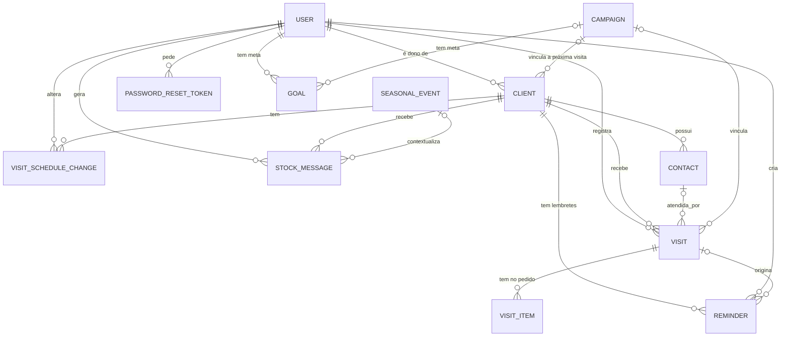

# ChokoCRM — Modelo de Dados

Este documento descreve o modelo de dados do ChokoCRM. Complementa a [especificação técnica](especificacao-tecnica.md), que prevalece em caso de divergência.

## 1. Visão geral

Este documento descreve o modelo de dados do ChokoCRM: o diagrama entidade-relacionamento (ER) das doze entidades persistidas e o dicionário de dados correspondente, campo a campo. Os nomes de entidades e campos aqui definidos são canônicos e foram implementados literalmente no `schema.prisma` a partir da Etapa 2 (Fundação). As sete primeiras vêm da proposta; a Etapa 8 (revisão pelo protótipo) acrescentou `PasswordResetToken`, `VisitItem`, `Campaign` e `Goal` (seções 3.8 a 3.11) e campos novos em `User`, `Client` e `Visit`; a Etapa 9 (ajustes pós-validação) acrescentou `Reminder` (seção 3.12), o lembrete como tarefa própria, e tirou `Client.lembrete`.

Duas classes de informação relevantes ao domínio **não são modeladas como entidade persistida** neste documento, por decisão explícita da especificação técnica:

- **Dados de venda e estoque**, obtidos sob demanda do ERP da Senior Sistemas por meio da interface `ErpProvider` (seção 4).
- **Cor do cliente**, calculada em tempo de consulta a partir do histórico de visitas (e, futuramente, de vendas) — nunca armazenada em coluna própria (seção 5).

## 2. Diagrama entidade-relacionamento



Leitura das cardinalidades:

- Um **User** (representante ou gestor) registra várias `Visit`, altera várias `VisitScheduleChange` e gera várias `StockMessage`; cada uma dessas ocorrências pertence a exatamente um usuário.
- Um **User** com papel representante é dono de vários `Client` (carteira); cada cliente pertence a exatamente um representante.
- Um **Client** possui vários `Contact`, recebe várias `Visit` e várias `StockMessage`, e tem várias `VisitScheduleChange`; cada uma dessas ocorrências pertence a exatamente um cliente.
- Um **Contact** pode ser atendido em zero ou várias `Visit` (campo `contact_id` opcional em `Visit` — nem toda visita identifica um contato específico); cada visita está associada a no máximo um contato.
- Um **SeasonalEvent** pode contextualizar zero ou várias `StockMessage` (campo `evento_sazonal` opcional em `StockMessage` — a mensagem pode ser gerada sem evento sazonal vigente); cada mensagem está associada a no máximo um evento sazonal.
- Um **User** pode ter vários `PasswordResetToken` (links de redefinição pedidos pelo gestor; só o último vale) e várias `Goal` (metas de visitas e vendas); cada token e cada meta pertencem a exatamente um usuário.
- Uma **Visit** com resultado `VENDA` pode ter vários `VisitItem` (o pedido do check-in); cada item pertence a exatamente uma visita e é apagado com ela.
- Uma **Campaign** pode estar vinculada a zero ou várias `Visit` (`campanha_id`), a zero ou vários `Client` pela próxima visita (`proxima_campanha_id`) e a zero ou várias `Goal` (metas da campanha). Excluir a campanha desvincula visitas e clientes e apaga as metas dela.
- Um **Client** tem zero ou vários `Reminder` (lembretes, Etapa 9); cada lembrete pertence a exatamente um cliente e é apagado com ele. Um **User** cria vários `Reminder` (`criado_por_id`) e uma **Visit** pode ser a origem de zero ou vários (`visit_id`, opcional: apagar a visita só solta o vínculo).

As entidades do diagrama (em maiúsculas, convenção do Mermaid) correspondem uma a uma às entidades do dicionário de dados da seção 3: `USER` → `User`, `CLIENT` → `Client`, `CONTACT` → `Contact`, `VISIT` → `Visit`, `VISIT_SCHEDULE_CHANGE` → `VisitScheduleChange`, `STOCK_MESSAGE` → `StockMessage`, `SEASONAL_EVENT` → `SeasonalEvent`, `PASSWORD_RESET_TOKEN` → `PasswordResetToken`, `VISIT_ITEM` → `VisitItem`, `CAMPAIGN` → `Campaign`, `GOAL` → `Goal`, `REMINDER` → `Reminder`.

## 3. Dicionário de dados

Convenções adotadas nas tabelas abaixo:

- **Obrigatório = Sim** corresponde a uma restrição `NOT NULL`; **Obrigatório = Não** corresponde a uma coluna anulável.
- Campos sem indicação de opcionalidade na especificação (seção 5) são tratados como obrigatórios. Os campos explicitamente opcionais são `Visit.contact_id` e `StockMessage.evento_sazonal` (marcados com `?` na seção 5 da especificação), além de `Client.erp_id`, opcional conforme UC02 e UC11 (`docs/casos-de-uso.md`).
- Os tipos indicados são conceituais, para orientar o mapeamento no `schema.prisma` da Etapa 2; a escolha final de tipos nativos do PostgreSQL/Prisma (por exemplo, o tipo do identificador ou `text` vs. `varchar`) é decisão de implementação daquela etapa.
- Toda chave primária `id` é um identificador único; sugere-se UUID, por ser prática comum em aplicações Node/Prisma/PostgreSQL — a confirmação é decisão da Etapa 2.

### 3.1 User

| Campo | Tipo | Obrigatório | Descrição / Regra |
|---|---|---|---|
| id | Identificador único (UUID sugerido) | Sim | Chave primária. |
| nome | Texto | Sim | Nome completo do usuário. |
| email | Texto (único) | Sim | E-mail de login; identificador de autenticação. |
| senha_hash | Texto | Sim | Hash da senha de acesso; a senha em texto plano nunca é armazenada. |
| role | Enum: `REPRESENTANTE` \| `GESTOR` | Sim | Papel do usuário; define autorização (ex.: gestão de usuários, de campanhas e de metas restritas a `GESTOR`, conforme seções 4.1 e 7 da especificação). Desde a Etapa 8 o painel e os alertas de produção servem os dois papéis, com o representante limitado à própria carteira. |
| ativo | Booleano | Sim | Conta ativa (Etapa 8; padrão `true`). Conta inativa não entra (o login responde 403 "Conta inativa. Fale com o gestor."), não aparece no seletor de representante nem na transferência e é ignorada pelo job diário; os clientes da carteira continuam com ela até o gestor transferi-los. |
| telefone | Texto | Não | Telefone de contato do usuário (Etapa 8), exibido na tela Usuários. |
| criado_em | Data/hora | Sim | Data e hora de criação do registro, preenchida automaticamente. |

### 3.2 Client

| Campo | Tipo | Obrigatório | Descrição / Regra |
|---|---|---|---|
| id | Identificador único (UUID sugerido) | Sim | Chave primária. |
| razao_social | Texto | Sim | Razão social da empresa cliente. |
| nome_fantasia | Texto | Sim | Nome fantasia da empresa cliente. |
| cnpj | Texto | Sim | CNPJ do cliente. |
| cidade | Texto | Sim | Cidade do estabelecimento do cliente. |
| endereco | Texto | Sim | Endereço completo do estabelecimento. |
| telefone | Texto | Sim | Telefone de contato principal do cliente; usado na geração do link de WhatsApp da mensagem de estoque (seção 6.3 da especificação). |
| email | Texto | Sim | E-mail de contato do cliente. |
| erp_id | Texto | Não | Identificador do cliente no ERP da Senior Sistemas; chave usada nas consultas ao `ErpProvider` (seção 4 deste documento). Preenchimento recomendado assim que disponível, mas opcional no cadastro — o cliente pode ainda não ter vínculo com o ERP (UC02, UC11 em `docs/casos-de-uso.md`). |
| recorrencia_dias | Número inteiro | Sim | Intervalo, em dias, entre visitas recorrentes a este cliente. **Valor padrão: 15. Faixa sugerida: 15 a 30.** Alteração exige registro correspondente em `VisitScheduleChange`, com justificativa (seção 6.2 da especificação). |
| proxima_visita | Data | Não | Data prevista da próxima visita, marcada no check-in (Etapa 8, UC17). Quando existe, é ela que a agenda usa; nula, a agenda usa a última visita (ou o cadastro) + `recorrencia_dias`. Cada check-in regrava (ou apaga) a data, e alterar a recorrência (UC09) a apaga. |
| proxima_campanha_id | Chave estrangeira → `Campaign.id` | Não | Campanha da próxima visita (Etapa 8), gravada e apagada junto com `proxima_visita` a cada check-in. Excluir a campanha só desvincula (`ON DELETE SET NULL`). |
| ativo | Booleano | Sim | Indica se o cliente está ativo na carteira do representante. A especificação não define valor padrão explícito para este campo; sugere-se `true` na criação, como decisão de implementação da Etapa 2. |
| representante_id | FK → User.id | Sim | Representante dono da carteira. Preenchido automaticamente com o usuário que cadastra; só o gestor transfere (Etapa 4). |
| criado_em | Data/hora | Sim | Data e hora de criação do registro. |

**Etapa 9:** o campo `lembrete` (texto de até 200 caracteres preso à próxima visita) **saiu** de `Client`: o lembrete virou a entidade `Reminder` (seção 3.12), com data própria, e a migration `20261025232841_lembretes_como_tarefa` copiou os lembretes existentes antes de remover a coluna (e a constraint `clients_lembrete_ate_200`).

### 3.3 Contact

| Campo | Tipo | Obrigatório | Descrição / Regra |
|---|---|---|---|
| id | Identificador único (UUID sugerido) | Sim | Chave primária. |
| client_id | Chave estrangeira → `Client.id` | Sim | Cliente ao qual o contato pertence. |
| nome | Texto | Sim | Nome do contato na empresa cliente. |
| cargo | Texto | Sim | Cargo/função do contato na empresa cliente. |
| telefone | Texto | Sim | Telefone do contato. |
| email | Texto | Sim | E-mail do contato. |
| principal | Booleano | Sim | Indica se este é o contato principal do cliente. **Regra: exatamente um contato principal por cliente.** A unicidade deve ser garantida na camada de aplicação (ao marcar um novo contato como principal, desmarcar o anterior, na mesma transação) e pode ser reforçada no banco por um índice único parcial sobre `client_id` restrito a `principal = true` — detalhamento da restrição é decisão de implementação da Etapa 2. |

### 3.4 Visit

| Campo | Tipo | Obrigatório | Descrição / Regra |
|---|---|---|---|
| id | Identificador único (UUID sugerido) | Sim | Chave primária. |
| client_id | Chave estrangeira → `Client.id` | Sim | Cliente visitado. |
| user_id | Chave estrangeira → `User.id` | Sim | Usuário (representante) que registrou a visita. |
| contact_id | Chave estrangeira → `Contact.id` | Não | Contato atendido na visita, quando identificado. Campo opcional — a visita pode ser registrada sem um contato específico. |
| data_hora | Data/hora | Sim | Data e hora em que a visita (check-in) ocorreu. |
| descricao | Texto | **Sim (NOT NULL)** | Relato da visita. **Campo obrigatório, com validação dupla (frontend e backend)** — requisito explícito da especificação (seção 5, observações, e seção 10, testes de integração). |
| resultado | Enumeração (`VENDA`, `NEGOCIACAO`, `SEM_VENDA`) | Sim | Resultado da visita. Substitui o antigo booleano `houve_venda` (Etapa 3): distingue "não vendi" de "a venda está em andamento". Apenas `VENDA` conta como venda no cálculo da cor do cliente (seção 5 deste documento). |
| foto_path | Texto | Não | Chave da foto de comprovação de presença no armazenamento de arquivos (ex.: `visits/<id>.jpg`), nunca um caminho absoluto. Nulo quando a visita não tem foto — a foto é **opcional** e pode ser anexada **uma única vez**. |
| criado_em | Data/hora | Sim | Momento em que o check-in foi **registrado** no sistema. Distinto de `data_hora`, que é quando a visita **ocorreu** (o representante pode lançar visita retroativa). |
| editado_em | Data/hora | Não | Momento da última edição da descrição. Nulo enquanto a descrição nunca foi editada. Somente a descrição é editável, e somente pelo autor (UC08). |
| campanha_id | Chave estrangeira → `Campaign.id` | Não | Campanha a que a visita foi vinculada no check-in (Etapa 8, UC18); só entram campanhas não encerradas. Excluir a campanha só desvincula (`ON DELETE SET NULL`). |

O pedido da visita fica em `VisitItem` (seção 3.9); o total do pedido (soma de quantidade × preço unitário) é calculado na leitura, nunca gravado.

### 3.5 VisitScheduleChange

| Campo | Tipo | Obrigatório | Descrição / Regra |
|---|---|---|---|
| id | Identificador único (UUID sugerido) | Sim | Chave primária. |
| client_id | Chave estrangeira → `Client.id` | Sim | Cliente cuja recorrência de visita foi alterada. |
| user_id | Chave estrangeira → `User.id` | Sim | Usuário que realizou a alteração. |
| recorrencia_anterior | Número inteiro | Sim | Valor de `recorrencia_dias` vigente antes da alteração. |
| recorrencia_nova | Número inteiro | Sim | Novo valor de `recorrencia_dias` (faixa sugerida: 15 a 30 dias). |
| justificativa | Texto | **Sim (NOT NULL)** | Motivo da alteração da recorrência. **Campo obrigatório** — toda alteração de `recorrencia_dias` deve gerar um registro correspondente nesta entidade, com justificativa preenchida (requisito explícito da especificação, seção 5 e seção 6.2). |
| data | Data/hora | Sim | Data (e hora) em que a alteração foi realizada. |

### 3.6 StockMessage

| Campo | Tipo | Obrigatório | Descrição / Regra |
|---|---|---|---|
| id | Identificador único (UUID sugerido) | Sim | Chave primária. |
| client_id | Chave estrangeira → `Client.id` | Sim | Cliente destinatário da mensagem de consulta de estoque. |
| user_id | Chave estrangeira → `User.id` | Sim | Representante que gerou a mensagem. |
| evento_sazonal | Chave estrangeira → `SeasonalEvent.id` | Não | Evento sazonal vigente no momento da geração, usado para sugerir produtos no template. Campo opcional — pode não haver evento sazonal ativo. |
| texto_final | Texto | Sim | Texto final da mensagem — o texto sugerido pelo sistema, revisado (ou não) pelo representante antes de confirmar — usado para compor o link `https://wa.me/<telefone>?text=<mensagem>` (seção 6.3 da especificação). |
| data_geracao | Data/hora | Sim | Data e hora de geração da mensagem; usada para auditoria e para o KPI de taxa de registro. |

**Não persistidos:** o contato escolhido (ou o telefone do cliente, quando não há contato) e o telefone usado para montar o link não são gravados nesta entidade — apenas o `texto_final` fica registrado. O destinatário da mensagem, portanto, não é recuperável a partir do histórico; apenas o conteúdo enviado, o autor, o cliente e o evento sazonal vigente na geração.

### 3.7 SeasonalEvent

| Campo | Tipo | Obrigatório | Descrição / Regra |
|---|---|---|---|
| id | Identificador único (UUID sugerido) | Sim | Chave primária. |
| nome | Texto (único) | Sim | Nome do evento já com o ano (ex.: "Páscoa 2026", "Natal 2026"); a unicidade é a chave de upsert do seed, que o torna idempotente entre execuções. |
| chave | Enum `EventoSazonal`: `PASCOA` \| `DIA_DAS_MAES` \| `NAMORADOS` \| `DIA_DOS_PAIS` \| `NATAL` | Sim | Evento do calendário de `backend/src/config/sazonalidade.ts` a que o registro corresponde (Etapa 6B). Liga o registro do banco à data exata do mesmo evento em outros anos — os insights comparam o período do evento com o do ano anterior, e a Páscoa muda até cinco semanas de um ano para o outro — e aos SKUs sugeridos do evento. Não é única: cada evento tem um registro por ano. |
| data_inicio | Data | Sim | Data de início do período de vigência do evento (30 dias antes da data do evento). |
| data_fim | Data | Sim | Data de término do período de vigência do evento — a própria data do evento (ex.: o domingo de Páscoa). É também por ela que os insights e os alertas localizam os eventos de um horizonte (UC13, UC15): `data_fim` entre hoje e hoje + horizonte, limites inclusivos. |
| produtos_sugeridos | Lista de texto | Sim | Lista de produtos sugeridos associados ao evento, em texto livre; utilizada na composição de templates de mensagem de estoque (seção 6.3) e exibida no card "Época do ano" do Painel (seção 6.4 da especificação). O cruzamento com o estoque do ERP (UC15) não usa este texto: é feito por SKU do catálogo, a partir de `SKUS_SUGERIDOS` em `config/sazonalidade.ts`. |

**Seed:** os registros de `SeasonalEvent` são derivados do calendário sazonal já existente em `backend/src/config/sazonalidade.ts` (datas por algoritmo de Meeus/Jones/Butcher para a Páscoa, N-ésimo domingo do mês para Dia das Mães/Dia dos Pais, datas fixas para Namorados/Natal), com nome, janela de vigência (`data_fim` − 30 dias) e produtos sugeridos calculados por `config/eventosSazonaisSeed.ts` para cada um dos 5 eventos (`PASCOA`, `DIA_DAS_MAES`, `NAMORADOS`, `DIA_DOS_PAIS`, `NATAL`) nos dois anos `[ano atual, ano atual + 1]` — 10 registros no total. Cada registro grava também a `chave` (o evento do calendário, `EventoSazonalSeed.chave`). O seed (`prisma/seed.ts`) faz `upsert` por `nome` — a `chave` entra tanto no `create` quanto no `update` —, portanto pode ser executado repetidamente sem duplicar eventos; `config/sazonalidade.ts` continua sendo a única fonte do calendário, usada também pelo gerador mock de ERP (seção 4).

**Migration da `chave` (Etapa 6B):** `20261007141059_seasonal_event_chave` cria o enum `EventoSazonal` e a coluna `chave` em quatro passos, para não quebrar bancos já semeados pela Etapa 6A: (1) cria o tipo; (2) adiciona a coluna como anulável; (3) preenche as linhas existentes a partir do prefixo de `nome` ("Páscoa ", "Dia das Mães ", "Dia dos Namorados ", "Dia dos Pais ", "Natal "); (4) torna a coluna `NOT NULL`. Um `nome` fora desse padrão deixaria a `chave` nula e o passo 4 falharia — comportamento desejado, porque a migration não inventa chave. O `SeasonalEvent` também ganhou a consulta `findNoIntervalo(de, ate)` no repository (eventos com `data_fim` no intervalo, ambos os limites inclusivos, em ordem de data).

### 3.8 PasswordResetToken

Link de redefinição de senha (Etapa 8, UC22), enviado por e-mail quando o gestor pede a redefinição da senha de alguém.

| Campo | Tipo | Obrigatório | Descrição / Regra |
|---|---|---|---|
| id | Identificador único (UUID) | Sim | Chave primária. |
| user_id | Chave estrangeira → `User.id` | Sim | Dono da conta; apagar o usuário apaga os tokens dele (`ON DELETE CASCADE`). |
| token_hash | Texto (único) | Sim | Hash SHA-256 do token. O token em si (32 bytes aleatórios) só existe no link do e-mail, no fragmento da URL (`/redefinir-senha#<token>`), e nunca é gravado. |
| expira_em | Data/hora | Sim | Validade de 24 horas a partir do pedido. |
| usado_em | Data/hora | Não | Momento em que o link foi usado; o link vale uma vez só. Pedir um novo invalida os anteriores ainda não usados. |
| criado_em | Data/hora | Sim | Momento do pedido. |

### 3.9 VisitItem

Item do pedido registrado no check-in com resultado `VENDA` (Etapa 8, UC16).

| Campo | Tipo | Obrigatório | Descrição / Regra |
|---|---|---|---|
| id | Identificador único (UUID) | Sim | Chave primária. |
| visit_id | Chave estrangeira → `Visit.id` | Sim | Visita do pedido; apagar a visita apaga os itens (`ON DELETE CASCADE`). |
| sku | Texto | Sim | SKU do produto no catálogo do ERP (`GET /erp/produtos`); SKU desconhecido é recusado (400). |
| produto_nome | Texto | Sim | Nome do produto copiado do catálogo no momento do check-in. |
| quantidade | Número inteiro | Sim | Quantidade pedida, maior que zero (`CHECK`); linhas com quantidade 0 são descartadas pelo formulário. |
| preco_unitario | Decimal (10,2) | Sim | Preço do catálogo no momento do check-in, não negativo (`CHECK`). Como nome e preço são copiados, o pedido não muda se o catálogo mudar depois. |

### 3.10 Campaign

Campanha, promoção ou evento comercial criado pelo gestor (Etapa 8, UC18).

| Campo | Tipo | Obrigatório | Descrição / Regra |
|---|---|---|---|
| id | Identificador único (UUID) | Sim | Chave primária. |
| nome | Texto | Sim | Nome da campanha. |
| tipo | Enum `TipoCampanha`: `CAMPANHA` \| `PROMOCAO` \| `EVENTO` | Sim | Tipo exibido no cartão. |
| inicio | Data | Sim | Primeiro dia da campanha (inclusivo). |
| fim | Data | Sim | Último dia da campanha (inclusivo); o banco recusa fim antes do início (`CHECK`). O status — Programada, Em andamento, Encerrada — é calculado a cada leitura pelo dia de hoje em `America/Sao_Paulo`, nunca gravado. |
| descricao | Texto | Sim | Descrição livre (padrão vazio). |
| desconto | Número inteiro | Não | Desconto em %, de 0 a 100 (`CHECK`); nulo = sem desconto. |
| produtos | Lista de texto | Sim | SKUs do catálogo do ERP em destaque na campanha (validados no backend). |
| criado_em | Data/hora | Sim | Data e hora de criação. |

### 3.11 Goal

Meta de visitas e vendas de um representante (Etapa 8, UC19), sem campanha ou de uma campanha.

| Campo | Tipo | Obrigatório | Descrição / Regra |
|---|---|---|---|
| id | Identificador único (UUID) | Sim | Chave primária. |
| representante_id | Chave estrangeira → `User.id` | Sim | Representante da meta. |
| periodo | Enum `PeriodoMeta`: `SEMANAL` \| `MENSAL` \| `PERSONALIZADO` \| `CAMPANHA` | Sim | Semanal = de segunda a domingo; mensal = do primeiro ao último dia do mês; personalizado = período livre; campanha = dentro do período da campanha. O banco exige `campanha_id` só no período `CAMPANHA` (`CHECK`). |
| inicio | Data | Sim | Primeiro dia da meta (inclusivo). Nas metas semanal e mensal, o backend recalcula o período a partir dele. |
| fim | Data | Sim | Último dia da meta (inclusivo); fim antes do início é recusado (`CHECK`). |
| meta_visitas | Número inteiro | Sim | Meta de visitas, não negativa. |
| meta_vendas | Decimal (12,2) | Sim | Meta de vendas em reais, não negativa. |
| campanha_id | Chave estrangeira → `Campaign.id` | Não | Campanha da meta; excluir a campanha apaga as metas dela (`ON DELETE CASCADE`). |
| criado_em | Data/hora | Sim | Data e hora de criação. |

**Realizado:** não é gravado. A cada leitura, conta as visitas feitas pelo representante (autor da visita) no período — e vinculadas à campanha, na meta de campanha — e soma o total dos pedidos das que tiveram resultado `VENDA`.

**Seed de demonstração (Etapa 8):** `backend/src/seed/demonstracao.ts` grava, relativo ao dia em que roda, três campanhas (uma em andamento), metas mensais para os dois representantes e uma da campanha em andamento, pedidos de dois itens do catálogo em toda visita de venda e a próxima visita em três clientes (um com campanha). `npm run db:seed:reset` apaga e recria esses dados, mantendo as contas criadas pelo app ([guia de desenvolvimento](guia-de-desenvolvimento.md#4-banco-de-dados-migrations-e-seed)).

**Seed de demonstração (Etapa 9):** o seed passa a gravar também quatro `Reminder`, criados pelo dono da carteira: três abertos (um deles vencido há 3 dias, para a seção "Lembretes" da agenda e o calendário mostrarem o vencido) e um já concluído, que não deve aparecer em lugar nenhum. As visitas marcadas no check-in continuam em três clientes, uma delas com data passada (vencida), para o calendário mostrar a marcada vencida no dia dela. As visitas com venda dos últimos 45 dias (o seed não grava visita mais antiga) alimentam os rankings e a receita por representante do Painel.

### 3.12 Reminder

Lembrete do cliente como tarefa própria (Etapa 9, UC17 e UC27): nasce no check-in, tem data, fica aberto até alguém concluí-lo e sobrevive a novos check-ins ([ADR-017](arquitetura.md#adr-017--lembrete-como-tarefa-própria-tabela-reminder)). Tabela `lembretes`.

| Campo | Tipo | Obrigatório | Descrição / Regra |
|---|---|---|---|
| id | Identificador único (UUID) | Sim | Chave primária. |
| client_id | Chave estrangeira → `Client.id` | Sim | Cliente do lembrete; apagar o cliente apaga os lembretes (`ON DELETE CASCADE`). O lembrete vale para a carteira atual do cliente: se ele for transferido, o lembrete vai junto. |
| criado_por_id | Chave estrangeira → `User.id` | Sim | Quem criou o lembrete (o representante do check-in). |
| visit_id | Chave estrangeira → `Visit.id` | Não | Check-in de origem; apagar a visita só solta o vínculo (`ON DELETE SET NULL`). Nulo nos lembretes migrados de `Client.lembrete`. |
| texto | Texto (até 200 caracteres) | Sim | O que lembrar. O banco recusa mais de 200 caracteres (`CHECK`, constraint `lembretes_texto_ate_200`), além do zod do check-in. |
| data | Data | Sim | Dia para o qual o lembrete vale (`DATE`, sem hora), independente da próxima visita; no check-in não pode ser antes de hoje. |
| concluido_em | Data/hora | Não | Momento da conclusão (`PATCH /lembretes/:id/concluir`); nulo enquanto aberto. Os concluídos continuam gravados (auditoria), mas não aparecem em tela nenhuma. |
| criado_em | Data/hora | Sim | Momento da criação. |

Índice em (`client_id`, `concluido_em`), para listar os abertos de um cliente. Um cliente pode ter vários lembretes abertos ao mesmo tempo; um check-in novo não conclui os que já estão abertos, e apagar a próxima visita no check-in ou mudar a recorrência (UC09) não toca neles.

**Migração (Etapa 9):** a migration `20261025232841_lembretes_como_tarefa` cria a tabela e, em SQL escrito à mão, copia cada `Client.lembrete` não nulo para um `Reminder` aberto, criado pelo dono da carteira (`criado_por_id = representante_id`), com `data` igual à `proxima_visita` do cliente ou, sem ela, ao dia da migração; depois remove a coluna `clients.lembrete`.

## 4. Dados externos (ERP)

Dados de **venda e estoque não são persistidos** no banco de dados do ChokoCRM. Eles são obtidos sob demanda a partir do ERP da Senior Sistemas, por meio da interface `ErpProvider` (padrão Adapter, seção 4.3 da especificação):

```ts
interface ErpProvider {
  getLastSale(clientErpId: string): Promise<Sale | null>;
  getSales(clientErpId: string, period: Period): Promise<Sale[]>;
  getPurchaseVolume(clientErpId: string, period: Period): Promise<Volume>;
  getStockHistory(clientErpId: string): Promise<StockSnapshot[]>;
}
```

- A chave de consulta é `Client.erp_id` (seção 3.2), que identifica o cliente no ERP da Senior.
- Enquanto a API real da Senior não estiver disponível, a interface é implementada por `MockErpProvider`, cujos dados **não vêm de nenhuma tabela nem de seed do Prisma**: são gerados em memória, a cada chamada, por um gerador determinístico (`providers/erp/mock/gerador.ts`) — um hash do `erp_id` (FNV-1a) alimenta um PRNG (mulberry32) que produz 24 meses de histórico de vendas e 12 snapshots quinzenais de estoque, aplicando o calendário sazonal (picos de venda nos 30 dias antes de Páscoa, Dia das Mães, Dia dos Namorados, Dia dos Pais e Natal) como multiplicador de valor. O mesmo `erp_id`, consultado no mesmo dia de calendário, sempre reproduz o mesmo histórico — determinismo que serve de base estável ao módulo de insights (seção 6.4 da especificação) e aos testes automatizados.
- Um `erp_id` terminado em `-0` é a convenção do mock para "cliente desconhecido no ERP": o gerador devolve vendas e estoque vazios, e `obterDadosErp` responde `NAO_ENCONTRADO` (UC11, `docs/casos-de-uso.md`).
- A futura substituição por uma implementação real (`SeniorErpProvider`) troca apenas a classe que implementa `ErpProvider`; nenhuma outra camada do sistema (services, controllers, repositories, frontend) precisa ser alterada — este é exatamente o propósito do padrão Adapter adotado (seções 4.1 e 4.3 da especificação).
- O catálogo de produtos (SKU, nome e, desde a Etapa 8, preço unitário) também vem do provedor simulado (`providers/erp/mock/catalogo.ts`, exposto em `GET /erp/produtos`); o check-in copia nome e preço para `VisitItem` (seção 3.9).
- Não havendo persistência local, `Sale`, `Period`, `Volume` e `StockSnapshot` são tipos de dados **de integração** (contrato do `ErpProvider`), e não entidades do banco de dados do ChokoCRM — por isso não constam do dicionário de dados da seção 3.

## 5. Cor do cliente

A cor do cliente é um indicador visual (badge exibido na lista de clientes e na ficha do cliente) que **não é armazenado em nenhuma entidade** — é **calculado em tempo de consulta**, a partir do histórico de visitas (`Visit`) do cliente. Essa decisão evita inconsistência de dados e a necessidade de jobs de sincronização (especificação, seção 5, observações).

O cálculo é avaliado nesta ordem — a primeira regra satisfeita determina a cor (especificação, seção 6.1):

| Ordem | Cor | Regra |
|---|---|---|
| 1 | 🔴 Vermelho | Mais de 30 dias sem visita. |
| 2 | 🟠 Laranja | Entre 15 e 30 dias sem visita. |
| 3 | 🟢 Verde | Última visita há até 15 dias, **com** venda (`Visit.resultado = VENDA`). |
| 4 | 🟡 Amarelo | Última visita há até 15 dias, **sem** venda (`Visit.resultado = NEGOCIACAO` ou `SEM_VENDA`). |

Observações:

- "Dias sem visita" é contado a partir da data da `Visit.data_hora` mais recente do cliente (ou desde o cadastro do cliente, caso ainda não haja nenhuma visita registrada).
- O tratamento exato dos limites (exatamente 15 e exatamente 30 dias) é decisão de implementação da regra na Etapa 4, respeitando a ordem de avaliação acima, definida pela especificação (seção 6.1).
- Os limiares (15 e 30 dias) ficam centralizados na camada de configuração (`config/`, seção 4.2 da especificação), permitindo ajuste fino junto à empresa sem alteração do código de negócio.
- **Na Etapa 5, essa cor de base passa a poder ser rebaixada** por uma segunda regra, aplicada depois da tabela acima: se a cor de base for verde ou amarela e a última venda do cliente no ERP (`ErpProvider`, seção 4 deste documento) estiver há mais de `LIMIAR_SEM_COMPRA_DIAS = 60` dias, a cor exibida passa a laranja (`rebaixadoPorVenda: true`, exposto na lista e na ficha do cliente). Laranja e vermelho não mudam — o rebaixamento nunca agrava mais de um degrau, e nunca promove uma cor. Sem `erp_id`, com `erp_id` desconhecido no provedor, ou com o provedor indisponível, não há dado de venda para comparar e a cor de base permanece intacta. O limiar de 60 dias fica em `config/classificacao.ts`, ao lado dos limiares de 15 e 30 dias, para ajuste conjunto junto à empresa.
