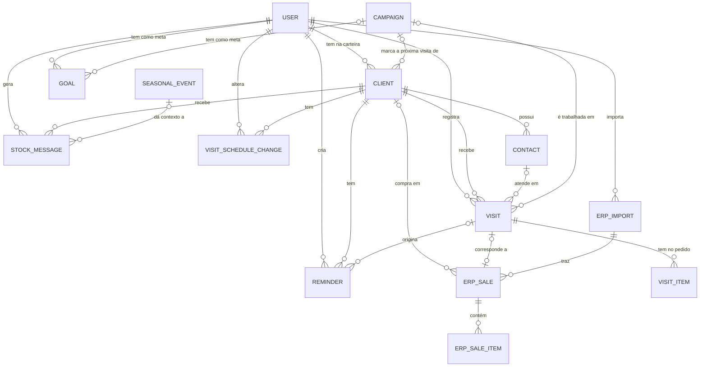

# Modelo de dados

Este documento descreve as tabelas do banco de dados do ChokoCRM e como elas se relacionam. A definição oficial está em [`backend/prisma/schema.prisma`](../backend/prisma/schema.prisma), e cada alteração do banco fica registrada em `backend/prisma/migrations`.

## Sumário

1. [Visão geral](#1-visão-geral)
2. [Diagrama de entidades e relacionamentos](#2-diagrama-de-entidades-e-relacionamentos)
3. [Tabelas](#3-tabelas)
4. [O que não é gravado](#4-o-que-não-é-gravado)

## 1. Visão geral

O banco é um PostgreSQL com 16 tabelas, que podem ser lidas em quatro grupos:

| Grupo | Tabelas | O que guardam |
|-------|---------|---------------|
| Pessoas e carteira | `users`, `clients`, `contacts` | Quem usa o sistema, os clientes de cada representante e as pessoas de contato em cada cliente |
| Visitas | `visits`, `visit_items`, `lembretes`, `visit_schedule_changes`, `stock_messages` | Cada visita registrada, o pedido feito nela, os lembretes, as mudanças no intervalo de visitas e as mensagens de estoque geradas |
| Planejamento comercial | `campaigns`, `goals`, `seasonal_events` | Campanhas, metas dos representantes e as datas comemorativas do ano |
| Notas fiscais | `erp_imports`, `erp_sales`, `erp_sale_items`, `erp_products` | Os arquivos importados, as notas lidas, os itens de cada nota e o catálogo de produtos |

A tabela `configuracoes` fica à parte e guarda a data do modo demonstração.

Todas as tabelas usam um identificador único (UUID) como chave primária, com exceção de `configuracoes`, cuja chave é um texto.

## 2. Diagrama de entidades e relacionamentos

As tabelas `erp_products` e `configuracoes` não se relacionam com as outras e por isso não aparecem no diagrama.

Como ler: um usuário tem vários clientes na carteira, e cada cliente pertence a um único usuário. Um cliente recebe várias visitas. Uma visita pode ter um pedido com vários itens e pode corresponder a uma nota fiscal importada. Uma campanha pode estar ligada a várias visitas e a várias metas.

## 3. Tabelas

Nas tabelas abaixo, a coluna "Obrigatório" indica se o campo precisa estar sempre preenchido.

### 3.1 Usuário (`users`)

Quem entra no sistema: representantes e gestores.

| Campo | Tipo | Obrigatório | Descrição |
|-------|------|-------------|-----------|
| `id` | UUID | Sim | Identificador |
| `nome` | Texto | Sim | Nome da pessoa |
| `email` | Texto, único | Sim | E-mail de login, sempre em minúsculas |
| `senha_hash` | Texto | Sim | Senha embaralhada com bcrypt. A senha original nunca é guardada |
| `role` | `REPRESENTANTE` ou `GESTOR` | Sim | Perfil, que define o que a pessoa pode fazer |
| `ativo` | Verdadeiro ou falso | Sim | Conta inativa não consegue entrar. O padrão é ativa |
| `telefone` | Texto | Não | Telefone de contato |
| `criado_em` | Data e hora | Sim | Quando a conta foi criada |

### 3.2 Cliente (`clients`)

Os estabelecimentos atendidos. Cada cliente pertence à carteira de um representante.

| Campo | Tipo | Obrigatório | Descrição |
|-------|------|-------------|-----------|
| `id` | UUID | Sim | Identificador |
| `razao_social` | Texto | Sim | Nome empresarial |
| `nome_fantasia` | Texto | Sim | Nome pelo qual o cliente é conhecido |
| `cnpj` | Texto, único | Sim | CNPJ. É por ele que as notas fiscais encontram o cliente |
| `cidade` | Texto | Sim | Município |
| `endereco` | Texto | Sim | Endereço |
| `telefone` | Texto | Sim | Telefone |
| `email` | Texto | Não | E-mail. O cliente criado a partir de uma nota fiscal nasce sem ele |
| `erp_id` | Texto | Não | Código do cliente no sistema de gestão da empresa |
| `recorrencia_dias` | Inteiro | Sim | Intervalo previsto entre visitas, em dias. O padrão é 15 |
| `proxima_visita` | Data | Não | Data marcada para a próxima visita. Vazia, a data é calculada pelo intervalo |
| `proxima_campanha_id` | UUID | Não | Campanha a trabalhar na próxima visita |
| `ativo` | Verdadeiro ou falso | Sim | Cliente inativo não recebe visitas, mas mantém o histórico |
| `criado_em` | Data e hora | Sim | Quando foi cadastrado |
| `representante_id` | UUID | Sim | Representante dono da carteira |

### 3.3 Contato (`contacts`)

As pessoas com quem o representante fala em cada cliente.

| Campo | Tipo | Obrigatório | Descrição |
|-------|------|-------------|-----------|
| `id` | UUID | Sim | Identificador |
| `client_id` | UUID | Sim | Cliente ao qual pertence |
| `nome` | Texto | Sim | Nome da pessoa |
| `cargo` | Texto | Sim | Função no estabelecimento |
| `telefone` | Texto | Sim | Telefone, usado na mensagem pelo WhatsApp |
| `email` | Texto | Sim | E-mail |
| `principal` | Verdadeiro ou falso | Sim | Indica o contato principal. Há um por cliente |

### 3.4 Visita (`visits`)

Cada check-in feito por um representante.

| Campo | Tipo | Obrigatório | Descrição |
|-------|------|-------------|-----------|
| `id` | UUID | Sim | Identificador |
| `client_id` | UUID | Sim | Cliente visitado |
| `user_id` | UUID | Sim | Representante que fez a visita |
| `contact_id` | UUID | Não | Pessoa atendida |
| `data_hora` | Data e hora | Sim | Quando a visita aconteceu |
| `descricao` | Texto | Sim | O que aconteceu na visita |
| `resultado` | `VENDA`, `NEGOCIACAO` ou `SEM_VENDA` | Sim | Como a visita terminou |
| `foto_path` | Texto | Não | Onde a foto está guardada |
| `foto_apagada_em` | Data e hora | Não | Quando a foto foi removida pela limpeza de 90 dias |
| `criado_em` | Data e hora | Sim | Quando o registro foi feito |
| `editado_em` | Data e hora | Não | Quando a descrição foi corrigida |
| `campanha_id` | UUID | Não | Campanha trabalhada na visita |
| `erp_sale_id` | UUID, único | Não | Nota fiscal que corresponde a esta visita |

### 3.5 Item do pedido (`visit_items`)

Os produtos do pedido registrado em uma visita com resultado de venda. Nome e preço são copiados do catálogo na hora da visita, então o pedido não muda se o catálogo mudar depois.

| Campo | Tipo | Obrigatório | Descrição |
|-------|------|-------------|-----------|
| `id` | UUID | Sim | Identificador |
| `visit_id` | UUID | Sim | Visita à qual pertence. Apagada a visita, os itens vão junto |
| `sku` | Texto | Sim | Código do produto |
| `produto_nome` | Texto | Sim | Nome do produto |
| `quantidade` | Inteiro | Sim | Quantidade pedida |
| `preco_unitario` | Decimal (10,2) | Sim | Preço de cada unidade |

### 3.6 Lembrete (`lembretes`)

Tarefas anotadas pelo representante, com data. Um cliente pode ter vários lembretes abertos.

| Campo | Tipo | Obrigatório | Descrição |
|-------|------|-------------|-----------|
| `id` | UUID | Sim | Identificador |
| `client_id` | UUID | Sim | Cliente ao qual se refere. Apagado o cliente, os lembretes vão junto |
| `criado_por_id` | UUID | Sim | Quem criou |
| `visit_id` | UUID | Não | Visita em que foi anotado |
| `texto` | Texto, até 200 caracteres | Sim | O que precisa ser feito |
| `data` | Data | Sim | Para quando |
| `concluido_em` | Data e hora | Não | Quando foi concluído. Vazio, o lembrete está aberto |
| `criado_em` | Data e hora | Sim | Quando foi criado |

### 3.7 Mudança de recorrência (`visit_schedule_changes`)

Histórico das alterações no intervalo de visitas de um cliente. Toda alteração exige uma justificativa.

| Campo | Tipo | Obrigatório | Descrição |
|-------|------|-------------|-----------|
| `id` | UUID | Sim | Identificador |
| `client_id` | UUID | Sim | Cliente alterado |
| `user_id` | UUID | Sim | Quem alterou |
| `recorrencia_anterior` | Inteiro | Sim | Intervalo antigo, em dias |
| `recorrencia_nova` | Inteiro | Sim | Intervalo novo, em dias |
| `justificativa` | Texto | Sim | Motivo da alteração |
| `data` | Data e hora | Sim | Quando foi alterado |

### 3.8 Mensagem de estoque (`stock_messages`)

Registro de cada mensagem de consulta de estoque gerada para envio pelo WhatsApp.

| Campo | Tipo | Obrigatório | Descrição |
|-------|------|-------------|-----------|
| `id` | UUID | Sim | Identificador |
| `client_id` | UUID | Sim | Cliente destinatário |
| `user_id` | UUID | Sim | Representante que gerou |
| `evento_sazonal` | UUID | Não | Data comemorativa que deu contexto à mensagem |
| `texto_final` | Texto | Sim | Texto enviado |
| `data_geracao` | Data e hora | Sim | Quando foi gerada |

### 3.9 Data comemorativa (`seasonal_events`)

As datas do ano que movimentam as vendas: Páscoa, Dia das Mães, Dia dos Namorados, Dia dos Pais e Natal. Há um registro por data e por ano.

| Campo | Tipo | Obrigatório | Descrição |
|-------|------|-------------|-----------|
| `id` | UUID | Sim | Identificador |
| `nome` | Texto, único | Sim | Nome com o ano, como "Páscoa 2027" |
| `chave` | `PASCOA`, `DIA_DAS_MAES`, `NAMORADOS`, `DIA_DOS_PAIS` ou `NATAL` | Sim | Qual é a data |
| `data_inicio` | Data | Sim | Início do período de vendas, 30 dias antes da data |
| `data_fim` | Data | Sim | O dia da data comemorativa |
| `produtos_sugeridos` | Lista de textos | Sim | Produtos indicados para o período |

### 3.10 Campanha (`campaigns`)

Campanhas, promoções e eventos comerciais criados pela gestão. A situação da campanha (programada, em andamento ou encerrada) não é gravada: sai das datas.

| Campo | Tipo | Obrigatório | Descrição |
|-------|------|-------------|-----------|
| `id` | UUID | Sim | Identificador |
| `nome` | Texto | Sim | Nome da campanha |
| `tipo` | `CAMPANHA`, `PROMOCAO` ou `EVENTO` | Sim | Tipo |
| `inicio` | Data | Sim | Primeiro dia |
| `fim` | Data | Sim | Último dia |
| `descricao` | Texto | Sim | Descrição. Pode ficar em branco |
| `desconto` | Inteiro de 0 a 100 | Não | Desconto oferecido, em porcentagem |
| `produtos` | Lista de textos | Sim | Códigos dos produtos em destaque |
| `criado_em` | Data e hora | Sim | Quando foi criada |

### 3.11 Meta (`goals`)

Metas de visitas e de vendas de um representante. O realizado não é gravado: é contado das visitas do período.

| Campo | Tipo | Obrigatório | Descrição |
|-------|------|-------------|-----------|
| `id` | UUID | Sim | Identificador |
| `representante_id` | UUID | Sim | Representante responsável |
| `periodo` | `SEMANAL`, `MENSAL`, `PERSONALIZADO` ou `CAMPANHA` | Sim | Tipo de período |
| `inicio` | Data | Sim | Primeiro dia |
| `fim` | Data | Sim | Último dia |
| `meta_visitas` | Inteiro | Sim | Quantidade de visitas a atingir |
| `meta_vendas` | Decimal (12,2) | Sim | Valor de vendas a atingir |
| `campanha_id` | UUID | Não | Campanha à qual a meta pertence. Excluída a campanha, a meta vai junto |
| `criado_em` | Data e hora | Sim | Quando foi criada |

### 3.12 Importação (`erp_imports`)

Cada arquivo PDF de notas fiscais enviado pela gestão, com o resumo do que foi lido.

| Campo | Tipo | Obrigatório | Descrição |
|-------|------|-------------|-----------|
| `id` | UUID | Sim | Identificador |
| `user_id` | UUID | Sim | Quem importou |
| `nome_arquivo` | Texto | Sim | Nome do arquivo |
| `criado_em` | Data e hora | Sim | Quando foi importado |
| `notas_importadas` | Inteiro | Sim | Quantas notas entraram |
| `notas_ignoradas` | Inteiro | Sim | Quantas foram descartadas |
| `vinculadas_automaticamente` | Inteiro | Sim | Quantas foram ligadas a uma visita sem intervenção |
| `pendentes` | Inteiro | Sim | Quantas aguardam a escolha de uma visita |
| `cnpjs_sem_cliente` | JSON | Sim | Empresas das notas que ainda não são clientes |

### 3.13 Nota fiscal (`erp_sales`)

Cada nota fiscal de venda lida de um PDF. A chave de acesso impede que a mesma nota entre duas vezes.

| Campo | Tipo | Obrigatório | Descrição |
|-------|------|-------------|-----------|
| `id` | UUID | Sim | Identificador |
| `chave_acesso` | Texto, único | Sim | Chave de acesso da nota |
| `numero` | Texto | Sim | Número da nota |
| `serie` | Texto | Sim | Série |
| `data_emissao` | Data | Sim | Data de emissão |
| `natureza_operacao` | Texto | Sim | Natureza da operação |
| `destinatario_cnpj` | Texto | Sim | CNPJ de quem comprou |
| `destinatario_nome` | Texto | Sim | Nome de quem comprou |
| `destinatario_endereco`, `destinatario_bairro`, `destinatario_cep`, `destinatario_municipio`, `destinatario_uf`, `destinatario_telefone` | Texto | Não | Endereço e telefone de quem comprou, usados para criar o cliente a partir da nota |
| `client_id` | UUID | Não | Cliente dono do CNPJ. Vazio enquanto o cliente não existe |
| `valor_produtos` | Decimal (12,2) | Sim | Soma dos produtos |
| `desconto` | Decimal (12,2) | Sim | Desconto |
| `valor_total` | Decimal (12,2) | Sim | Total da nota |
| `import_id` | UUID | Sim | Importação que trouxe a nota |
| `vinculo_status` | Ver abaixo | Sim | Situação da ligação com uma visita |
| `visita_sugerida_id` | UUID | Não | Visita sugerida quando a ligação depende de confirmação |
| `atualizado_em` | Data e hora | Sim | Última atualização |

Valores de `vinculo_status`:

| Valor | Significado |
|-------|-------------|
| `AUTOMATICO` | Ligada sozinha à visita do mesmo dia |
| `PENDENTE` | Aguarda a gestão confirmar a visita sugerida |
| `VINCULADA` | Ligada a uma visita pela gestão |
| `RECUSADA` | A gestão decidiu não ligar a nenhuma visita |
| `SEM_VISITA` | O cliente não tem visita para ligar |
| `SEM_CLIENTE` | O CNPJ ainda não é cliente |

### 3.14 Item da nota (`erp_sale_items`)

| Campo | Tipo | Obrigatório | Descrição |
|-------|------|-------------|-----------|
| `id` | UUID | Sim | Identificador |
| `sale_id` | UUID | Sim | Nota à qual pertence. Apagada a nota, os itens vão junto |
| `produto_codigo` | Texto | Sim | Código do produto |
| `produto_nome` | Texto | Sim | Descrição do produto |
| `quantidade` | Decimal (12,4) | Sim | Quantidade |
| `preco_unitario` | Decimal (12,4) | Sim | Preço de cada unidade |
| `valor_total` | Decimal (12,2) | Sim | Total do item |
| `ordem` | Inteiro | Sim | Posição do item na nota |

### 3.15 Produto (`erp_products`)

Catálogo de produtos, formado pelos produtos de demonstração e pelos que aparecem nas notas importadas. É usado no pedido do check-in e nas campanhas.

| Campo | Tipo | Obrigatório | Descrição |
|-------|------|-------------|-----------|
| `id` | UUID | Sim | Identificador |
| `codigo` | Texto, único | Sim | Código do produto |
| `nome` | Texto | Sim | Nome |
| `preco_unitario` | Decimal (10,2) | Sim | Preço |
| `atualizado_em` | Data e hora | Sim | Última atualização |

### 3.16 Configuração (`configuracoes`)

Configurações do sistema, uma linha por chave. Hoje existe apenas a linha `demonstracao`.

| Campo | Tipo | Obrigatório | Descrição |
|-------|------|-------------|-----------|
| `chave` | Texto | Sim | Nome da configuração |
| `data_simulada` | Data | Não | Data escolhida no modo demonstração |
| `dia_de_referencia` | Data | Não | Dia real em que a data foi escolhida. Permite que a data simulada avance um dia a cada dia |
| `atualizado_em` | Data e hora | Sim | Última alteração |
| `atualizado_por` | Texto | Não | Quem alterou |

Com `data_simulada` e `dia_de_referencia` vazias, o sistema usa a data real.

## 4. O que não é gravado

Algumas informações que aparecem nas telas não existem em nenhuma tabela, porque são calculadas a cada consulta:

| Informação | De onde sai |
|------------|-------------|
| Cor do cliente | Data e resultado da última visita, e data da última compra |
| Agenda do dia | Data marcada da próxima visita ou, na falta dela, última visita mais o intervalo |
| Situação da campanha | Datas de início e fim comparadas com o dia de hoje |
| Realizado das metas | Visitas e pedidos do representante no período |
| Indicadores e gráficos do painel | Visitas, pedidos e vendas do período |
| Sugestões por época do ano | Compras do cliente no mesmo período do ano anterior |

As vendas e o estoque da fonte simulada também não ficam no banco: são gerados a partir do código do cliente toda vez que são consultados. As regras de cada cálculo estão em [Funcionalidades](funcionalidades.md).
